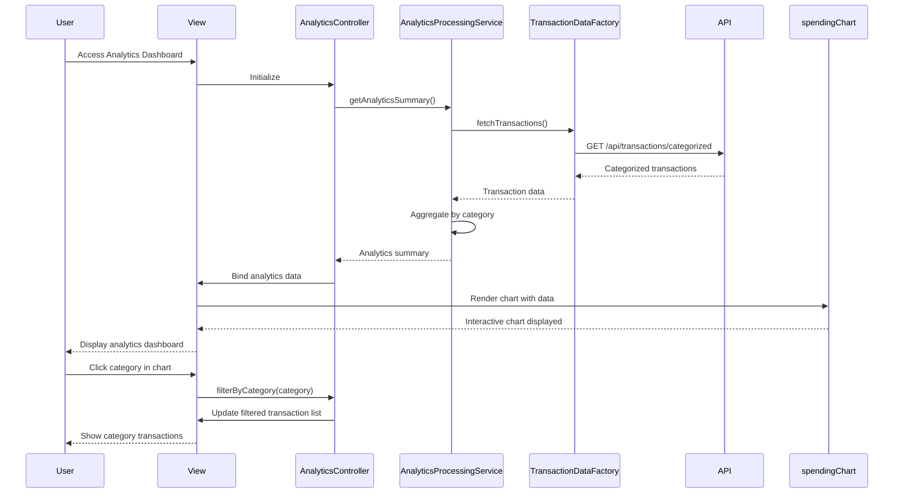

# Low-Level Design: Transaction Analytics and Category-wise Spending Insights
**Epic ID:** QE-10060

## a. Architecture Mapping

- **Analytics Dashboard** → AngularJS Module (`ccAnalyticsModule`) + Controller (`AnalyticsController`) + HTML5 View
- **Visualization Engine** → AngularJS Directive (`spendingChart`) wrapping Chart.js for interactive charts
- **Categorization Engine Integration** → REST API endpoint consumed via Service (`CategorizationService`)
- **Transaction Data Feed Integration** → REST API endpoints consumed via Factory (`TransactionDataFactory`)
- **Analytics Processing** → AngularJS Service (`AnalyticsProcessingService`) for data aggregation and filtering

**Recommended Folder Structure:**
```
app/
├── modules/analytics/
│   ├── controllers/analytics.controller.js
│   ├── services/analytics-processing.service.js
│   ├── services/categorization.service.js
│   ├── factories/transaction-data.factory.js
│   ├── directives/spending-chart.directive.js
│   ├── views/analytics-dashboard.html
│   └── analytics.module.js
├── shared/
│   └── styles/analytics.css
└── app.js
```

## b. Component Specifications

| Component Name | Artifact Type | Responsibility | Key Dependencies |
|----------------|---------------|----------------|------------------|
| ccAnalyticsModule | Module | Root module for analytics feature | angular, ngRoute, chart.js |
| AnalyticsController | Controller | Manages analytics view state, filters, and chart data binding | AnalyticsProcessingService, CategorizationService, $scope, $filter |
| AnalyticsProcessingService | Service | Aggregates transactions by category and calculates spending insights | TransactionDataFactory, $q |
| CategorizationService | Service | Fetches categorized transaction data from backend | TransactionDataFactory, $http |
| TransactionDataFactory | Factory | Handles REST API calls for transaction data retrieval | $http, API_CONFIG |
| spendingChart | Directive | Renders interactive pie/bar charts for category-wise spending | Chart.js, $timeout |
| analytics-dashboard.html | View | Displays category breakdown, filters, and interactive charts | Bootstrap, AngularJS directives |

## c. Data Model

```javascript
// Transaction Model
const Transaction = {
  transactionId: String,       // Unique transaction identifier
  cardId: String,              // Reference to credit card
  amount: Number,              // Transaction amount
  merchantName: String,        // Merchant/vendor name
  category: String,            // Food & Dining, Fuel, Shopping, Travel, Entertainment, Utilities, Healthcare, Education, Miscellaneous
  transactionDate: Date,       // Date of transaction
  description: String          // Transaction description
};

// Category Spending Model
const CategorySpending = {
  category: String,            // Category name
  totalSpend: Number,          // Total amount spent in category
  transactionCount: Number,    // Number of transactions
  percentage: Number           // Percentage of total spend
};

// Analytics Summary Model
const AnalyticsSummary = {
  totalSpend: Number,          // Total spend across all categories
  categoryBreakdown: Array,    // Array of CategorySpending objects
  topCategory: String,         // Category with highest spend
  dateRange: Object            // {startDate: Date, endDate: Date}
};
```

## d. Data Flow

User accesses the analytics dashboard view, triggering AnalyticsController to invoke AnalyticsProcessingService, which fetches categorized transaction data via TransactionDataFactory REST API call. The service aggregates transactions by the nine predefined categories (Food & Dining, Fuel, Shopping, Travel, Entertainment, Utilities, Healthcare, Education, Miscellaneous), calculates total spend per category, and computes percentage distribution. The aggregated data is passed to the spendingChart directive, which renders an interactive pie chart using Chart.js. User can apply category filters or date range filters, which trigger re-aggregation in AnalyticsProcessingService and chart re-render. Drill-down on a category filters the transaction list view to show individual transactions for that category, all updated via two-way data binding.

## e. Primary Sequence Diagram



## f. Implementation Notes

- Use Chart.js via angular-chart.js for pie and bar chart visualizations with click event handlers for drill-down
- Implement AnalyticsProcessingService with Array.reduce() and ES6 Map for efficient category aggregation of up to 10,000 transactions
- Use AngularJS $filter for date range filtering and custom currency formatting
- Leverage ng-if and ng-show for conditional rendering of chart types (pie vs. bar) based on user preference
- Implement lazy loading for transaction details on category drill-down to optimize initial page load under 1 second

## g. Error Handling

HTTP interceptor captures API errors and displays user notifications; service layer uses try/catch with fallback to empty analytics summary on failure.

## h. Security Notes

Standard input validation and secure API calls assumed; transaction data filtered by authenticated user ID on backend.