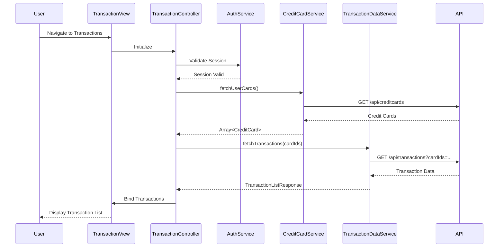

# Low-Level Design: QE-10061 - Transaction Management and Monitoring

## a. Architecture Mapping

- **Module**: `transactionManagement` - Main module for transaction viewing and monitoring
- **Controller**: `TransactionController` - Manages transaction list view, filtering, and pagination
- **Service**: `TransactionDataService` - Fetches transaction records via REST API
- **Service**: `CreditCardService` - Retrieves credit card details for filtering transactions by card
- **Service**: `AuthService` - Validates user authentication and session
- **Directive**: `transactionList` - Custom directive for rendering paginated transaction table
- **Filter**: `transactionFilter` - Custom AngularJS filter for client-side transaction filtering by card, date, amount

**Recommended Folder Structure:**
```
/app
  /modules
    /transactions
      transactions.module.js
      transactions.controller.js
      transactions.html
  /services
    transactionData.service.js
    creditCard.service.js
    auth.service.js
  /directives
    transactionList.directive.js
  /filters
    transaction.filter.js
  /models
    transaction.model.js
```

## b. Component Specifications

| Name | Artifact Type | Responsibility | Key Dependencies |
|------|--------------|----------------|------------------|
| transactionManagement | Module | Root module for transaction management feature | angular, ui.router, ngTable |
| TransactionController | Controller | Manages transaction view state, handles filtering, pagination, and card selection | TransactionDataService, CreditCardService, AuthService |
| TransactionDataService | Service | Fetches transaction records for user's credit cards via REST API | $http, $q, AuthService |
| CreditCardService | Service | Retrieves user's credit cards for filter dropdown and card-specific queries | $http, AuthService |
| AuthService | Service | Validates user session before allowing transaction data access | $http, $window |
| transactionList | Directive | Renders paginated, sortable transaction table with responsive design | ngTable, transactionFilter |
| transactionFilter | Filter | Filters transactions by card, date range, amount range, and description keyword | None |

## c. Data Model

**Transaction Model:**
```javascript
{
  transactionId: String,
  cardId: String,
  cardNumber: String (masked),
  amount: Number,
  currency: String,
  category: String,
  date: Date,
  description: String,
  merchantName: String,
  status: String
}
```

**TransactionListResponse Model:**
```javascript
{
  transactions: Array<Transaction>,
  totalCount: Number,
  pageSize: Number,
  currentPage: Number
}
```

## d. Data Flow

User authenticates and navigates to transaction history → TransactionController initializes and calls AuthService to validate session → Controller invokes CreditCardService to fetch user's credit cards for filter dropdown → Controller calls TransactionDataService to retrieve all transactions across user's cards via REST API → API returns paginated transaction records → transactionList directive renders transactions in responsive table with sorting and pagination → User applies filters (by card, date range, amount) → transactionFilter processes filter criteria client-side or triggers server-side query for large datasets → Filtered transaction list updates in view → User clicks on transaction row to view detailed transaction information in modal or expanded row.

## e. Primary Sequence Diagram



## f. Implementation Notes

- Use AngularJS ngTable or ui-grid for high-performance rendering of large transaction datasets with virtual scrolling
- Implement server-side pagination and filtering for datasets exceeding 1000 records to maintain performance
- Use ES6 template literals for dynamic API query string construction with filter parameters
- Leverage AngularJS $filter service for client-side filtering on smaller datasets
- Apply Bootstrap table-responsive class for mobile-friendly transaction table layout

## g. Error Handling

HTTP interceptor-based error handling with user notification via modal dialog; retry mechanism for failed API calls.

## h. Security Notes

Requires token-based auth via existing SSO; transaction data masked (card numbers) and access controlled per user ownership.