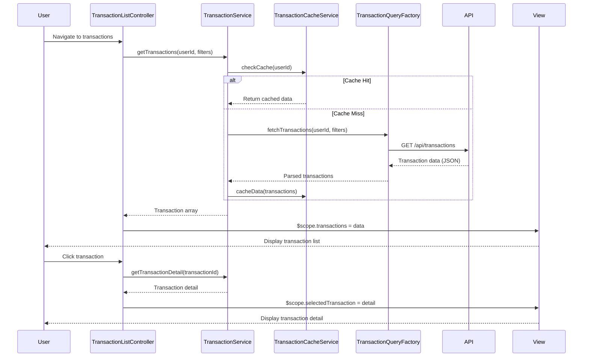

# Low-Level Design: Transaction Management and Viewing
**Epic ID:** QE-10062

## a. Architecture Mapping

- **User Interface** → AngularJS Module: `transactionModule` with Controller: `TransactionListController`, `TransactionDetailController`
- **Transaction Management Service** → AngularJS Service: `TransactionService` (handles business logic and orchestration)
- **Transaction Query Engine** → AngularJS Factory: `TransactionQueryFactory` (handles API calls and caching)
- **Transaction Cache** → AngularJS Service: `TransactionCacheService` (in-memory cache with TTL)
- **Dashboard KPI System Integration** → AngularJS Service: `KPIDataProviderService` (exposes transaction data downstream)

**Recommended Folder Structure:**
```
app/
├── modules/
│   └── transactions/
│       ├── controllers/
│       ├── services/
│       ├── factories/
│       ├── views/
│       └── transaction.module.js
├── shared/
│   ├── services/
│   └── factories/
└── assets/
```

## b. Component Specifications

| Name | Artifact Type | Responsibility | Key Dependencies |
|------|---------------|----------------|------------------|
| transactionModule | Module | Encapsulates all transaction-related functionality | angular, ngRoute, ngResource |
| TransactionListController | Controller | Manages transaction list view, filtering, pagination | TransactionService, $scope, $filter |
| TransactionDetailController | Controller | Manages single transaction detail view | TransactionService, $scope, $routeParams |
| TransactionService | Service | Orchestrates transaction retrieval, filtering, and downstream data sharing | TransactionQueryFactory, TransactionCacheService, KPIDataProviderService |
| TransactionQueryFactory | Factory | Executes REST API calls to fetch transactions, handles retries | $http, $q, API_CONFIG |
| TransactionCacheService | Service | Provides in-memory caching with TTL for transaction data | $cacheFactory |
| KPIDataProviderService | Service | Exposes transaction data to Dashboard KPI and Analytics modules | TransactionService |
| transactionListView | HTML Template | Displays paginated list of transactions with filters | Bootstrap grid, ng-repeat, ng-click |
| transactionDetailView | HTML Template | Displays detailed information for a single transaction | Bootstrap card, ng-bind |

## c. Data Model

**Transaction Object:**
```javascript
{
  transactionId: String,
  cardId: String,
  cardLast4: String,
  date: Date,
  merchant: String,
  amount: Number,
  currency: String,
  category: String,
  status: String,
  description: String
}
```

**TransactionFilter Object:**
```javascript
{
  cardIds: Array<String>,
  startDate: Date,
  endDate: Date,
  categories: Array<String>,
  minAmount: Number,
  maxAmount: Number
}
```

## d. Data Flow

User navigates to transaction list view → TransactionListController initializes and calls TransactionService.getTransactions() → TransactionService checks TransactionCacheService for cached data → If cache miss, TransactionQueryFactory makes REST API call to backend (GET /api/transactions?userId={userId}&months=12) → Response is cached and returned to controller → Controller binds transaction array to $scope → View renders transaction list using ng-repeat → User clicks transaction → TransactionDetailController fetches detail via TransactionService → Detail view displays full transaction info → TransactionService also exposes data via KPIDataProviderService for dashboard and analytics consumption.

## e. Primary Sequence Diagram



## f. Implementation Notes

- Use AngularJS Dependency Injection for all services, factories, and controllers to ensure testability and modularity.
- Implement TransactionQueryFactory using $http with promise-based error handling; use $q for chaining and aggregation.
- Apply ES6 classes for service definitions where appropriate; transpile using Babel if targeting older browsers.
- Use ngRoute for view navigation between list and detail views; pass transactionId via $routeParams.
- Implement client-side pagination and filtering using AngularJS filters to minimize API calls; server-side pagination for large datasets.

## g. Error Handling

Use HTTP interceptor to catch API errors globally; display user-friendly notifications via a shared NotificationService; log errors to console in dev mode.

## h. Security Notes

Requires token-based authentication via existing SSO; include auth token in API request headers; validate user authorization for transaction access on backend.