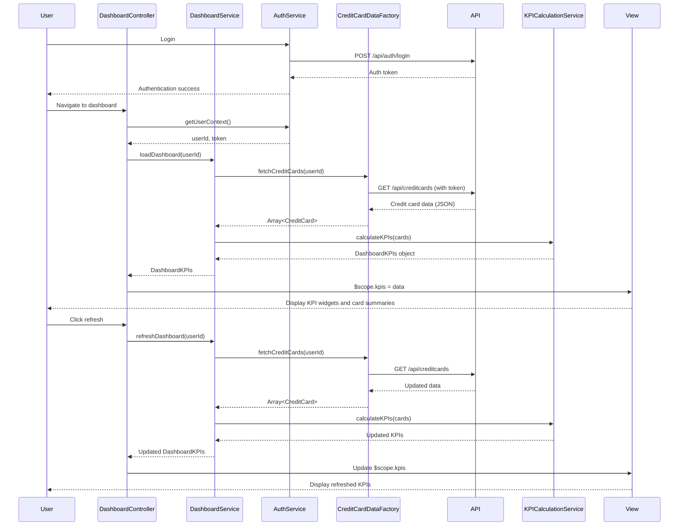

# Low-Level Design: Dashboard KPIs and Credit Card Overview
**Epic ID:** QE-10063

## a. Architecture Mapping

- **User Interface** → AngularJS Module: `dashboardModule` with Controller: `DashboardController`
- **Dashboard Service** → AngularJS Service: `DashboardService` (orchestrates KPI retrieval and refresh)
- **KPI Calculation Engine** → AngularJS Service: `KPICalculationService` (computes KPIs from raw data)
- **Data Aggregation Layer** → AngularJS Factory: `CreditCardDataFactory` (fetches credit card data via REST API)
- **User Authentication Service** → AngularJS Service: `AuthService` (handles authentication and authorization)
- **KPI Widgets** → AngularJS Directives: `kpiWidget`, `creditCardSummary`

**Recommended Folder Structure:**
```
app/
├── modules/
│   └── dashboard/
│       ├── controllers/
│       ├── services/
│       ├── directives/
│       ├── views/
│       └── dashboard.module.js
├── shared/
│   ├── services/
│   └── factories/
└── assets/
    └── css/
```

## b. Component Specifications

| Name | Artifact Type | Responsibility | Key Dependencies |
|------|---------------|----------------|------------------|
| dashboardModule | Module | Encapsulates dashboard functionality and KPI display | angular, ngRoute, ngResource |
| DashboardController | Controller | Manages dashboard state, KPI data binding, and refresh triggers | DashboardService, AuthService, $scope, $interval |
| DashboardService | Service | Orchestrates data retrieval, KPI calculation, and real-time refresh | KPICalculationService, CreditCardDataFactory |
| KPICalculationService | Service | Computes monthly spend, total credit limit, available credit, outstanding amounts | None (pure calculation logic) |
| CreditCardDataFactory | Factory | Fetches credit card account data, balances, limits via REST API | $http, $q, API_CONFIG |
| AuthService | Service | Validates user authentication and provides user context | $http, $window (for token storage) |
| kpiWidget | Directive | Reusable KPI display widget with label, value, and icon | None |
| creditCardSummary | Directive | Displays individual credit card summary with key metrics | None |
| dashboardView | HTML Template | Main dashboard layout with KPI widgets and card summaries | Bootstrap grid, custom CSS |

## c. Data Model

**CreditCard Object:**
```javascript
{
  cardId: String,
  cardNumber: String,
  cardLast4: String,
  cardType: String,
  creditLimit: Number,
  currentBalance: Number,
  availableCredit: Number,
  outstandingAmount: Number,
  monthlySpend: Number
}
```

**DashboardKPIs Object:**
```javascript
{
  totalMonthlySpend: Number,
  totalCreditLimit: Number,
  totalAvailableCredit: Number,
  totalOutstanding: Number,
  cardCount: Number,
  cards: Array<CreditCard>
}
```

## d. Data Flow

User logs in → AuthService validates credentials and stores auth token → User navigates to dashboard → DashboardController initializes and calls DashboardService.loadDashboard() → DashboardService calls CreditCardDataFactory.fetchCreditCards(userId) → Factory makes REST API call (GET /api/creditcards?userId={userId}) with auth token → Response contains array of credit card objects → KPICalculationService computes aggregated KPIs (sum of limits, balances, monthly spend) → DashboardService returns DashboardKPIs object to controller → Controller binds data to $scope → View renders KPI widgets and card summaries using directives → User clicks refresh → DashboardService re-fetches data and updates $scope → View updates in real-time.

## e. Primary Sequence Diagram



## f. Implementation Notes

- Use AngularJS DI to inject all services and factories; ensure singleton pattern for AuthService and DashboardService.
- Implement real-time refresh using $interval service with configurable polling interval (default 60 seconds); allow user-triggered refresh.
- Use Bootstrap responsive grid (col-xs, col-sm, col-md) for KPI widget layout to ensure mobile/tablet/desktop compatibility.
- Create reusable directives (kpiWidget, creditCardSummary) with isolated scope and two-way data binding for modularity.
- Apply ES6 arrow functions and template literals for cleaner service code; use Babel for transpilation.

## g. Error Handling

HTTP interceptor catches API failures; display error notifications using shared NotificationService; retry failed requests once before showing error to user.

## h. Security Notes

Requires token-based auth via existing SSO; include JWT token in Authorization header for all API calls; validate token expiry and refresh if needed.