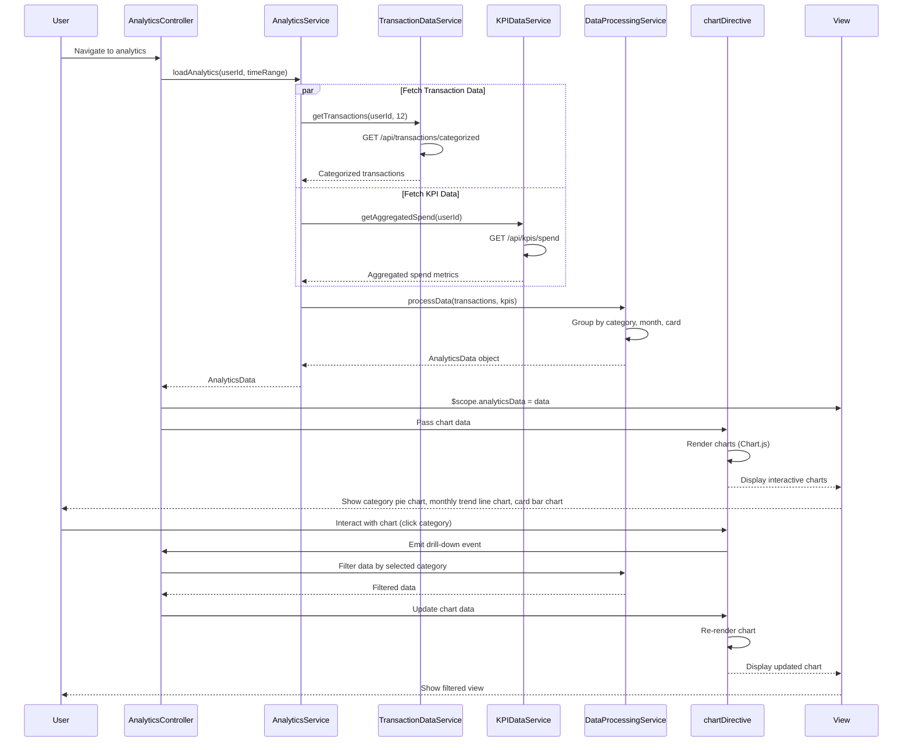

# Low-Level Design: Spending Analytics and Insights
**Epic ID:** QE-10064

## a. Architecture Mapping

- **User Interface** → AngularJS Module: `analyticsModule` with Controller: `AnalyticsController`
- **Analytics Service** → AngularJS Service: `AnalyticsService` (orchestrates data retrieval and processing)
- **Transaction Data Service** → AngularJS Service: `TransactionDataService` (provides categorized transaction data)
- **Dashboard KPI Module** → AngularJS Service: `KPIDataService` (provides aggregated spend metrics)
- **Data Visualization Engine** → AngularJS Directive: `chartDirective` (wraps Chart.js or D3.js for rendering)
- **Data Processing** → AngularJS Service: `DataProcessingService` (groups and aggregates data by category, card, time)

**Recommended Folder Structure:**
```
app/
├── modules/
│   └── analytics/
│       ├── controllers/
│       ├── services/
│       ├── directives/
│       ├── views/
│       └── analytics.module.js
├── shared/
│   ├── services/
│   └── directives/
└── assets/
    └── js/libs/
```

## b. Component Specifications

| Name | Artifact Type | Responsibility | Key Dependencies |
|------|---------------|----------------|------------------|
| analyticsModule | Module | Encapsulates spending analytics and visualization functionality | angular, ngRoute, chart.js |
| AnalyticsController | Controller | Manages analytics view state, user interactions, and chart data binding | AnalyticsService, $scope, $filter |
| AnalyticsService | Service | Orchestrates data retrieval from multiple sources and coordinates processing | TransactionDataService, KPIDataService, DataProcessingService |
| TransactionDataService | Service | Fetches categorized transaction data via REST API | $http, $q, API_CONFIG |
| KPIDataService | Service | Provides aggregated spend metrics from dashboard module | $http, $q |
| DataProcessingService | Service | Groups and aggregates transactions by category, card, and time period | None (pure logic) |
| chartDirective | Directive | Renders interactive charts using Chart.js; supports category, trend, and card-wise views | Chart.js library |
| analyticsView | HTML Template | Main analytics layout with filter controls and chart containers | Bootstrap, custom CSS |

## c. Data Model

**CategorySpend Object:**
```javascript
{
  category: String,
  amount: Number,
  percentage: Number,
  transactionCount: Number
}
```

**MonthlyTrend Object:**
```javascript
{
  month: String,
  year: Number,
  totalSpend: Number,
  categoryBreakdown: Array<CategorySpend>
}
```

**CardWiseSpend Object:**
```javascript
{
  cardId: String,
  cardLast4: String,
  totalSpend: Number,
  categoryBreakdown: Array<CategorySpend>
}
```

**AnalyticsData Object:**
```javascript
{
  categorySpends: Array<CategorySpend>,
  monthlyTrends: Array<MonthlyTrend>,
  cardWiseSpends: Array<CardWiseSpend>,
  categories: Array<String>
}
```

## d. Data Flow

User navigates to analytics view → AnalyticsController initializes and calls AnalyticsService.loadAnalytics(userId, timeRange) → AnalyticsService calls TransactionDataService.getTransactions(userId, 12 months) and KPIDataService.getAggregatedSpend(userId) in parallel → Both services return categorized transaction data and spend metrics → DataProcessingService.processData() groups transactions by 9 predefined categories (Food & Dining, Fuel, Shopping, Travel, Entertainment, Utilities, Healthcare, Education, Miscellaneous), aggregates by month and card → Processed AnalyticsData object is returned to controller → Controller binds data to $scope and passes to chartDirective → chartDirective renders interactive pie chart (category-wise), line chart (monthly trends), and bar chart (card-wise) using Chart.js → User interacts with charts (hover, click) to drill down → Controller updates filters and re-processes data → Charts update dynamically.

## e. Primary Sequence Diagram



## f. Implementation Notes

- Use AngularJS DI for all services and directives; inject $q for promise-based parallel API calls in AnalyticsService.
- Implement chartDirective as an isolated-scope directive wrapping Chart.js; pass chart type, data, and options as attributes.
- Use ES6 Array methods (map, filter, reduce) in DataProcessingService for efficient data aggregation and grouping.
- Apply responsive chart sizing using Chart.js responsive config and Bootstrap container classes for mobile/tablet/desktop support.
- Cache processed analytics data in AnalyticsService to avoid redundant processing on filter changes; invalidate cache on data refresh.

## g. Error Handling

HTTP interceptor catches API errors; display user-friendly error messages via NotificationService; gracefully degrade to partial data display if one API call fails.

## h. Security Notes

Requires token-based auth via existing SSO; include auth token in all API requests; ensure backend validates user access to transaction and KPI data.