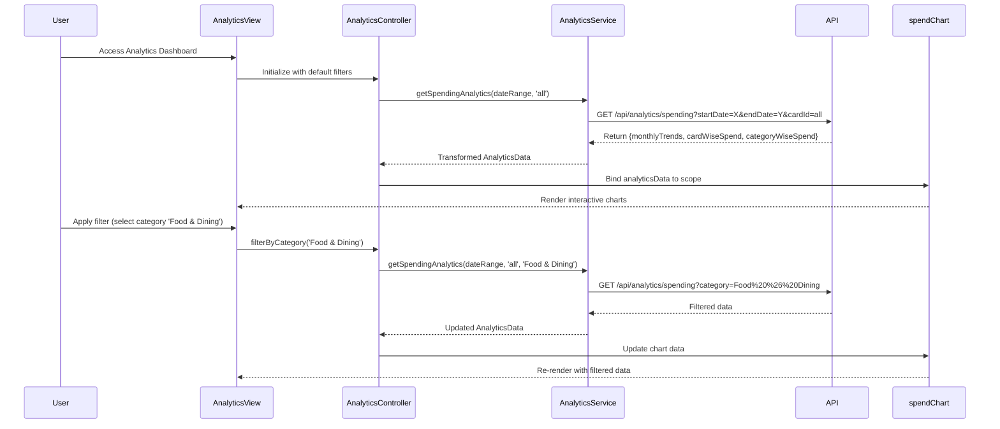

# Low-Level Design: QE-10065 - Spending Analytics and Insights

## a. Architecture Mapping

- **AngularJS Module**: `creditCard.analytics` - Main analytics feature module
- **Controller**: `AnalyticsController` - Manages analytics dashboard state and user interactions
- **Service**: `AnalyticsService` - Handles API calls to Analytics Service and data transformation
- **Service**: `CategoryService` - Manages category definitions and filtering logic
- **Directive**: `spendChart` - Renders interactive spending visualizations (line, bar, pie charts)
- **Factory**: `TransactionAggregator` - Client-side aggregation and filtering utilities

**Folder Structure:**
```
/app
  /modules
    /analytics
      analytics.module.js
      analytics.controller.js
      analytics.service.js
      category.service.js
      /directives
        spend-chart.directive.js
      /views
        analytics-dashboard.html
```

## b. Component Specifications

| Component Name | Artifact Type | Responsibility | Key Dependencies |
|----------------|---------------|----------------|------------------|
| creditCard.analytics | Module | Registers analytics feature components and routes | ngRoute, chart.js |
| AnalyticsController | Controller | Manages dashboard state, filters, date range selection, and chart data binding | AnalyticsService, CategoryService, $scope |
| AnalyticsService | Service | Fetches categorized transaction data, monthly trends, and card-wise analytics from REST API | $http, $q |
| CategoryService | Service | Provides category definitions (9 categories), filtering, and drill-down logic | None |
| spendChart | Directive | Renders responsive interactive charts using Chart.js with drill-down support | chart.js library |
| TransactionAggregator | Factory | Provides utility functions for client-side data aggregation and filtering | None |

## c. Data Model

**AnalyticsData (JS Object)**
```javascript
{
  monthlyTrends: [
    { month: String, totalSpend: Number, cardBreakdown: Array }
  ],
  cardWiseSpend: [
    { cardId: String, cardName: String, totalSpend: Number, categoryBreakdown: Array }
  ],
  categoryWiseSpend: [
    { category: String, amount: Number, percentage: Number, transactionCount: Number }
  ],
  dateRange: { startDate: Date, endDate: Date },
  selectedCard: String // 'all' or specific cardId
}
```

**Category (JS Object)**
```javascript
{
  id: String,
  name: String, // 'Food & Dining', 'Fuel', 'Shopping', 'Travel', 'Entertainment', 'Utilities', 'Healthcare', 'Education', 'Miscellaneous'
  color: String // Hex color for chart rendering
}
```

## d. Data Flow

User accesses analytics dashboard → AnalyticsController initializes and calls AnalyticsService.getSpendingAnalytics(dateRange, cardId) → Service sends GET request to /api/analytics/spending with query params → API returns aggregated data (monthly trends, card-wise, category-wise) → AnalyticsService transforms response into AnalyticsData model → Controller updates $scope.analyticsData → spendChart directive watches data changes and renders/updates Chart.js visualizations → User applies filters (date range, card selection, category drill-down) → Controller invokes AnalyticsService with new params → Updated data re-renders charts.

## e. Primary Sequence Diagram



## f. Implementation Notes

- Use AngularJS Dependency Injection to inject AnalyticsService and CategoryService into AnalyticsController
- Leverage ES6 arrow functions and template literals for cleaner service code and API URL construction
- Implement Chart.js with responsive:true and maintainAspectRatio:false for mobile-friendly rendering
- Use $http interceptors for loading states and API error handling
- Apply Bootstrap grid system (col-md-6, col-xs-12) for responsive chart layout across devices

## g. Error Handling

HTTP interceptor captures API errors and displays user-friendly notifications via a global ErrorService; try/catch blocks wrap chart rendering logic.

## h. Security Notes

Standard input validation and secure API calls assumed; requires token-based auth via existing SSO for API access.