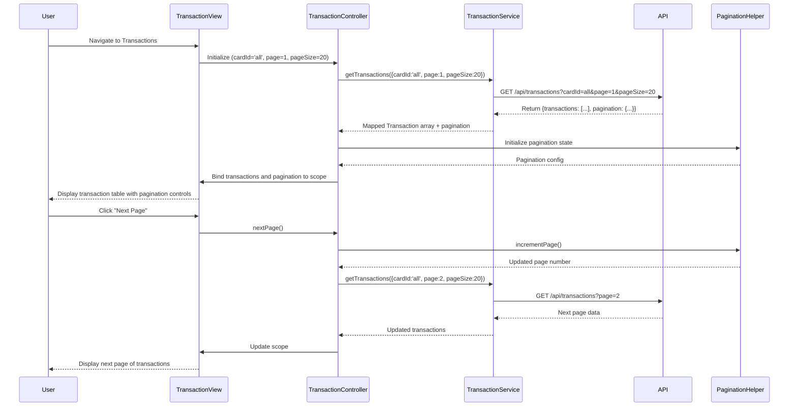

# Low-Level Design: QE-10066 - Transaction Management and Viewing

## a. Architecture Mapping

- **AngularJS Module**: `creditCard.transactions` - Main transaction management module
- **Controller**: `TransactionController` - Manages transaction list state, pagination, and filtering
- **Service**: `TransactionService` - Handles API calls to Transaction Management Service
- **Directive**: `transactionList` - Renders paginated transaction table with sorting
- **Filter**: `transactionDate` - Formats transaction timestamps for display
- **Factory**: `PaginationHelper` - Manages pagination state and navigation logic

**Folder Structure:**
```
/app
  /modules
    /transactions
      transactions.module.js
      transaction.controller.js
      transaction.service.js
      /directives
        transaction-list.directive.js
      /filters
        transaction-date.filter.js
      /factories
        pagination-helper.factory.js
      /views
        transaction-view.html
```

## b. Component Specifications

| Component Name | Artifact Type | Responsibility | Key Dependencies |
|----------------|---------------|----------------|------------------|
| creditCard.transactions | Module | Registers transaction feature components and routes | ngRoute |
| TransactionController | Controller | Manages transaction list state, pagination controls, card filter, and date range selection | TransactionService, PaginationHelper, $scope |
| TransactionService | Service | Fetches paginated transaction data from REST API with filters (cardId, dateRange, page, pageSize) | $http, $q |
| transactionList | Directive | Renders transaction table with sortable columns and pagination controls | PaginationHelper |
| transactionDate | Filter | Formats ISO timestamp to user-friendly date/time display | $filter (date) |
| PaginationHelper | Factory | Provides pagination state management (currentPage, totalPages, pageSize) and navigation functions | None |

## c. Data Model

**Transaction (JS Object)**
```javascript
{
  transactionId: String,
  cardId: String,
  cardName: String,
  merchantName: String,
  amount: Number,
  currency: String,
  timestamp: String, // ISO 8601 format
  status: String, // 'posted', 'pending', 'declined'
  category: String
}
```

**TransactionListResponse (JS Object)**
```javascript
{
  transactions: Array<Transaction>,
  pagination: {
    currentPage: Number,
    totalPages: Number,
    pageSize: Number,
    totalRecords: Number
  }
}
```

## d. Data Flow

User navigates to transaction view → TransactionController initializes with default filters (all cards, last 30 days, page 1, pageSize 20) → Calls TransactionService.getTransactions(filters) → Service sends GET request to /api/transactions with query params → API returns TransactionListResponse with paginated data → Service maps response to Transaction model array → Controller updates $scope.transactions and $scope.pagination → transactionList directive renders table with transactionDate filter applied → User clicks next page or applies card filter → Controller updates filters and re-invokes TransactionService → Updated transaction list re-renders.

## e. Primary Sequence Diagram



## f. Implementation Notes

- Use AngularJS $http service with promise-based API calls; chain .then() for success and .catch() for error handling
- Implement PaginationHelper as a reusable factory with methods: nextPage(), prevPage(), goToPage(n), setPageSize()
- Apply Bootstrap table classes (table-striped, table-hover) for transaction list styling
- Use AngularJS built-in 'date' filter within transactionDate custom filter for consistent timestamp formatting
- Leverage ES6 const/let for variable declarations and destructuring for cleaner API response handling

## g. Error Handling

Global $http interceptor captures API errors and displays toast notifications; empty state UI shown when no transactions found.

## h. Security Notes

Requires token-based auth via existing SSO; API enforces user-level authorization to return only authorized card transactions.