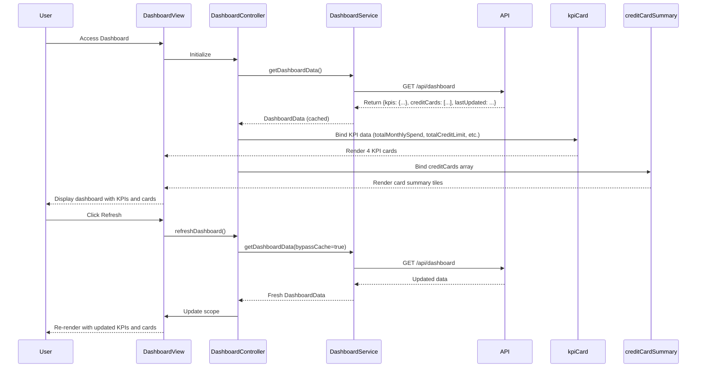

# Low-Level Design: QE-10067 - Dashboard KPIs and Credit Card Overview

## a. Architecture Mapping

- **AngularJS Module**: `creditCard.dashboard` - Main dashboard module
- **Controller**: `DashboardController` - Manages dashboard state and KPI data binding
- **Service**: `DashboardService` - Handles API calls to Dashboard Service for KPIs and card data
- **Service**: `KPIService` - Provides KPI calculation and formatting utilities
- **Directive**: `kpiCard` - Renders individual KPI metric cards (monthly spend, credit limit, available credit, outstanding)
- **Directive**: `creditCardSummary` - Renders individual credit card summary tiles

**Folder Structure:**
```
/app
  /modules
    /dashboard
      dashboard.module.js
      dashboard.controller.js
      dashboard.service.js
      kpi.service.js
      /directives
        kpi-card.directive.js
        credit-card-summary.directive.js
      /views
        dashboard.html
```

## b. Component Specifications

| Component Name | Artifact Type | Responsibility | Key Dependencies |
|----------------|---------------|----------------|------------------|
| creditCard.dashboard | Module | Registers dashboard components, routes, and initializes default view | ngRoute |
| DashboardController | Controller | Fetches and manages dashboard KPIs and credit card list; handles refresh action | DashboardService, KPIService, $scope, $interval |
| DashboardService | Service | Fetches aggregated KPIs and credit card details from REST API | $http, $q |
| KPIService | Service | Provides utility functions for KPI formatting (currency, percentages) and threshold calculations | None |
| kpiCard | Directive | Renders a single KPI metric card with icon, label, value, and optional trend indicator | KPIService |
| creditCardSummary | Directive | Renders credit card tile with card name, last 4 digits, balance, limit, and utilization bar | None |

## c. Data Model

**DashboardData (JS Object)**
```javascript
{
  kpis: {
    totalMonthlySpend: Number,
    totalCreditLimit: Number,
    totalAvailableCredit: Number,
    totalOutstanding: Number
  },
  creditCards: [
    {
      cardId: String,
      cardName: String,
      last4Digits: String,
      creditLimit: Number,
      availableCredit: Number,
      outstandingAmount: Number,
      monthlySpend: Number,
      utilizationPercentage: Number
    }
  ],
  lastUpdated: String // ISO timestamp
}
```

## d. Data Flow

User accesses dashboard → DashboardController initializes and calls DashboardService.getDashboardData() → Service sends GET request to /api/dashboard → API aggregates data from Credit Card Data Service and KPI Calculation Engine → Returns DashboardData with KPIs and card array → DashboardService caches response and returns to controller → Controller updates $scope.dashboardData → kpiCard directives render four KPI metrics → creditCardSummary directives render each card tile → User clicks refresh icon → Controller re-invokes DashboardService (bypasses cache) → Updated data re-renders dashboard.

## e. Primary Sequence Diagram



## f. Implementation Notes

- Use AngularJS Dependency Injection to inject DashboardService and KPIService into DashboardController
- Implement $interval service for optional auto-refresh every 60 seconds (configurable)
- Apply Bootstrap grid (col-md-3 for KPI cards, col-sm-6 for credit card tiles) for responsive layout
- Use ES6 template literals for dynamic API URL construction and string interpolation in directives
- Cache DashboardService API response using $cacheFactory with 30-second TTL for performance

## g. Error Handling

$http interceptor handles API failures and displays error banner; retry mechanism with exponential backoff for transient errors.

## h. Security Notes

Requires token-based auth via existing SSO; API validates user session and returns only authorized credit card data.