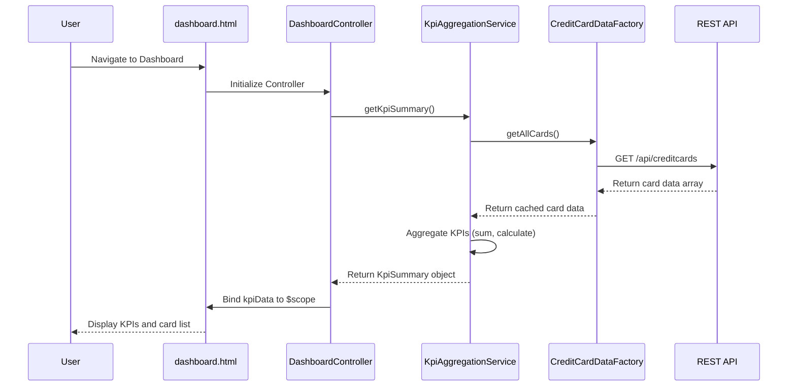

# Low-Level Design: QE-10068 - Credit Card Dashboard and KPI Overview

## a. Architecture Mapping

**HLD Component → AngularJS Artifact Mapping:**
- User Interface → AngularJS Module: `creditCard.dashboard` + View Template: `dashboard.html`
- Dashboard Controller → AngularJS Controller: `DashboardController`
- KPI Aggregation Service → AngularJS Service: `KpiAggregationService`
- Credit Card Data Service → AngularJS Factory: `CreditCardDataFactory`
- Data Repository → REST API integration via `$http` service

**Recommended Folder Structure:**
```
app/
├── modules/
│   └── dashboard/
│       ├── controllers/
│       │   └── DashboardController.js
│       ├── services/
│       │   └── KpiAggregationService.js
│       ├── factories/
│       │   └── CreditCardDataFactory.js
│       ├── views/
│       │   └── dashboard.html
│       └── dashboard.module.js
├── common/
│   └── services/
│       └── ApiInterceptor.js
└── assets/
    └── css/
        └── dashboard.css
```

## b. Component Specifications

| Component Name | Artifact Type | Responsibility | Key Dependencies |
|---|---|---|---|
| creditCard.dashboard | Module | Root module for dashboard feature, registers all dashboard components | angular, ngRoute, ui.bootstrap |
| DashboardController | Controller | Manages dashboard view state, coordinates KPI display, handles user interactions | KpiAggregationService, $scope, $timeout |
| KpiAggregationService | Service | Aggregates and calculates KPIs (monthly spend, credit limit, available credit, outstanding) from card data | CreditCardDataFactory, $q |
| CreditCardDataFactory | Factory | Fetches credit card data and transaction data from REST API, caches results | $http, $cacheFactory |
| dashboard.html | View Template | Renders KPI cards, credit card list, responsive layout using Bootstrap grid | Bootstrap CSS, AngularJS directives |
| ApiInterceptor | Service | Handles HTTP request/response interception, error handling, loading indicators | $q, $injector |

## c. Data Model

**CreditCard Model:**
```javascript
{
  cardId: String,
  cardNumber: String,
  cardHolderName: String,
  bankName: String,
  cardType: String,
  creditLimit: Number,
  availableCredit: Number,
  outstandingAmount: Number,
  lastUpdated: Date
}
```

**KpiSummary Model:**
```javascript
{
  monthlySpend: Number,
  totalCreditLimit: Number,
  totalAvailableCredit: Number,
  totalOutstanding: Number,
  cardCount: Number,
  calculatedAt: Date
}
```

## d. Data Flow

User navigates to the dashboard view → AngularJS router loads `DashboardController` and `dashboard.html` → Controller invokes `KpiAggregationService.getKpiSummary()` → Service calls `CreditCardDataFactory.getAllCards()` → Factory makes REST API call via `$http` to `/api/creditcards` endpoint → API returns card data array → Factory caches and returns data → Service aggregates KPIs (sum credit limits, calculate available credit, compute monthly spend from transactions) → Controller receives KpiSummary object and binds to `$scope.kpiData` → View renders KPI cards and credit card list using Angular data binding and Bootstrap responsive grid → UI updates complete within 2-second performance target.

## e. Primary Sequence Diagram



## f. Implementation Notes

- Use AngularJS 1.x module pattern with dependency injection for all controllers, services, and factories
- Implement ES6 classes for service logic where appropriate, transpile using Babel if needed
- Use `$http` service with promise-based API calls; implement `$cacheFactory` for 5-minute cache on card data to optimize performance
- Apply Bootstrap 3/4 responsive grid (col-xs, col-sm, col-md, col-lg) for dashboard layout to meet responsive NFR
- Use `ng-repeat` with `track by cardId` for rendering card list to support 10+ cards efficiently

## g. Error Handling

HTTP interceptor-based error handling via `ApiInterceptor` service; displays user-friendly error notifications using Bootstrap alerts on API failures.

## h. Security Notes

Standard input validation and secure API calls assumed; token-based authentication via existing SSO integrated in HTTP headers.