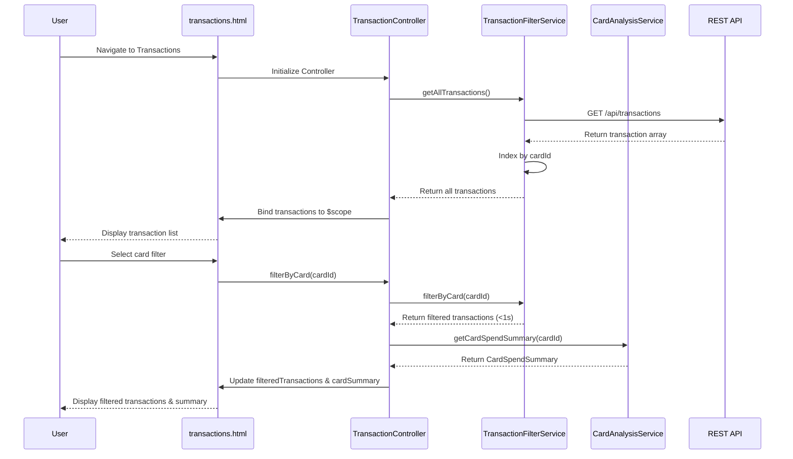

# Low-Level Design: QE-10069 - Transaction Management and Card-wise Analysis

## a. Architecture Mapping

**HLD Component → AngularJS Artifact Mapping:**
- User Interface → AngularJS Module: `creditCard.transactions` + View Template: `transactions.html`
- Transaction Controller → AngularJS Controller: `TransactionController`
- Transaction Filter Service → AngularJS Service: `TransactionFilterService`
- Card-wise Analysis Engine → AngularJS Service: `CardAnalysisService`
- Transaction Data Repository → REST API integration via `$http` service
- Card Identification Service → AngularJS Factory: `CardIdentificationFactory`

**Recommended Folder Structure:**
```
app/
├── modules/
│   └── transactions/
│       ├── controllers/
│       │   └── TransactionController.js
│       ├── services/
│       │   ├── TransactionFilterService.js
│       │   └── CardAnalysisService.js
│       ├── factories/
│       │   └── CardIdentificationFactory.js
│       ├── views/
│       │   └── transactions.html
│       └── transactions.module.js
├── common/
│   └── filters/
│       └── dateFilter.js
└── assets/
    └── css/
        └── transactions.css
```

## b. Component Specifications

| Component Name | Artifact Type | Responsibility | Key Dependencies |
|---|---|---|---|
| creditCard.transactions | Module | Root module for transaction management feature, registers transaction components | angular, ngRoute, ui.bootstrap |
| TransactionController | Controller | Manages transaction view state, handles filter interactions, displays transaction list and card-wise analysis | TransactionFilterService, CardAnalysisService, $scope, $filter |
| TransactionFilterService | Service | Filters transactions by card, date range, amount; implements indexed query logic for sub-1-second response | $q, $filter |
| CardAnalysisService | Service | Computes card-wise spending totals, transaction counts, and spending patterns per card | TransactionFilterService, $q |
| CardIdentificationFactory | Factory | Maps transactions to card IDs, fetches card metadata from REST API | $http, $cacheFactory |
| transactions.html | View Template | Renders transaction table, card filter dropdown, card-wise spending summary using Bootstrap components | Bootstrap CSS, AngularJS directives |

## c. Data Model

**Transaction Model:**
```javascript
{
  transactionId: String,
  cardId: String,
  merchantName: String,
  category: String,
  amount: Number,
  transactionDate: Date,
  description: String,
  status: String
}
```

**CardSpendSummary Model:**
```javascript
{
  cardId: String,
  cardNumber: String,
  totalSpend: Number,
  transactionCount: Number,
  lastTransactionDate: Date
}
```

## d. Data Flow

User navigates to transactions view → AngularJS router loads `TransactionController` and `transactions.html` → Controller invokes `TransactionFilterService.getAllTransactions()` → Service makes REST API call via `$http` to `/api/transactions` endpoint → API returns transaction array (supports 1000+ transactions per card) → Service caches and indexes transactions by cardId → Controller receives transaction data and binds to `$scope.transactions` → User selects card filter → Controller calls `TransactionFilterService.filterByCard(cardId)` → Service performs indexed filter and returns filtered transactions within 1 second → Controller invokes `CardAnalysisService.getCardSpendSummary(cardId)` → Service aggregates spend totals and transaction counts → Controller updates `$scope.filteredTransactions` and `$scope.cardSummary` → View re-renders transaction table and card-wise summary using Angular data binding.

## e. Primary Sequence Diagram



## f. Implementation Notes

- Use AngularJS 1.x dependency injection for all transaction components; implement ES6 arrow functions for filter callbacks
- Implement client-side indexing using JavaScript Map or object literal keyed by cardId for sub-1-second filter performance
- Use `ng-repeat` with `track by transactionId` for efficient rendering of 1000+ transactions; implement virtual scrolling if needed
- Apply Bootstrap table component with responsive classes for transaction list display
- Use `$filter` service for date formatting and amount formatting in transaction display

## g. Error Handling

HTTP interceptor-based error handling; try/catch blocks in filter and analysis services with user notification via Bootstrap toast/alert on failures.

## h. Security Notes

Requires token-based auth via existing SSO; standard input validation on filter parameters to prevent injection attacks.