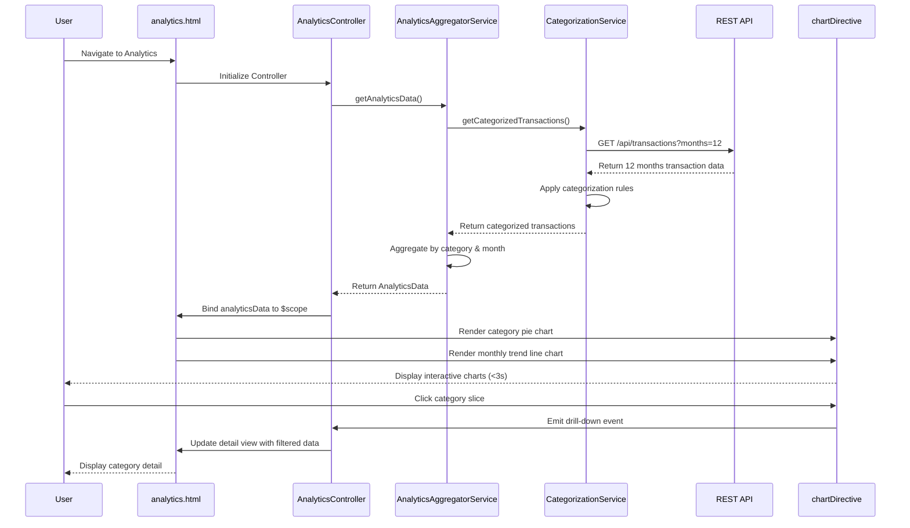

# Low-Level Design: QE-10070 - Spending Analytics and Insights

## a. Architecture Mapping

**HLD Component → AngularJS Artifact Mapping:**
- User Interface → AngularJS Module: `creditCard.analytics` + View Template: `analytics.html`
- Analytics Controller → AngularJS Controller: `AnalyticsController`
- Visualization Engine → AngularJS Directive: `chartDirective` (wraps Chart.js or D3.js)
- Transaction Categorization Service → AngularJS Service: `CategorizationService`
- Analytics Data Aggregator → AngularJS Service: `AnalyticsAggregatorService`
- Transaction Data Repository → REST API integration via `$http` service

**Recommended Folder Structure:**
```
app/
├── modules/
│   └── analytics/
│       ├── controllers/
│       │   └── AnalyticsController.js
│       ├── services/
│       │   ├── CategorizationService.js
│       │   └── AnalyticsAggregatorService.js
│       ├── directives/
│       │   └── chartDirective.js
│       ├── views/
│       │   └── analytics.html
│       └── analytics.module.js
├── common/
│   └── constants/
│       └── categories.constant.js
└── assets/
    ├── css/
    │   └── analytics.css
    └── js/
        └── chart.min.js
```

## b. Component Specifications

| Component Name | Artifact Type | Responsibility | Key Dependencies |
|---|---|---|---|
| creditCard.analytics | Module | Root module for analytics feature, registers analytics components and charting library | angular, ngRoute, chart.js or d3.js |
| AnalyticsController | Controller | Manages analytics view state, coordinates data aggregation, handles chart interactions and drill-down | AnalyticsAggregatorService, $scope, $filter |
| chartDirective | Directive | Wraps Chart.js/D3.js library, renders interactive category-wise and monthly trend charts with responsive behavior | Chart.js or D3.js, $window |
| CategorizationService | Service | Categorizes transactions into 9 predefined categories (Food & Dining, Fuel, Shopping, Travel, Entertainment, Utilities, Healthcare, Education, Miscellaneous) | $http, CATEGORIES constant |
| AnalyticsAggregatorService | Service | Aggregates transaction data by category and month, pre-computes analytics data for 12+ months to meet 3-second render NFR | CategorizationService, $q |
| analytics.html | View Template | Renders category-wise spending charts, monthly trend charts, filter controls using Bootstrap layout | Bootstrap CSS, chartDirective |
| CATEGORIES | Constant | Defines 9 spending categories with metadata (name, icon, color) | None |

## c. Data Model

**CategorySpend Model:**
```javascript
{
  category: String,
  totalSpend: Number,
  transactionCount: Number,
  percentage: Number
}
```

**MonthlyTrend Model:**
```javascript
{
  month: String,
  year: Number,
  totalSpend: Number,
  categoryBreakdown: Array<CategorySpend>
}
```

**AnalyticsData Model:**
```javascript
{
  categorySpending: Array<CategorySpend>,
  monthlyTrends: Array<MonthlyTrend>,
  dateRange: { start: Date, end: Date },
  generatedAt: Date
}
```

## d. Data Flow

User navigates to analytics view → AngularJS router loads `AnalyticsController` and `analytics.html` → Controller invokes `AnalyticsAggregatorService.getAnalyticsData()` → Service calls `CategorizationService.getCategorizedTransactions()` → Categorization service fetches transactions from REST API `/api/transactions` and applies rule-based categorization logic → Service returns categorized transactions → Aggregator service computes category-wise totals and monthly trends for 12 months of historical data → Service returns `AnalyticsData` object → Controller binds data to `$scope.analyticsData` → View invokes `chartDirective` with category and trend data → Directive renders interactive Chart.js pie chart for categories and line chart for monthly trends → Charts render within 3 seconds with responsive behavior → User interacts with chart (click category) → Directive emits drill-down event → Controller filters transactions by selected category and updates detail view.

## e. Primary Sequence Diagram



## f. Implementation Notes

- Use AngularJS 1.x directive with isolated scope for `chartDirective`; bind chart data via two-way binding and watch for updates
- Integrate Chart.js library via CDN or npm; use responsive chart options to meet cross-device NFR
- Implement ES6 Map for efficient category aggregation in `AnalyticsAggregatorService`
- Pre-aggregate analytics data server-side or cache client-side for 12 months to optimize 3-second render time
- Use AngularJS `$filter` for date range filtering and Bootstrap date picker for interactive date selection

## g. Error Handling

HTTP interceptor-based error handling; fallback to cached analytics data if API call fails; user notification via Bootstrap alert.

## h. Security Notes

Standard input validation and secure API calls assumed; token-based authentication via existing SSO for transaction data access.