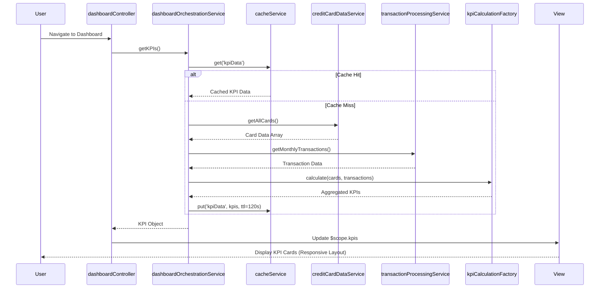

# Low-Level Design: Credit Card Dashboard and KPI Management
**Epic ID:** QE-10071

## a. Architecture Mapping

- **Dashboard Orchestration Service** → AngularJS Service (dashboardOrchestrationService)
- **User Dashboard UI** → AngularJS Controller (dashboardController) + HTML View (dashboard.html)
- **KPI Calculation Engine** → AngularJS Factory (kpiCalculationFactory)
- **Data Cache Layer** → AngularJS Service with $cacheFactory (cacheService)
- **Credit Card Data Service Integration** → AngularJS Service (creditCardDataService)
- **Transaction Processing Service Integration** → AngularJS Service (transactionProcessingService)

**Folder Structure:**
```
/app
  /modules
    /dashboard
      /controllers (dashboardController.js)
      /services (dashboardOrchestrationService.js, creditCardDataService.js, transactionProcessingService.js, cacheService.js)
      /factories (kpiCalculationFactory.js)
      /views (dashboard.html)
      dashboard.module.js
  /shared
    /directives (kpiCard.directive.js)
  /assets
    /css (dashboard.css)
```

## b. Component Specifications

| Component Name | Artifact Type | Responsibility | Key Dependencies |
|----------------|---------------|----------------|------------------|
| dashboardController | Controller | Manages dashboard view state, triggers KPI refresh, handles user interactions | dashboardOrchestrationService, $scope, $interval |
| dashboardOrchestrationService | Service | Orchestrates KPI data retrieval, coordinates cache and backend services | creditCardDataService, transactionProcessingService, cacheService, kpiCalculationFactory |
| creditCardDataService | Service | Fetches card information, limits, and balances via REST API | $http, API_CONFIG |
| transactionProcessingService | Service | Retrieves monthly spend and outstanding amounts via REST API | $http, API_CONFIG |
| kpiCalculationFactory | Factory | Aggregates multi-card data and computes KPIs (total limit, available credit, outstanding, monthly spend) | None |
| cacheService | Service | Manages KPI data caching with TTL to ensure sub-2-second load | $cacheFactory |
| kpiCard.directive | Directive | Reusable UI component for displaying individual KPI metric with icon and value | None |
| dashboard.html | View | Responsive dashboard layout using Bootstrap grid for KPI cards | Bootstrap 3.x |

## c. Data Model

**KPI Model (kpiModel.js):**
```javascript
{
  monthlySpend: Number,        // Current month total spend
  totalCreditLimit: Number,    // Sum of all card limits
  availableCredit: Number,     // Total limit - total outstanding
  outstandingAmount: Number,   // Sum of all card outstanding balances
  lastUpdated: Date            // Timestamp of last refresh
}
```

**Card Summary Model:**
```javascript
{
  cardId: String,
  cardNumber: String,          // Masked (last 4 digits)
  creditLimit: Number,
  currentBalance: Number,
  availableCredit: Number
}
```

## d. Data Flow

User navigates to dashboard → dashboardController initializes and calls dashboardOrchestrationService.getKPIs() → Service checks cacheService for valid cached KPIs → On cache miss, service invokes creditCardDataService.getAllCards() and transactionProcessingService.getMonthlyTransactions() in parallel → Raw data is passed to kpiCalculationFactory which aggregates totals across all cards → Computed KPIs are stored in cache and returned to controller → Controller updates $scope.kpis → View renders KPI cards using kpiCard directive with Bootstrap responsive grid → $interval triggers periodic refresh every 30 seconds, repeating the flow.

## e. Primary Sequence Diagram



## f. Implementation Notes

- Use AngularJS 1.x module pattern with dependency injection for all services and controllers
- Leverage $http service with promise-based API calls; implement parallel requests using $q.all for card and transaction data
- Apply $cacheFactory with 120-second TTL to ensure sub-2-second dashboard load on repeat visits
- Use Bootstrap 3.x grid system (col-xs/sm/md/lg) for responsive KPI card layout across devices
- Implement $interval for auto-refresh every 30 seconds; clean up interval on $scope.$on('$destroy')

## g. Error Handling

HTTP interceptor captures API errors, displays user-friendly notifications via toastr, and falls back to cached data if available.

## h. Security Notes

Requires token-based auth via existing SSO; API calls include Authorization header with JWT token.