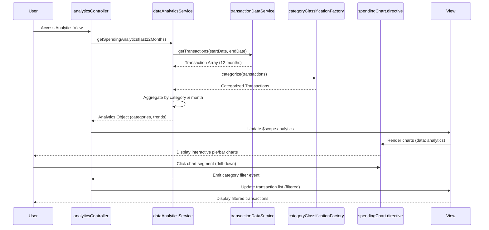

# Low-Level Design: Spending Analytics and Transaction Insights
**Epic ID:** QE-10072

## a. Architecture Mapping

- **Analytics Presentation Layer** → AngularJS Controller (analyticsController) + HTML View (analytics.html)
- **Data Analytics Service** → AngularJS Service (dataAnalyticsService)
- **Category Classification Engine** → AngularJS Factory (categoryClassificationFactory)
- **Transaction Data Service** → AngularJS Service (transactionDataService)
- **Chart Rendering** → AngularJS Directive (spendingChart.directive) using Chart.js library

**Folder Structure:**
```
/app
  /modules
    /analytics
      /controllers (analyticsController.js)
      /services (dataAnalyticsService.js, transactionDataService.js)
      /factories (categoryClassificationFactory.js)
      /directives (spendingChart.directive.js)
      /views (analytics.html)
      analytics.module.js
  /shared
    /filters (currencyFormat.filter.js)
  /assets
    /css (analytics.css)
```

## b. Component Specifications

| Component Name | Artifact Type | Responsibility | Key Dependencies |
|----------------|---------------|----------------|------------------|
| analyticsController | Controller | Manages analytics view, handles date range selection, triggers data refresh | dataAnalyticsService, $scope, $filter |
| dataAnalyticsService | Service | Orchestrates analytics data retrieval, aggregates category-wise and monthly trends | transactionDataService, categoryClassificationFactory, $q |
| transactionDataService | Service | Fetches transaction history (up to 12 months) via REST API | $http, API_CONFIG |
| categoryClassificationFactory | Factory | Maps transactions to 9 predefined categories and calculates category totals | None |
| spendingChart.directive | Directive | Renders interactive pie/bar charts using Chart.js for category and trend visualization | Chart.js library |
| currencyFormat.filter | Filter | Formats numeric values as currency for display | None |
| analytics.html | View | Displays category breakdown, monthly trends, and transaction list with Bootstrap layout | Bootstrap 3.x |

## c. Data Model

**Transaction Model (transactionModel.js):**
```javascript
{
  transactionId: String,
  cardId: String,
  amount: Number,
  date: Date,
  merchantName: String,
  category: String,            // One of 9 categories
  description: String
}
```

**Category Analytics Model:**
```javascript
{
  categoryName: String,        // Food & Dining, Fuel, Shopping, etc.
  totalSpend: Number,
  transactionCount: Number,
  percentageOfTotal: Number
}
```

**Monthly Trend Model:**
```javascript
{
  month: String,               // YYYY-MM format
  totalSpend: Number,
  categoryBreakdown: Array     // Array of {category, amount}
}
```

## d. Data Flow

User accesses analytics view → analyticsController calls dataAnalyticsService.getSpendingAnalytics(dateRange) → Service invokes transactionDataService.getTransactions(startDate, endDate) to fetch 12 months of data → Raw transactions are passed to categoryClassificationFactory.categorize(transactions) which assigns each transaction to one of 9 categories → Service aggregates data by category and month, calculates totals and percentages → Processed analytics object (category breakdown + monthly trends) is returned to controller → Controller updates $scope.analytics → View renders category pie chart and monthly trend bar chart using spendingChart directive → User clicks chart segment to drill down, triggering filtered transaction list display.

## e. Primary Sequence Diagram



## f. Implementation Notes

- Use AngularJS 1.x with ES6 classes for services and factories; transpile with Babel if needed
- Integrate Chart.js 2.x via angular-chart.js wrapper for declarative chart directives
- Implement lazy loading for transaction data: fetch only visible month range initially, load more on scroll
- Use $filter service for date range filtering and currency formatting in views
- Apply debouncing on date range picker to avoid excessive API calls during user interaction

## g. Error Handling

HTTP interceptor with try/catch in service methods; display error toasts and show cached/partial data when API fails.

## h. Security Notes

Standard input validation and secure API calls assumed; token-based authentication for transaction data access.