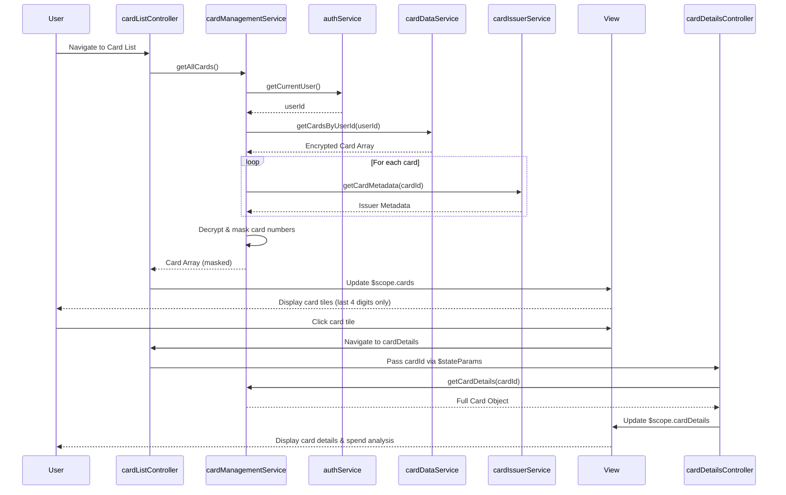

# Low-Level Design: Multiple Credit Card Management
**Epic ID:** QE-10073

## a. Architecture Mapping

- **Card Management Service** → AngularJS Service (cardManagementService)
- **User Interface (Card List)** → AngularJS Controller (cardListController) + HTML View (cardList.html)
- **User Interface (Card Details)** → AngularJS Controller (cardDetailsController) + HTML View (cardDetails.html)
- **User Authentication Service Integration** → AngularJS Service (authService)
- **Credit Card Data Repository** → AngularJS Service (cardDataService) for REST API calls
- **Card Issuer Data Feeds Integration** → AngularJS Service (cardIssuerService)

**Folder Structure:**
```
/app
  /modules
    /cards
      /controllers (cardListController.js, cardDetailsController.js, cardRegistrationController.js)
      /services (cardManagementService.js, cardDataService.js, cardIssuerService.js)
      /views (cardList.html, cardDetails.html, cardRegistration.html)
      cards.module.js
  /shared
    /services (authService.js)
    /directives (cardTile.directive.js)
    /filters (cardMask.filter.js)
  /assets
    /css (cards.css)
```

## b. Component Specifications

| Component Name | Artifact Type | Responsibility | Key Dependencies |
|----------------|---------------|----------------|------------------|
| cardListController | Controller | Displays list of user's cards, handles card selection and navigation | cardManagementService, $scope, $state |
| cardDetailsController | Controller | Shows individual card details, spend analysis, and comparison metrics | cardManagementService, $stateParams, $scope |
| cardRegistrationController | Controller | Handles new card registration form, validates input, submits card data | cardManagementService, authService, $scope |
| cardManagementService | Service | Orchestrates card CRUD operations, validates ownership, coordinates data retrieval | cardDataService, cardIssuerService, authService, $q |
| cardDataService | Service | Performs REST API calls for card data persistence (GET/POST/PUT/DELETE) | $http, API_CONFIG |
| cardIssuerService | Service | Fetches card metadata from issuer feeds (card type, benefits, limits) | $http, ISSUER_API_CONFIG |
| authService | Service | Validates user authentication and card ownership | $http, $window.localStorage |
| cardTile.directive | Directive | Reusable card display component showing masked number, limit, and balance | None |
| cardMask.filter | Filter | Masks card number to show only last 4 digits (e.g., **** **** **** 1234) | None |

## c. Data Model

**Card Model (cardModel.js):**
```javascript
{
  cardId: String,
  userId: String,
  cardNumber: String,          // Encrypted in storage, masked in UI
  cardHolderName: String,
  expiryDate: String,          // MM/YY format
  cardType: String,            // Visa, MasterCard, Amex
  creditLimit: Number,
  currentBalance: Number,
  availableCredit: Number,
  issuerName: String,
  lastFourDigits: String,      // For display only
  registeredDate: Date
}
```

**Card Comparison Model:**
```javascript
{
  cardId: String,
  monthlySpend: Number,
  utilizationRate: Number,     // (currentBalance / creditLimit) * 100
  availableCredit: Number
}
```

## d. Data Flow

User navigates to card list view → cardListController calls cardManagementService.getAllCards() → Service invokes authService.getCurrentUser() to get userId → cardDataService.getCardsByUserId(userId) fetches encrypted card data from repository → For each card, cardIssuerService.getCardMetadata(cardId) retrieves issuer-specific details → cardManagementService decrypts and masks card numbers, merges issuer metadata → Array of card objects is returned to controller → Controller updates $scope.cards → View renders card tiles using cardTile directive with masked numbers via cardMask filter → User clicks card tile → $state.go('cardDetails', {cardId}) navigates to cardDetailsController → Details view displays full card info and spend analysis.

## e. Primary Sequence Diagram



## f. Implementation Notes

- Use AngularJS 1.x with ui-router for state-based navigation between card list and details views
- Implement card number encryption/decryption using CryptoJS library; store only encrypted values in localStorage or backend
- Apply cardMask filter globally to ensure no full card numbers are displayed in any view
- Use $q.all to parallelize issuer metadata fetches for multiple cards to meet 1-second retrieval NFR
- Validate card ownership in cardManagementService before any CRUD operation by comparing userId from authService

## g. Error Handling

HTTP interceptor handles API failures; user-friendly error messages via modal dialogs; retry mechanism for issuer feed timeouts.

## h. Security Notes

Requires token-based auth via existing SSO; card data encrypted at rest and in transit; PCI-DSS compliant masking (display last 4 digits only).