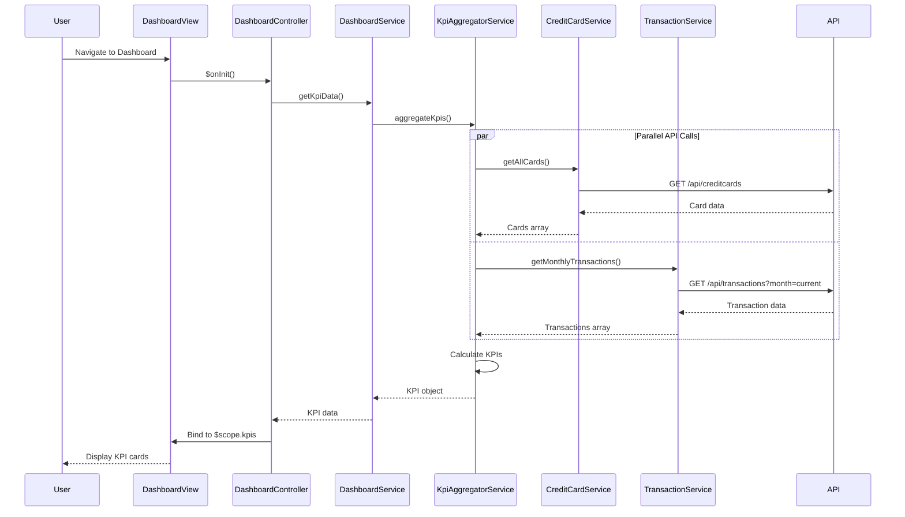

# Low-Level Design: QE-10074 - Dashboard and KPI Management

## a. Architecture Mapping

**HLD Component → AngularJS Artifact Mapping:**
- User Interface → `dashboardModule` (AngularJS Module) + `dashboard.html` (View Template)
- Dashboard Service → `DashboardController` (Controller) + `DashboardService` (Service)
- Data Aggregator → `KpiAggregatorService` (Service/Factory)
- Credit Card Service → `CreditCardService` (Service - REST integration)
- Transaction Service → `TransactionService` (Service - REST integration)

**Recommended Folder Structure:**
```
app/
├── modules/
│   └── dashboard/
│       ├── dashboard.module.js
│       ├── dashboard.controller.js
│       ├── dashboard.html
│       └── dashboard.service.js
├── shared/
│   └── services/
│       ├── kpi-aggregator.service.js
│       ├── credit-card.service.js
│       └── transaction.service.js
├── models/
│   └── kpi.model.js
└── assets/css/dashboard.css
```

## b. Component Specifications

| Component Name | Artifact Type | Responsibility | Key Dependencies |
|----------------|---------------|----------------|------------------|
| dashboardModule | Module | Declares dashboard feature module and routes | angular, ui.router |
| DashboardController | Controller | Manages dashboard view state, binds KPI data to UI | DashboardService, $scope |
| DashboardService | Service | Orchestrates KPI data retrieval and aggregation | KpiAggregatorService, $http, $q |
| KpiAggregatorService | Service | Aggregates data from Credit Card and Transaction services | CreditCardService, TransactionService |
| CreditCardService | Service | Fetches credit card limits and balances via REST API | $http, API_CONFIG |
| TransactionService | Service | Fetches monthly spend and outstanding amounts via REST API | $http, API_CONFIG |
| KpiModel | Factory/Model | Defines KPI data structure (monthly spend, credit limit, available credit, outstanding) | None |

## c. Data Model

```javascript
// KPI Model
const KpiModel = {
  monthlySpend: Number,        // Total spending for current month
  totalCreditLimit: Number,    // Sum of all card limits
  availableCredit: Number,     // Total limit - outstanding
  outstandingAmount: Number,   // Total outstanding balance
  creditUtilization: Number,   // (outstanding / total limit) * 100
  lastUpdated: Date            // Timestamp of last data refresh
};

// Credit Card Summary Model
const CreditCardSummary = {
  cardId: String,
  cardNumber: String,          // Masked
  creditLimit: Number,
  currentBalance: Number,
  availableCredit: Number
};
```

## d. Data Flow

User navigates to dashboard → `DashboardController` initializes and calls `DashboardService.getKpiData()` → `DashboardService` invokes `KpiAggregatorService.aggregateKpis()` → `KpiAggregatorService` makes parallel REST calls via `CreditCardService.getAllCards()` and `TransactionService.getMonthlyTransactions()` → Services return promises resolved with card and transaction data → Aggregator calculates KPIs (sum limits, compute utilization, aggregate spending) → Aggregated KPI object returned to Controller → Controller binds data to `$scope.kpis` → View renders KPI cards with real-time metrics and responsive layout.

## e. Primary Sequence Diagram



## f. Implementation Notes

- Use AngularJS 1.x module pattern with dependency injection for all services and controllers
- Implement ES6 classes for services; use arrow functions for callbacks and promise chains
- Leverage `$q.all()` for parallel REST API calls to optimize dashboard load time (target <2s)
- Apply Bootstrap grid system (col-md-3, col-sm-6, col-xs-12) for responsive KPI card layout
- Use `$http` interceptors for centralized API error handling and loading state management

## g. Error Handling

HTTP interceptor captures API failures; display user-friendly toast notifications using angular-toastr; fallback to cached KPI data if available.

## h. Security Notes

Requires token-based auth via existing SSO; all API calls include Authorization header with JWT token.