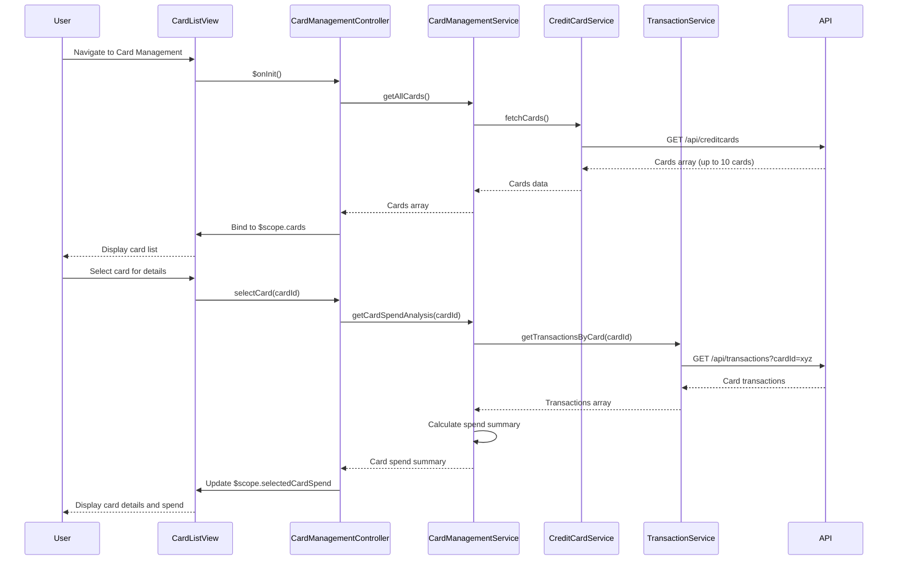

# Low-Level Design: QE-10075 - Multiple Credit Card Management

## a. Architecture Mapping

**HLD Component → AngularJS Artifact Mapping:**
- User Interface → `cardManagementModule` (AngularJS Module) + `card-list.html` (View Template)
- Card Management Module → `CardManagementController` (Controller) + `CardManagementService` (Service)
- Card Filter Component → `cardFilterDirective` (Directive) + `CardFilterService` (Service)
- Credit Card Service → `CreditCardService` (Service - REST integration)
- Transaction Service → `TransactionService` (Service - REST integration)

**Recommended Folder Structure:**
```
app/
├── modules/
│   └── card-management/
│       ├── card-management.module.js
│       ├── card-management.controller.js
│       ├── card-list.html
│       ├── card-details.html
│       └── card-management.service.js
├── shared/
│   ├── directives/
│   │   └── card-filter.directive.js
│   └── services/
│       ├── credit-card.service.js
│       └── transaction.service.js
├── models/
│   └── credit-card.model.js
└── assets/css/card-management.css
```

## b. Component Specifications

| Component Name | Artifact Type | Responsibility | Key Dependencies |
|----------------|---------------|----------------|------------------|
| cardManagementModule | Module | Declares card management feature module and routes | angular, ui.router |
| CardManagementController | Controller | Manages card list view, handles card selection and filtering | CardManagementService, $scope, $state |
| CardManagementService | Service | Orchestrates card data retrieval and card-wise spend analysis | CreditCardService, TransactionService, $q |
| cardFilterDirective | Directive | Provides UI component for filtering cards by type, status, issuer | CardFilterService |
| CardFilterService | Service | Implements filter logic for card list | None |
| CreditCardService | Service | Fetches credit card information and metadata via REST API | $http, API_CONFIG |
| TransactionService | Service | Fetches card-specific spending data via REST API | $http, API_CONFIG |
| CreditCardModel | Factory/Model | Defines credit card data structure | None |

## c. Data Model

```javascript
// Credit Card Model
const CreditCardModel = {
  cardId: String,              // Unique identifier
  cardNumber: String,          // Masked (e.g., "**** **** **** 1234")
  cardType: String,            // "Visa", "Mastercard", "Amex", etc.
  issuer: String,              // Bank name
  cardholderName: String,
  creditLimit: Number,
  currentBalance: Number,
  availableCredit: Number,
  outstandingAmount: Number,
  status: String,              // "Active", "Blocked", "Expired"
  expiryDate: Date,
  lastTransactionDate: Date
};

// Card Spend Summary Model
const CardSpendSummary = {
  cardId: String,
  monthlySpend: Number,
  categoryBreakdown: Object,   // { "Food": 500, "Fuel": 200, ... }
  transactionCount: Number
};
```

## d. Data Flow

User navigates to card management view → `CardManagementController` initializes and calls `CardManagementService.getAllCards()` → Service invokes `CreditCardService.fetchCards()` to retrieve card list via REST API → Cards array returned and bound to `$scope.cards` → View renders card list with Bootstrap card components → User selects a card → Controller calls `CardManagementService.getCardSpendAnalysis(cardId)` → Service fetches card-specific transactions via `TransactionService.getTransactionsByCard(cardId)` → Spend summary calculated and returned → Controller updates `$scope.selectedCardSpend` → View displays card details and spend metrics.

## e. Primary Sequence Diagram



## f. Implementation Notes

- Use AngularJS 1.x component-based architecture; define card-list and card-detail as reusable components
- Implement ES6 Map for efficient card lookup by cardId; use filter and reduce for spend aggregation
- Apply ng-repeat with track by cardId for optimized rendering of card list (target <1s render time)
- Use Bootstrap card component with responsive grid (col-lg-4, col-md-6, col-sm-12) for card display
- Implement client-side filtering using custom filter service; support filter by status, type, and issuer

## g. Error Handling

HTTP interceptor handles API errors; display error messages via angular-toastr; retry failed requests with exponential backoff.

## h. Security Notes

Requires token-based auth via existing SSO; mask sensitive card data (show only last 4 digits); validate card ownership before displaying details.