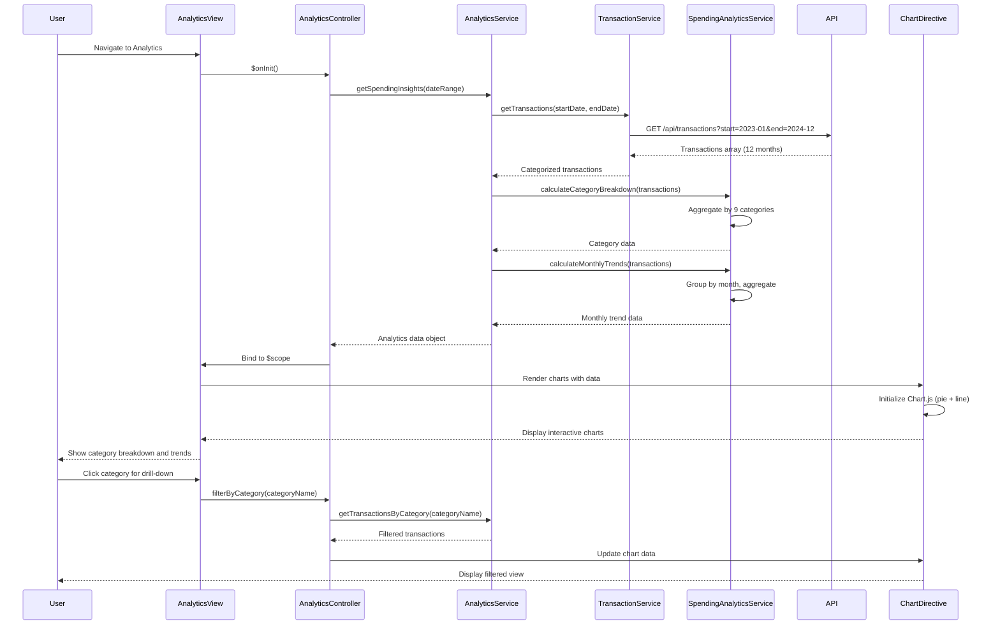

# Low-Level Design: QE-10076 - Analytics and Spending Insights

## a. Architecture Mapping

**HLD Component → AngularJS Artifact Mapping:**
- User Interface → `analyticsModule` (AngularJS Module) + `analytics.html` (View Template)
- Analytics Module → `AnalyticsController` (Controller) + `AnalyticsService` (Service)
- Transaction Service → `TransactionService` (Service - REST integration)
- Analytics Engine → `SpendingAnalyticsService` (Service/Factory)
- Visualization Component → `chartDirective` (Directive using Chart.js or D3.js)

**Recommended Folder Structure:**
```
app/
├── modules/
│   └── analytics/
│       ├── analytics.module.js
│       ├── analytics.controller.js
│       ├── analytics.html
│       └── analytics.service.js
├── shared/
│   ├── directives/
│   │   └── chart.directive.js
│   └── services/
│       ├── transaction.service.js
│       └── spending-analytics.service.js
├── models/
│   └── spending-category.model.js
└── assets/css/analytics.css
```

## b. Component Specifications

| Component Name | Artifact Type | Responsibility | Key Dependencies |
|----------------|---------------|----------------|------------------|
| analyticsModule | Module | Declares analytics feature module and routes | angular, ui.router, chart.js |
| AnalyticsController | Controller | Manages analytics view, handles user interactions (filter, drill-down) | AnalyticsService, $scope |
| AnalyticsService | Service | Orchestrates data retrieval and coordinates with analytics engine | TransactionService, SpendingAnalyticsService, $q |
| SpendingAnalyticsService | Service | Performs category aggregation, trend calculation, and data transformation | None |
| TransactionService | Service | Fetches categorized transaction data via REST API (up to 12 months) | $http, API_CONFIG |
| chartDirective | Directive | Renders interactive charts (pie, bar, line) using Chart.js library | Chart.js |
| SpendingCategoryModel | Factory/Model | Defines spending category structure | None |

## c. Data Model

```javascript
// Spending Category Model
const SpendingCategoryModel = {
  categoryName: String,        // "Food & Dining", "Fuel", "Shopping", etc.
  totalAmount: Number,
  transactionCount: Number,
  percentageOfTotal: Number
};

// Monthly Trend Model
const MonthlyTrendModel = {
  month: String,               // "2024-01", "2024-02", etc.
  totalSpend: Number,
  categoryBreakdown: Array     // Array of SpendingCategoryModel
};

// Transaction Model (from API)
const TransactionModel = {
  transactionId: String,
  cardId: String,
  amount: Number,
  category: String,            // One of 9 predefined categories
  transactionDate: Date,
  merchantName: String
};
```

## d. Data Flow

User navigates to analytics view → `AnalyticsController` initializes and calls `AnalyticsService.getSpendingInsights(dateRange)` → Service invokes `TransactionService.getTransactions(startDate, endDate)` to fetch up to 12 months of categorized transaction data via REST API → Transactions array returned → `SpendingAnalyticsService.calculateCategoryBreakdown(transactions)` aggregates spending by category and computes percentages → `SpendingAnalyticsService.calculateMonthlyTrends(transactions)` generates monthly trend data → Processed analytics data returned to Controller → Controller binds data to `$scope.categoryData` and `$scope.trendData` → `chartDirective` renders interactive pie chart (category breakdown) and line chart (monthly trends) → User interacts with chart (filter, drill-down) → Controller updates data and triggers chart re-render.

## e. Primary Sequence Diagram



## f. Implementation Notes

- Use AngularJS 1.x with Chart.js library for interactive visualizations; wrap Chart.js in custom directive for reusability
- Implement ES6 array methods (map, filter, reduce) for efficient category aggregation and trend calculation
- Use `$http` with caching enabled for transaction API calls; cache 12-month data client-side to optimize performance
- Apply lazy loading for chart library; load Chart.js only when analytics module is activated
- Implement responsive chart sizing using Chart.js responsive options; ensure charts render within 3s on initial load

## g. Error Handling

HTTP interceptor captures API failures; display error notification via angular-toastr; show cached data with "Data may be outdated" warning if API unavailable.

## h. Security Notes

Requires token-based auth via existing SSO; validate date range parameters to prevent unauthorized historical data access beyond 12 months.