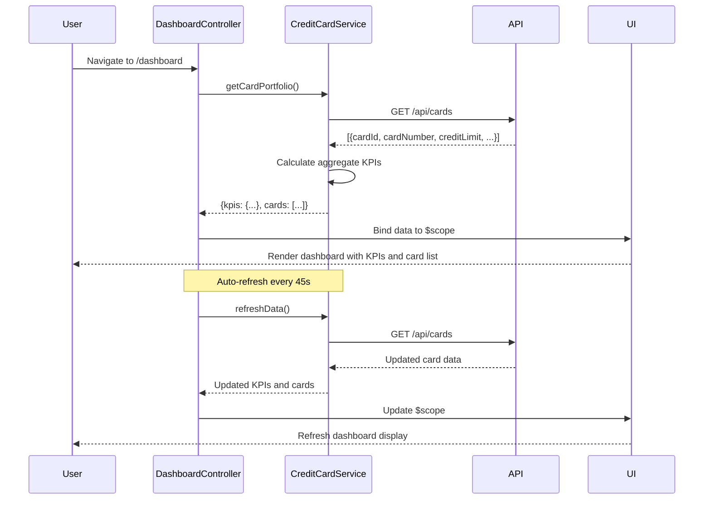

# Low-Level Design: Credit Card Management and Dashboard Overview
**Epic ID:** QE-10077

## a. Architecture Mapping

- **Dashboard Module** → AngularJS Module (`app.dashboard`)
- **Dashboard Controller** → AngularJS Controller (`DashboardController`) - manages KPI display and card list
- **Credit Card Service** → AngularJS Service (`CreditCardService`) - fetches card data and KPIs via REST API
- **Authentication Interceptor** → AngularJS Factory (`AuthInterceptor`) - handles token injection and session validation
- **KPI Directive** → AngularJS Directive (`kpiCard`) - reusable component for displaying individual KPI metrics

**Recommended Folder Structure:**
```
/app
  /dashboard
    dashboard.module.js
    dashboard.controller.js
    dashboard.html
  /services
    creditcard.service.js
  /directives
    kpi-card.directive.js
  /interceptors
    auth.interceptor.js
```

## b. Component Specifications

| Name | Artifact Type | Responsibility | Key Dependencies |
|------|---------------|----------------|------------------|
| DashboardController | Controller | Orchestrates dashboard view, fetches KPIs and card list, handles data refresh | CreditCardService, $scope, $interval |
| CreditCardService | Service | Encapsulates REST API calls to retrieve card details, balances, and KPIs | $http, $q, API_ENDPOINTS |
| kpiCard | Directive | Renders individual KPI metric with label, value, and optional trend indicator | None |
| AuthInterceptor | Factory | Intercepts HTTP requests to inject auth tokens and handle 401 responses | $q, $window, AuthService |
| dashboard.module | Module | Defines dashboard module, routes, and dependencies | ui.router, ngAnimate |

## c. Data Model

**CreditCard Object:**
```javascript
{
  cardId: String,
  cardNumber: String (masked),
  cardType: String, // 'Visa', 'MasterCard', etc.
  creditLimit: Number,
  availableCredit: Number,
  outstandingAmount: Number,
  monthlySpend: Number,
  expiryDate: String // 'MM/YY'
}
```

**DashboardKPI Object:**
```javascript
{
  totalCreditLimit: Number,
  totalAvailableCredit: Number,
  totalOutstanding: Number,
  totalMonthlySpend: Number,
  cardCount: Number
}
```

## d. Data Flow

User navigates to dashboard → DashboardController initializes and invokes CreditCardService.getCardPortfolio() → Service makes GET request to /api/cards endpoint → Backend returns array of CreditCard objects → Service calculates aggregate KPIs (totalCreditLimit, totalAvailableCredit, etc.) → Controller binds KPI data to $scope.kpis and card list to $scope.cards → View renders KPI cards using kpiCard directive and displays card list → $interval triggers CreditCardService.refreshData() every 45 seconds → Updated data is bound to scope, triggering UI refresh without page reload.

## e. Primary Sequence Diagram



## f. Implementation Notes

- Use AngularJS 1.x module pattern with dependency injection for all services and controllers
- Leverage $http service with promise-based API calls; use $q for chaining and error handling
- Implement $interval for periodic data refresh (45s cycle); cancel interval on $scope.$destroy to prevent memory leaks
- Use Bootstrap grid system (col-md-*, col-sm-*) for responsive layout across devices
- Apply ES6 arrow functions and const/let for cleaner service and controller code

## g. Error Handling

HTTP interceptor-based error handling with AuthInterceptor catching 401/403 for re-authentication and global error service displaying user-friendly notifications via toastr or similar.

## h. Security Notes

Requires token-based authentication via existing SSO; AuthInterceptor injects JWT token in Authorization header for all API requests.