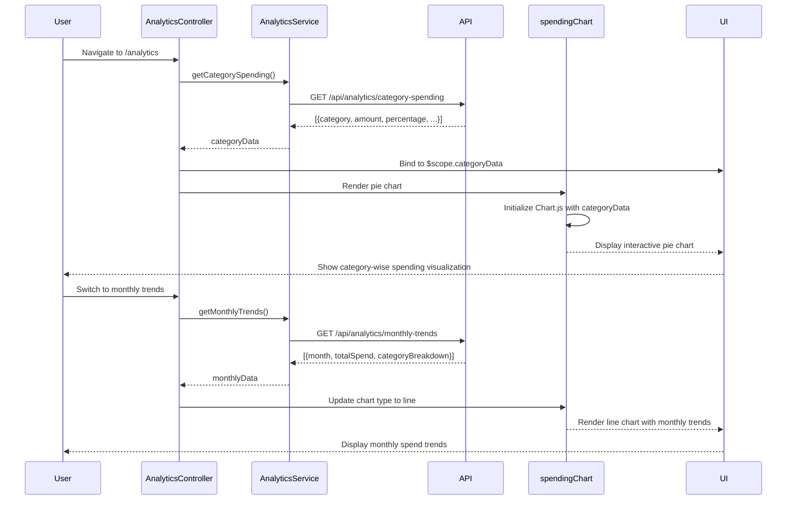

# Low-Level Design: Spending Analytics and Insights
**Epic ID:** QE-10078

## a. Architecture Mapping

- **Analytics Module** → AngularJS Module (`app.analytics`)
- **Analytics Controller** → AngularJS Controller (`AnalyticsController`) - manages chart rendering and user interactions
- **Analytics Service** → AngularJS Service (`AnalyticsService`) - fetches categorized spending data and trends via REST API
- **Chart Directive** → AngularJS Directive (`spendingChart`) - wraps Chart.js for category, monthly, and card-wise visualizations
- **Category Filter** → AngularJS Filter (`categoryName`) - maps category codes to display names

**Recommended Folder Structure:**
```
/app
  /analytics
    analytics.module.js
    analytics.controller.js
    analytics.html
  /services
    analytics.service.js
  /directives
    spending-chart.directive.js
  /filters
    category-name.filter.js
```

## b. Component Specifications

| Name | Artifact Type | Responsibility | Key Dependencies |
|------|---------------|----------------|------------------|
| AnalyticsController | Controller | Manages analytics view, fetches spending data, handles chart type switching | AnalyticsService, $scope, $filter |
| AnalyticsService | Service | Retrieves categorized spending, monthly trends, and card-wise analysis from REST API | $http, $q, API_ENDPOINTS |
| spendingChart | Directive | Renders interactive Chart.js visualizations (pie, bar, line) based on input data | Chart.js library |
| categoryName | Filter | Transforms category code (e.g., 'FOOD') to display name ('Food & Dining') | None |
| analytics.module | Module | Defines analytics module, routes, and chart library integration | ui.router, chart.js |

## c. Data Model

**CategorySpending Object:**
```javascript
{
  category: String, // 'FOOD', 'FUEL', 'SHOPPING', etc.
  amount: Number,
  transactionCount: Number,
  percentage: Number // % of total spend
}
```

**MonthlyTrend Object:**
```javascript
{
  month: String, // 'YYYY-MM'
  totalSpend: Number,
  categoryBreakdown: Array<{category: String, amount: Number}>
}
```

**CardWiseSpend Object:**
```javascript
{
  cardId: String,
  cardName: String,
  totalSpend: Number,
  categoryBreakdown: Array<{category: String, amount: Number}>
}
```

## d. Data Flow

User navigates to analytics section → AnalyticsController invokes AnalyticsService.getCategorySpending() → Service calls GET /api/analytics/category-spending → Backend returns array of CategorySpending objects → Controller binds data to $scope.categoryData → spendingChart directive renders pie chart using Chart.js → User switches to monthly trends view → Controller calls AnalyticsService.getMonthlyTrends() → Service fetches MonthlyTrend data from GET /api/analytics/monthly-trends → Controller updates $scope.monthlyData → Directive re-renders as line chart → User filters by specific card → Controller applies filter and updates chart data dynamically.

## e. Primary Sequence Diagram



## f. Implementation Notes

- Use Chart.js 2.x or 3.x for rendering responsive, interactive charts (pie, bar, line)
- Implement AngularJS directive pattern to wrap Chart.js; use $watch to detect data changes and update charts
- Leverage AnalyticsService with $http for REST API integration; cache responses using $cacheFactory for performance
- Apply Bootstrap responsive utilities and custom CSS media queries for mobile-optimized chart display
- Use ES6 array methods (map, reduce, filter) for data transformation and aggregation in service layer

## g. Error Handling

Try/catch blocks in service methods with promise rejection; global error interceptor displays user-friendly messages for API failures via notification service.

## h. Security Notes

Standard input validation and secure API calls assumed; analytics endpoints protected by same token-based auth as dashboard.