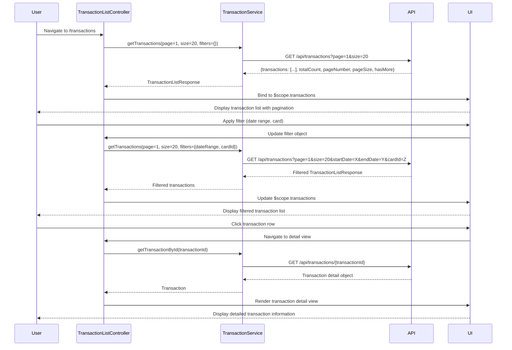

# Low-Level Design: Transaction Monitoring and Tracking
**Epic ID:** QE-10079

## a. Architecture Mapping

- **Transaction Module** → AngularJS Module (`app.transactions`)
- **Transaction List Controller** → AngularJS Controller (`TransactionListController`) - manages transaction list view, pagination, and filtering
- **Transaction Detail Controller** → AngularJS Controller (`TransactionDetailController`) - displays detailed transaction information
- **Transaction Service** → AngularJS Service (`TransactionService`) - fetches transaction data via REST API with pagination and search support
- **Transaction Filter Directive** → AngularJS Directive (`transactionFilter`) - provides UI for search and filter controls

**Recommended Folder Structure:**
```
/app
  /transactions
    transactions.module.js
    transaction-list.controller.js
    transaction-detail.controller.js
    transaction-list.html
    transaction-detail.html
  /services
    transaction.service.js
  /directives
    transaction-filter.directive.js
```

## b. Component Specifications

| Name | Artifact Type | Responsibility | Key Dependencies |
|------|---------------|----------------|------------------|
| TransactionListController | Controller | Manages transaction list display, pagination, search/filter application | TransactionService, $scope, $state |
| TransactionDetailController | Controller | Displays detailed view of selected transaction | TransactionService, $stateParams, $scope |
| TransactionService | Service | Fetches paginated transaction data, applies search/filter, retrieves transaction details | $http, $q, API_ENDPOINTS |
| transactionFilter | Directive | Renders search input and filter dropdowns (date range, card, amount range) | None |
| transactions.module | Module | Defines transaction module, routes for list and detail views | ui.router |

## c. Data Model

**Transaction Object:**
```javascript
{
  transactionId: String,
  cardId: String,
  cardName: String,
  merchantName: String,
  amount: Number,
  currency: String, // 'USD', 'EUR', etc.
  transactionDate: String, // ISO 8601 format
  category: String,
  status: String, // 'Posted', 'Pending'
  description: String
}
```

**TransactionListResponse Object:**
```javascript
{
  transactions: Array<Transaction>,
  totalCount: Number,
  pageNumber: Number,
  pageSize: Number,
  hasMore: Boolean
}
```

## d. Data Flow

User navigates to transactions page → TransactionListController initializes with default pagination (page 1, size 20) → Controller invokes TransactionService.getTransactions(pageNumber, pageSize, filters) → Service makes GET request to /api/transactions?page=1&size=20 → Backend returns TransactionListResponse with transactions array and pagination metadata → Controller binds transactions to $scope.transactions and pagination info to $scope.pagination → View renders transaction list with infinite scroll or pagination controls → User applies search/filter (e.g., date range, specific card) → Controller updates filter object and calls TransactionService.getTransactions() with new filters → Service appends query params and fetches filtered results → UI updates with filtered transaction list → User clicks transaction row → $state.go('transactionDetail', {id: transactionId}) → TransactionDetailController fetches full transaction details via TransactionService.getTransactionById(transactionId) → Detailed view is rendered.

## e. Primary Sequence Diagram



## f. Implementation Notes

- Use ui-router for state management with 'transactionList' and 'transactionDetail' states
- Implement infinite scroll using ng-infinite-scroll directive or custom scroll event listener with pagination logic
- TransactionService should build query params dynamically based on filter object; use $httpParamSerializer for URL encoding
- Apply debounce (300ms) on search input to minimize API calls during typing
- Use Bootstrap table and responsive utilities for mobile-friendly transaction list display

## g. Error Handling

HTTP interceptor catches API errors; service methods reject promises with error details; controller displays user-friendly error messages via toastr or alert service.

## h. Security Notes

Requires token-based auth via existing SSO; transaction endpoints validate user ownership of requested card data to prevent unauthorized access.