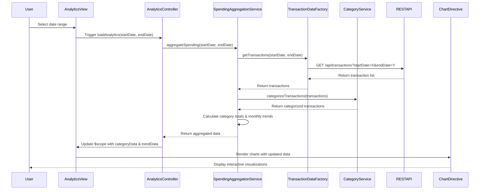

# Low-Level Design: QE-10080 - Spending Analytics and Trend Visualization

## a. Architecture Mapping

**HLD Component → AngularJS Artifact:**
- Analytics Dashboard UI → AngularJS Module (`analyticsModule`) + Controller (`AnalyticsController`) + HTML View
- Visualization Engine → Directive (`spendingChart`) wrapping Chart.js library
- Aggregation & Calculation Layer → Service (`SpendingAggregationService`)
- Transaction Data Service Integration → Factory (`TransactionDataFactory`) for REST API calls
- Data Categorization Engine Integration → Service (`CategoryService`) for classification logic

**Recommended Folder Structure:**
```
app/
├── modules/
│   └── analytics/
│       ├── analytics.module.js
│       ├── controllers/
│       │   └── analytics.controller.js
│       ├── services/
│       │   ├── spending-aggregation.service.js
│       │   └── category.service.js
│       ├── factories/
│       │   └── transaction-data.factory.js
│       ├── directives/
│       │   └── spending-chart.directive.js
│       └── views/
│           └── analytics-dashboard.html
```

## b. Component Specifications

| Component Name | Artifact Type | Responsibility | Key Dependencies |
|----------------|---------------|----------------|------------------|
| analyticsModule | Module | Register all analytics-related components and configure routing | ngRoute, chart.js |
| AnalyticsController | Controller | Manage analytics dashboard state, user interactions, date range selection | SpendingAggregationService, CategoryService, $scope |
| SpendingAggregationService | Service | Aggregate transaction data by category and time period, calculate totals | TransactionDataFactory, CategoryService |
| CategoryService | Service | Classify transactions into 9 predefined categories using rule-based logic | $http (if remote categorization API) |
| TransactionDataFactory | Factory | Fetch transaction data from REST API, handle caching and error responses | $http, $q |
| spendingChart | Directive | Render interactive category-wise and monthly trend charts using Chart.js | Chart.js library, $timeout |

## c. Data Model

**Transaction Model:**
```javascript
{
  transactionId: String,
  cardId: String,
  amount: Number,
  category: String, // One of: Food & Dining, Fuel, Shopping, Travel, Entertainment, Utilities, Healthcare, Education, Miscellaneous
  date: Date,
  description: String,
  merchantName: String
}
```

**CategorySpending Model:**
```javascript
{
  category: String,
  totalAmount: Number,
  transactionCount: Number,
  percentage: Number
}
```

**MonthlyTrend Model:**
```javascript
{
  month: String, // YYYY-MM format
  totalSpending: Number,
  categoryBreakdown: Array<CategorySpending>
}
```

## d. Data Flow

User selects date range on Analytics Dashboard → AnalyticsController captures input and invokes SpendingAggregationService → Service calls TransactionDataFactory to fetch raw transaction data via REST API (`GET /api/transactions?startDate=X&endDate=Y`) → CategoryService classifies uncategorized transactions → SpendingAggregationService aggregates data by category and month → Aggregated data is bound to $scope → spendingChart directive watches data changes and renders/updates interactive Chart.js visualizations (pie chart for categories, line chart for monthly trends) → User interacts with charts (hover, click) to view detailed breakdowns.

## e. Primary Sequence Diagram



## f. Implementation Notes

- Use AngularJS 1.x module pattern with dependency injection for all services, factories, and controllers.
- Integrate Chart.js via custom directive with isolated scope; watch data changes using `$scope.$watch` for reactive updates.
- Implement TransactionDataFactory with promise-based API calls using `$http` and `$q` for async handling.
- Cache transaction data in factory using simple in-memory object to reduce redundant API calls during same session.
- Use ES6 arrow functions, template literals, and const/let for cleaner, modern JavaScript code.

## g. Error Handling

HTTP interceptor-based error handling for API failures; display user-friendly error messages via toast notifications on chart rendering or data fetch errors.

## h. Security Notes

Standard input validation and secure API calls assumed; requires token-based auth via existing SSO for transaction data access.