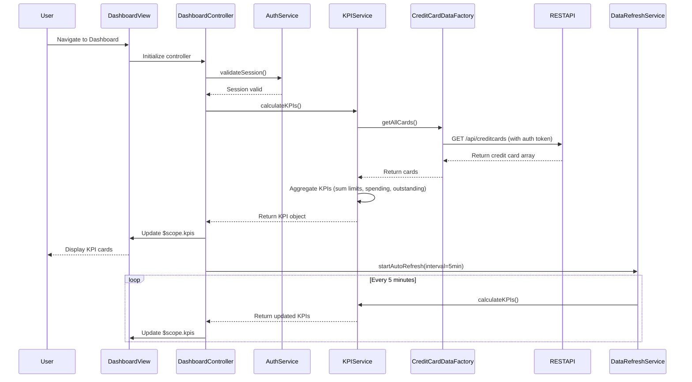

# Low-Level Design: QE-10081 - Credit Card Dashboard and KPI Monitoring

## a. Architecture Mapping

**HLD Component → AngularJS Artifact:**
- Responsive Dashboard UI → AngularJS Module (`dashboardModule`) + Controller (`DashboardController`) + Responsive HTML View with Bootstrap grid
- KPI Aggregation Service → Service (`KPIService`) for calculating and aggregating KPIs
- Credit Card Data Source Integration → Factory (`CreditCardDataFactory`) for REST API calls
- User Authentication Service Integration → Service (`AuthService`) for token management and session handling
- Real-time Data Refresh Engine → Service (`DataRefreshService`) using `$interval` for periodic updates

**Recommended Folder Structure:**
```
app/
├── modules/
│   └── dashboard/
│       ├── dashboard.module.js
│       ├── controllers/
│       │   └── dashboard.controller.js
│       ├── services/
│       │   ├── kpi.service.js
│       │   ├── auth.service.js
│       │   └── data-refresh.service.js
│       ├── factories/
│       │   └── credit-card-data.factory.js
│       └── views/
│           └── dashboard.html
```

## b. Component Specifications

| Component Name | Artifact Type | Responsibility | Key Dependencies |
|----------------|---------------|----------------|------------------|
| dashboardModule | Module | Register dashboard components, configure routing and responsive breakpoints | ngRoute, ui.bootstrap |
| DashboardController | Controller | Manage dashboard state, trigger KPI calculations, handle user interactions | KPIService, DataRefreshService, $scope |
| KPIService | Service | Aggregate credit card data to compute monthly spend, total limit, available credit, outstanding amount | CreditCardDataFactory |
| CreditCardDataFactory | Factory | Fetch all credit card data from REST API, handle caching and error responses | $http, $q, AuthService |
| AuthService | Service | Manage user authentication tokens, validate session, handle login/logout | $http, $window (for localStorage) |
| DataRefreshService | Service | Schedule periodic data refresh using $interval, trigger KPI recalculation | $interval, KPIService |

## c. Data Model

**CreditCard Model:**
```javascript
{
  cardId: String,
  cardNumber: String, // Masked, e.g., "**** **** **** 1234"
  cardType: String, // Visa, MasterCard, Amex, etc.
  creditLimit: Number,
  availableCredit: Number,
  outstandingAmount: Number,
  monthlySpend: Number,
  status: String // Active, Inactive, Blocked
}
```

**KPI Model:**
```javascript
{
  totalMonthlySpend: Number,
  totalCreditLimit: Number,
  totalAvailableCredit: Number,
  totalOutstandingAmount: Number,
  cardCount: Number
}
```

## d. Data Flow

User navigates to Dashboard → DashboardController initializes and calls AuthService to validate session → On successful auth, controller invokes KPIService.calculateKPIs() → KPIService calls CreditCardDataFactory.getAllCards() which makes REST API call (`GET /api/creditcards`) → Factory returns array of CreditCard objects → KPIService aggregates data (sum creditLimit, availableCredit, outstandingAmount, monthlySpend across all cards) → Aggregated KPI object is bound to $scope → Dashboard view renders KPI cards using Bootstrap responsive grid → DataRefreshService triggers periodic refresh every 5 minutes via $interval, repeating the flow to update KPIs in near real-time.

## e. Primary Sequence Diagram



## f. Implementation Notes

- Use AngularJS 1.x with dependency injection; configure dashboardModule with ui-router or ngRoute for SPA navigation.
- Implement responsive layout using Bootstrap 3/4 grid system (col-xs, col-sm, col-md, col-lg classes) for mobile, tablet, desktop breakpoints.
- Use $http service with interceptors in CreditCardDataFactory for adding auth tokens to headers and handling 401/403 responses.
- DataRefreshService uses `$interval` with configurable refresh frequency; ensure proper cleanup on controller destroy using `$scope.$on('$destroy')`.
- Cache credit card data in factory for 5 minutes to minimize redundant API calls; invalidate cache on manual refresh or data update.

## g. Error Handling

HTTP interceptor captures API errors; display toast notifications for network failures; retry logic with exponential backoff for transient errors.

## h. Security Notes

Requires token-based auth via existing SSO; auth tokens stored in localStorage and attached to all API requests via $http interceptor; sensitive card data masked in UI.