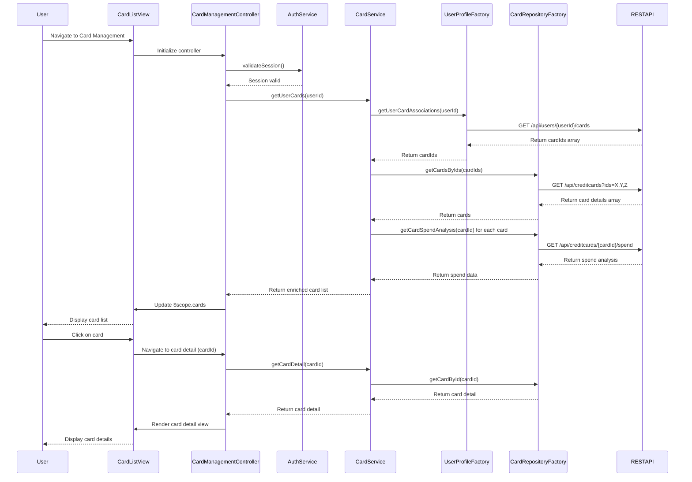

# Low-Level Design: QE-10082 - Credit Card Management and Tracking

## a. Architecture Mapping

**HLD Component → AngularJS Artifact:**
- User Interface → AngularJS Module (`cardManagementModule`) + Controller (`CardManagementController`) + HTML Views (list, detail)
- Card Management Service → Service (`CardService`) for business logic and card operations
- User Profile Service Integration → Factory (`UserProfileFactory`) for REST API calls to user profile endpoints
- Credit Card Data Repository Integration → Factory (`CardRepositoryFactory`) for CRUD operations on card data
- Authentication Layer → Service (`AuthService`) for session and token management (shared across modules)

**Recommended Folder Structure:**
```
app/
├── modules/
│   └── card-management/
│       ├── card-management.module.js
│       ├── controllers/
│       │   └── card-management.controller.js
│       ├── services/
│       │   ├── card.service.js
│       │   └── auth.service.js
│       ├── factories/
│       │   ├── user-profile.factory.js
│       │   └── card-repository.factory.js
│       └── views/
│           ├── card-list.html
│           └── card-detail.html
```

## b. Component Specifications

| Component Name | Artifact Type | Responsibility | Key Dependencies |
|----------------|---------------|----------------|------------------|
| cardManagementModule | Module | Register card management components, configure routing for list and detail views | ngRoute |
| CardManagementController | Controller | Manage card list/detail views, handle user actions (view, select card), maintain view state | CardService, $scope, $routeParams |
| CardService | Service | Business logic for card operations, aggregate card-wise spend analysis, track card status | CardRepositoryFactory, UserProfileFactory |
| CardRepositoryFactory | Factory | CRUD operations on credit card data via REST API, handle caching | $http, $q |
| UserProfileFactory | Factory | Fetch user-card associations, retrieve user profile data via REST API | $http, $q, AuthService |
| AuthService | Service | Manage authentication tokens, validate user session, handle secure access | $http, $window |

## c. Data Model

**CreditCard Model:**
```javascript
{
  cardId: String,
  userId: String,
  cardNumber: String, // Masked
  cardType: String, // Visa, MasterCard, Amex
  cardHolderName: String,
  expiryDate: String, // MM/YY format
  creditLimit: Number,
  availableCredit: Number,
  outstandingAmount: Number,
  status: String, // Active, Inactive, Blocked
  issueDate: Date,
  lastTransactionDate: Date
}
```

**CardSpendAnalysis Model:**
```javascript
{
  cardId: String,
  monthlySpend: Number,
  categoryBreakdown: Array<{category: String, amount: Number}>,
  transactionCount: Number
}
```

**UserCardAssociation Model:**
```javascript
{
  userId: String,
  cardIds: Array<String>
}
```

## d. Data Flow

User navigates to Card Management page → CardManagementController initializes and calls AuthService to validate session → On success, controller invokes CardService.getUserCards() → CardService calls UserProfileFactory.getUserCardAssociations() to fetch user-card mappings via REST API (`GET /api/users/{userId}/cards`) → CardService then calls CardRepositoryFactory.getCardsByIds(cardIds) to fetch full card details via REST API (`GET /api/creditcards?ids=X,Y,Z`) → CardRepositoryFactory returns array of CreditCard objects → CardService enriches data with spend analysis by calling CardRepositoryFactory.getCardSpendAnalysis(cardId) → Aggregated card list with details bound to $scope → View renders card list; user clicks on a card → Controller navigates to detail view, passing cardId via $routeParams → Detail view displays individual card information, status, limits, and usage patterns.

## e. Primary Sequence Diagram



## f. Implementation Notes

- Use AngularJS 1.x module pattern with dependency injection for all components; configure routing with ngRoute or ui-router for list and detail views.
- Implement CardRepositoryFactory with promise-based $http calls; use $q for chaining multiple API requests (user profile + card details).
- Cache card data in CardRepositoryFactory using simple in-memory cache with TTL (e.g., 10 minutes) to reduce API load.
- Use ES6 features (arrow functions, const/let, template literals) for cleaner code; ensure compatibility with Babel if targeting older browsers.
- Implement pagination or virtual scrolling in card list view if user has large number of cards to maintain performance.

## g. Error Handling

HTTP interceptor-based error handling for API failures; display user-friendly error messages via toast notifications; implement try/catch in service layer for data processing errors.

## h. Security Notes

Requires token-based auth via existing SSO; all API calls include auth token in headers; sensitive card data (full card number, CVV) never transmitted or stored in client; card numbers masked in UI.