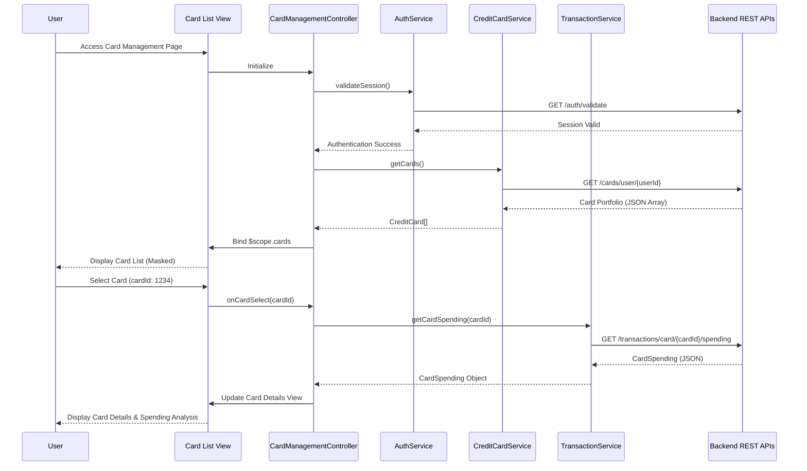

# Low-Level Design: QE-10083 - Multiple Credit Card Management

## a. Architecture Mapping

- **AngularJS Module**: `creditCard.management` - Root module for credit card management features
- **Controller**: `CardManagementController` - Manages card list, selection, filtering, and comparison logic
- **Service**: `CreditCardService` - Handles API calls to Credit Card Data Service for card information retrieval
- **Service**: `TransactionService` - Fetches card-specific spending data from Transaction Service API
- **Service**: `AuthService` - Manages user authentication and secure access control
- **Directive**: `cardListView` - Renders the list of credit cards with masked details
- **Directive**: `cardDetailsView` - Displays individual card details and utilization metrics
- **Directive**: `cardComparisonView` - Enables side-by-side card comparison (up to 3-4 cards)

**Recommended Folder Structure:**
```
app/
├── modules/
│   └── credit-card-management/
│       ├── controllers/
│       │   └── card-management.controller.js
│       ├── services/
│       │   ├── credit-card.service.js
│       │   ├── transaction.service.js
│       │   └── auth.service.js
│       ├── directives/
│       │   ├── card-list-view.directive.js
│       │   ├── card-details-view.directive.js
│       │   └── card-comparison-view.directive.js
│       ├── views/
│       │   ├── card-list.html
│       │   ├── card-details.html
│       │   └── card-comparison.html
│       └── credit-card-management.module.js
└── shared/
    └── styles/
        └── card-management.css
```

## b. Component Specifications

| Component Name | Artifact Type | Responsibility | Key Dependencies |
|----------------|---------------|----------------|------------------|
| `creditCard.management` | Module | Root module registering all card management components | angular, ngRoute, ngResource |
| `CardManagementController` | Controller | Orchestrates card list display, filtering, selection, and comparison workflows | CreditCardService, TransactionService, AuthService, $scope |
| `CreditCardService` | Service/Factory | Fetches user's card portfolio from Credit Card Data Service REST API | $http, $q, API_CONFIG |
| `TransactionService` | Service/Factory | Retrieves card-specific transaction and spending data from Transaction Service API | $http, $q, API_CONFIG |
| `AuthService` | Service/Factory | Validates user authentication and manages secure session tokens | $http, $window, $cookies |
| `cardListView` | Directive | Renders card list with masked card numbers and basic card info | CreditCardService |
| `cardDetailsView` | Directive | Displays detailed card information including balance, limit, utilization, and spending | TransactionService |
| `cardComparisonView` | Directive | Provides side-by-side comparison of selected cards (max 3-4 cards) | CreditCardService, TransactionService |

## c. Data Model

**CreditCard Model:**
```javascript
class CreditCard {
  cardId: String           // Unique card identifier
  cardNumber: String       // Masked card number (e.g., "****1234")
  cardType: String         // Card type (Visa, MasterCard, Amex, etc.)
  cardHolderName: String   // Name on the card
  creditLimit: Number      // Total credit limit
  availableCredit: Number  // Available credit
  outstandingBalance: Number // Current outstanding balance
  utilizationRate: Number  // Calculated as (outstandingBalance / creditLimit) * 100
  expiryDate: String       // Card expiry (MM/YY)
  issuer: String           // Card issuing bank
  status: String           // Active, Inactive, Blocked
}
```

**CardSpending Model:**
```javascript
class CardSpending {
  cardId: String           // Reference to CreditCard
  monthlySpend: Number     // Total spending for current month
  lastTransactionDate: Date // Date of last transaction
  transactionCount: Number // Number of transactions
  topCategory: String      // Highest spending category
}
```

## d. Data Flow

User authenticates via `AuthService`, which validates credentials and establishes a secure session. Upon successful login, `CardManagementController` invokes `CreditCardService.getCards()` to fetch the user's card portfolio from the Credit Card Data Service REST API. The service returns an array of `CreditCard` objects with masked sensitive details, which the controller binds to `$scope.cards` and renders via the `cardListView` directive. When the user selects a specific card, the controller calls `TransactionService.getCardSpending(cardId)` to retrieve card-specific spending data from the Transaction Service API. The response is mapped to a `CardSpending` object and displayed in `cardDetailsView` directive, showing balance, credit limit, utilization percentage, and spending analysis. For card comparison, the user selects multiple cards (up to 3-4), and the controller aggregates data from both services to populate the `cardComparisonView` directive with side-by-side metrics.

## e. Primary Sequence Diagram



## f. Implementation Notes

- Use AngularJS Dependency Injection to inject services into controllers and directives for testability and modularity.
- Implement `$http` interceptors for adding authentication tokens to all API requests and handling 401/403 responses globally.
- Use ES6 classes for data models (CreditCard, CardSpending) with constructor functions for data mapping and validation.
- Apply Bootstrap grid system (col-md-4, col-sm-6) for responsive card layout; use CSS3 media queries for mobile breakpoints at 768px.
- Leverage `$q` promises for asynchronous API calls with `.then()` and `.catch()` for success and error handling in services.

## g. Error Handling

HTTP interceptor-based error handling with try/catch blocks in services; display user-friendly error notifications via Bootstrap alerts for API failures, authentication errors, and network issues.

## h. Security Notes

Requires token-based authentication via existing SSO; all card data transmitted over HTTPS with sensitive fields masked client-side (last 4 digits visible); session tokens stored in secure HTTP-only cookies.