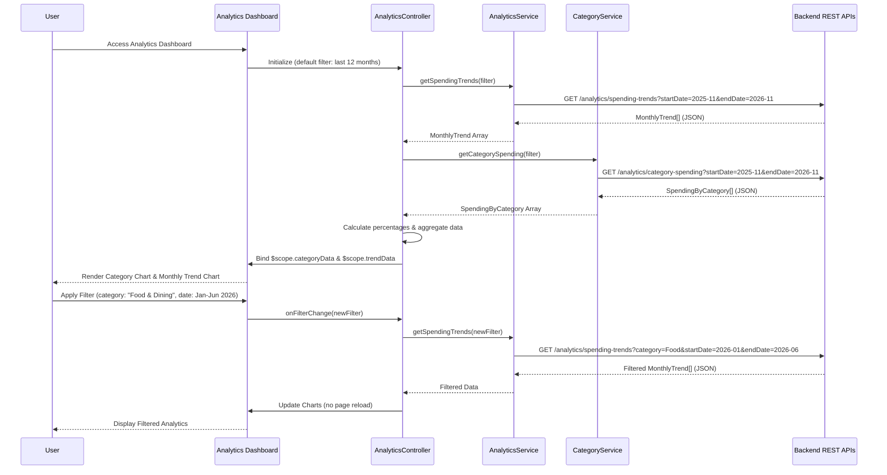

# Low-Level Design: QE-10084 - Analytics and Spending Insights

## a. Architecture Mapping

- **AngularJS Module**: `creditCard.analytics` - Root module for analytics and spending insights features
- **Controller**: `AnalyticsController` - Manages analytics dashboard, filtering, and user interactions
- **Service**: `AnalyticsService` - Fetches aggregated spending data and trends from Analytics Engine API
- **Service**: `CategoryService` - Retrieves transaction categorization data from Transaction Categorization Service
- **Directive**: `categorySpendingChart` - Renders category-wise spending visualization (pie/bar chart)
- **Directive**: `monthlyTrendChart` - Displays monthly spending trend line chart
- **Directive**: `categoryFilter` - Provides interactive category filtering UI component
- **Factory**: `ChartConfigFactory` - Centralizes chart configuration for consistent visualization styling

**Recommended Folder Structure:**
```
app/
├── modules/
│   └── analytics/
│       ├── controllers/
│       │   └── analytics.controller.js
│       ├── services/
│       │   ├── analytics.service.js
│       │   └── category.service.js
│       ├── directives/
│       │   ├── category-spending-chart.directive.js
│       │   ├── monthly-trend-chart.directive.js
│       │   └── category-filter.directive.js
│       ├── factories/
│       │   └── chart-config.factory.js
│       ├── views/
│       │   ├── analytics-dashboard.html
│       │   └── spending-details.html
│       └── analytics.module.js
└── shared/
    ├── libs/
    │   └── chart.js (or D3.js)
    └── styles/
        └── analytics.css
```

## b. Component Specifications

| Component Name | Artifact Type | Responsibility | Key Dependencies |
|----------------|---------------|----------------|------------------|
| `creditCard.analytics` | Module | Root module for analytics features and visualization components | angular, ngRoute, chart.js |
| `AnalyticsController` | Controller | Orchestrates analytics dashboard, manages filters, and coordinates data retrieval | AnalyticsService, CategoryService, $scope, $filter |
| `AnalyticsService` | Service/Factory | Fetches aggregated spending data and monthly trends from Analytics Engine REST API | $http, $q, API_CONFIG |
| `CategoryService` | Service/Factory | Retrieves categorized transaction data from Transaction Categorization Service API | $http, $q, API_CONFIG |
| `categorySpendingChart` | Directive | Renders interactive pie or bar chart showing spending breakdown by category | ChartConfigFactory, chart.js |
| `monthlyTrendChart` | Directive | Displays line chart visualizing monthly spending trends over 12 months | ChartConfigFactory, chart.js |
| `categoryFilter` | Directive | Provides multi-select dropdown for filtering by category and date range | $scope |
| `ChartConfigFactory` | Factory | Provides reusable chart configuration objects (colors, labels, tooltips) | None |

## c. Data Model

**SpendingByCategory Model:**
```javascript
class SpendingByCategory {
  category: String         // Category name (Food & Dining, Fuel, Shopping, etc.)
  totalAmount: Number      // Total spending in this category
  transactionCount: Number // Number of transactions
  percentage: Number       // Percentage of total spending
  monthYear: String        // Month and year (e.g., "2026-11")
}
```

**MonthlyTrend Model:**
```javascript
class MonthlyTrend {
  month: String            // Month-year identifier (e.g., "2026-01")
  totalSpend: Number       // Total spending for the month
  categoryBreakdown: Array<SpendingByCategory> // Spending by category for the month
}
```

**AnalyticsFilter Model:**
```javascript
class AnalyticsFilter {
  startDate: Date          // Filter start date
  endDate: Date            // Filter end date
  selectedCategories: Array<String> // Array of selected category names
  cardId: String           // Optional: filter by specific card
}
```

## d. Data Flow

User accesses the analytics dashboard, triggering `AnalyticsController` initialization. The controller invokes `AnalyticsService.getSpendingTrends(filter)` with default filter parameters (last 12 months, all categories). The service calls the Analytics Engine REST API (`GET /analytics/spending-trends`), which internally aggregates data from the Transaction Categorization Service and Transaction Processing Service. The API returns an array of `MonthlyTrend` objects containing monthly spending totals and category breakdowns. Simultaneously, `CategoryService.getCategorySpending(filter)` fetches category-wise aggregated data. The controller processes the responses, calculates percentages, and binds data to `$scope.categoryData` and `$scope.trendData`. The `categorySpendingChart` directive renders a pie/bar chart using Chart.js, and `monthlyTrendChart` renders a line chart. When the user applies filters via `categoryFilter` directive, the controller updates the filter model and re-fetches data without page reload, updating charts dynamically.

## e. Primary Sequence Diagram



## f. Implementation Notes

- Use Chart.js or D3.js library for rendering interactive charts; configure via `ChartConfigFactory` for consistent styling and color schemes across all visualizations.
- Implement client-side filtering using AngularJS `$filter` service to enable interactive drill-down without additional API calls for already-loaded data.
- Use AngularJS `$http` service with promise chaining (`.then()`) for sequential API calls; cache analytics data in controller scope to minimize redundant API requests.
- Apply Bootstrap responsive grid (col-lg-6, col-md-12) for chart layout; ensure charts resize dynamically using Chart.js responsive configuration.
- Leverage ES6 arrow functions and template literals for cleaner service and controller code; use `const` and `let` for block-scoped variables.

## g. Error Handling

HTTP interceptor captures API errors; controller displays user-friendly error messages via Bootstrap alert components for failed data retrieval or rendering issues.

## h. Security Notes

Standard input validation and secure API calls assumed; analytics data filtered by authenticated user context to prevent unauthorized access to other users' spending data.