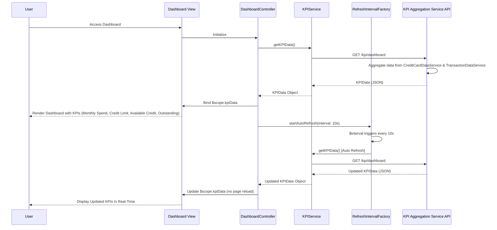

# Low-Level Design: QE-10085 - Dashboard and KPI Management

## a. Architecture Mapping

- **AngularJS Module**: `creditCard.dashboard` - Root module for dashboard and KPI management features
- **Controller**: `DashboardController` - Manages dashboard state, KPI data retrieval, and real-time refresh logic
- **Service**: `KPIService` - Fetches aggregated KPI data from KPI Aggregation Service API
- **Service**: `CreditCardDataService` - Retrieves card balances and credit limits from Credit Card Data Service
- **Service**: `TransactionDataService` - Fetches monthly spend and outstanding amounts from Transaction Processing Service
- **Directive**: `kpiCard` - Reusable component for displaying individual KPI metrics (monthly spend, credit limit, etc.)
- **Directive**: `dashboardSummary` - Displays consolidated dashboard overview with all KPIs
- **Factory**: `RefreshIntervalFactory` - Manages real-time data refresh intervals and polling logic

**Recommended Folder Structure:**
```
app/
├── modules/
│   └── dashboard/
│       ├── controllers/
│       │   └── dashboard.controller.js
│       ├── services/
│       │   ├── kpi.service.js
│       │   ├── credit-card-data.service.js
│       │   └── transaction-data.service.js
│       ├── directives/
│       │   ├── kpi-card.directive.js
│       │   └── dashboard-summary.directive.js
│       ├── factories/
│       │   └── refresh-interval.factory.js
│       ├── views/
│       │   ├── dashboard.html
│       │   └── kpi-card.template.html
│       └── dashboard.module.js
└── shared/
    └── styles/
        └── dashboard.css
```

## b. Component Specifications

| Component Name | Artifact Type | Responsibility | Key Dependencies |
|----------------|---------------|----------------|------------------|
| `creditCard.dashboard` | Module | Root module for dashboard and KPI visualization | angular, ngRoute, ngResource |
| `DashboardController` | Controller | Orchestrates KPI data retrieval, manages refresh intervals, and coordinates UI updates | KPIService, RefreshIntervalFactory, $scope, $interval |
| `KPIService` | Service/Factory | Fetches aggregated KPI data (monthly spend, credit limit, available credit, outstanding) from KPI Aggregation Service API | $http, $q, API_CONFIG |
| `CreditCardDataService` | Service/Factory | Retrieves card balances and credit limits from Credit Card Data Service REST API | $http, $q, API_CONFIG |
| `TransactionDataService` | Service/Factory | Fetches monthly spending and outstanding amounts from Transaction Processing Service API | $http, $q, API_CONFIG |
| `kpiCard` | Directive | Reusable component rendering individual KPI metric with label, value, and icon | None |
| `dashboardSummary` | Directive | Displays consolidated dashboard with all KPIs in responsive grid layout | kpiCard |
| `RefreshIntervalFactory` | Factory | Manages polling intervals for real-time KPI data refresh (5-10 second intervals) | $interval, $rootScope |

## c. Data Model

**KPIData Model:**
```javascript
class KPIData {
  monthlySpend: Number       // Total spending for current month across all cards
  totalCreditLimit: Number   // Sum of credit limits across all cards
  availableCredit: Number    // Total available credit (creditLimit - outstandingBalance)
  outstandingAmount: Number  // Total outstanding balance across all cards
  utilizationRate: Number    // Calculated as (outstandingAmount / totalCreditLimit) * 100
  lastUpdated: Date          // Timestamp of last data refresh
}
```

**CardSummary Model:**
```javascript
class CardSummary {
  cardId: String             // Unique card identifier
  creditLimit: Number        // Card's credit limit
  currentBalance: Number     // Current outstanding balance
  availableCredit: Number    // Available credit for this card
}
```

## d. Data Flow

User accesses the dashboard, triggering `DashboardController` initialization. The controller invokes `KPIService.getKPIData()`, which makes a REST API call to the KPI Aggregation Service (`GET /kpi/dashboard`). The backend service aggregates data by calling `CreditCardDataService` (for card balances and limits) and `TransactionDataService` (for monthly spend and outstanding amounts), both querying their respective data stores. The aggregated `KPIData` object is returned to the controller and bound to `$scope.kpiData`. The `dashboardSummary` directive renders the KPIs using multiple `kpiCard` directives in a Bootstrap responsive grid. The `RefreshIntervalFactory` initiates a polling mechanism using `$interval` (every 5-10 seconds), repeatedly calling `KPIService.getKPIData()` to fetch updated data. On each refresh, the controller updates `$scope.kpiData`, and AngularJS two-way data binding automatically updates the UI without page reload, ensuring real-time visibility into financial metrics.

## e. Primary Sequence Diagram



## f. Implementation Notes

- Use AngularJS `$interval` service in `RefreshIntervalFactory` for polling-based real-time refresh; ensure interval is cancelled on controller `$destroy` event to prevent memory leaks.
- Implement `$http` service with caching disabled for KPI API calls to ensure fresh data on each request; use `cache: false` configuration.
- Apply Bootstrap grid system (col-lg-3, col-md-6, col-sm-12) for responsive KPI card layout; use CSS3 flexbox for equal-height cards.
- Use ES6 template literals for dynamic HTML generation in `kpiCard` directive; leverage AngularJS `$compile` for dynamic directive rendering if needed.
- Implement loading spinners using Bootstrap or custom CSS during API calls; bind spinner visibility to `$scope.loading` flag toggled in controller.

## g. Error Handling

HTTP interceptor-based error handling with try/catch in services; display user-friendly error notifications via Bootstrap alert for API failures, timeout errors, or data aggregation issues.

## h. Security Notes

Requires token-based auth via existing SSO; all KPI data transmitted over HTTPS; API endpoints validate user authentication and return only user-specific aggregated data to prevent unauthorized access.