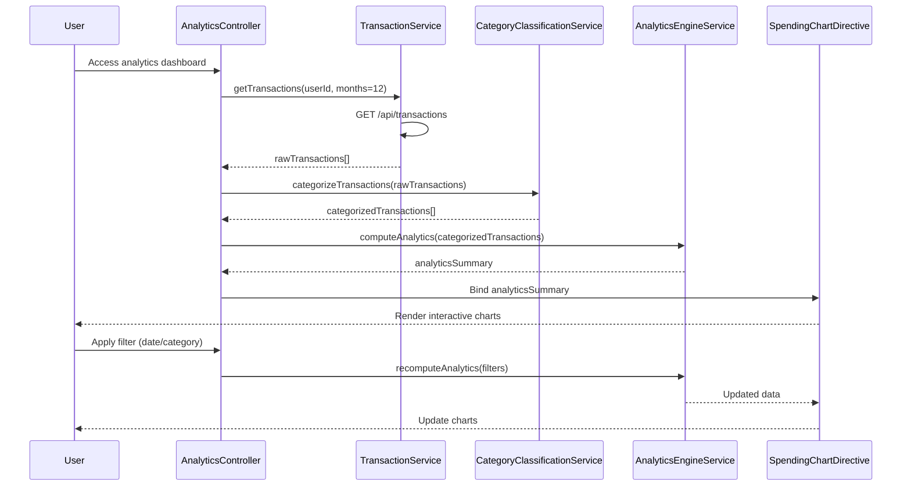

# Low-Level Design: QE-10086 - Spending Analytics and Insights

## a. Architecture Mapping

- **Analytics Module** (`app.analytics`) → Main AngularJS module containing all analytics components
- **AnalyticsController** → Manages analytics dashboard state, user interactions, and data binding
- **TransactionService** → Factory for retrieving raw transaction data via REST API
- **CategoryClassificationService** → Service for categorizing transactions into 9 predefined categories
- **AnalyticsEngineService** → Service for trend calculation, aggregation, and pattern identification
- **SpendingChartDirective** → Directive for rendering interactive charts using charting library

**Folder Structure:**
```
/app
  /analytics
    analytics.module.js
    analytics.controller.js
    analytics.html
    /services
      transaction.service.js
      category-classification.service.js
      analytics-engine.service.js
    /directives
      spending-chart.directive.js
```

## b. Component Specifications

| Component Name | Artifact Type | Responsibility | Key Dependencies |
|----------------|---------------|----------------|------------------|
| AnalyticsModule | Module | Register all analytics components and configure routing | angular, ui-router |
| AnalyticsController | Controller | Manage dashboard state, handle user interactions, bind data to view | TransactionService, AnalyticsEngineService, $scope |
| TransactionService | Factory | Fetch raw transaction data from REST API endpoint | $http, $q |
| CategoryClassificationService | Service | Classify transactions into 9 categories based on MCC/merchant name | None |
| AnalyticsEngineService | Service | Aggregate data, compute trends, calculate category totals | CategoryClassificationService |
| SpendingChartDirective | Directive | Render interactive charts (line, pie, bar) with filtering/drill-down | Chart.js or D3.js, $timeout |

## c. Data Model

**Transaction Object:**
```javascript
{
  id: String,
  amount: Number,
  date: Date,
  merchantName: String,
  merchantCode: String,
  cardId: String,
  category: String // One of 9 categories
}
```

**AnalyticsSummary Object:**
```javascript
{
  monthlyTrends: Array<{month: String, totalSpend: Number}>,
  categoryBreakdown: Array<{category: String, amount: Number, percentage: Number}>,
  totalTransactions: Number,
  dateRange: {start: Date, end: Date}
}
```

**Category Enum:**
```javascript
['Food & Dining', 'Fuel', 'Shopping', 'Travel', 'Entertainment', 'Utilities', 'Healthcare', 'Education', 'Miscellaneous']
```

## d. Data Flow

User accesses analytics dashboard → AnalyticsController initializes and calls TransactionService.getTransactions() → Service fetches raw transaction data via REST API (GET /api/transactions?userId={id}&months=12) → CategoryClassificationService categorizes each transaction → AnalyticsEngineService aggregates data to compute monthly trends and category totals → Controller binds AnalyticsSummary to $scope → SpendingChartDirective renders interactive visualizations → User applies filters (date range, category) → Controller triggers re-aggregation → Charts update in real-time.

## e. Primary Sequence Diagram



## f. Implementation Notes

- Use AngularJS DI to inject services into controller; follow John Papa style guide for module organization
- Implement caching in TransactionService using $cacheFactory to minimize API calls and meet 3-second render NFR
- Use Chart.js or D3.js for charting; wrap in directive with isolated scope for reusability
- Apply ES6 arrow functions, const/let, and template literals for cleaner code
- Implement lazy loading for 12-month transaction data; fetch on-demand for older months if needed

## g. Error Handling

Use $http interceptor to catch API errors globally; display user-friendly notifications via toastr or custom modal service; wrap service calls in try/catch blocks.

## h. Security Notes

Standard input validation and secure API calls assumed; ensure token-based auth via existing SSO for API endpoints.