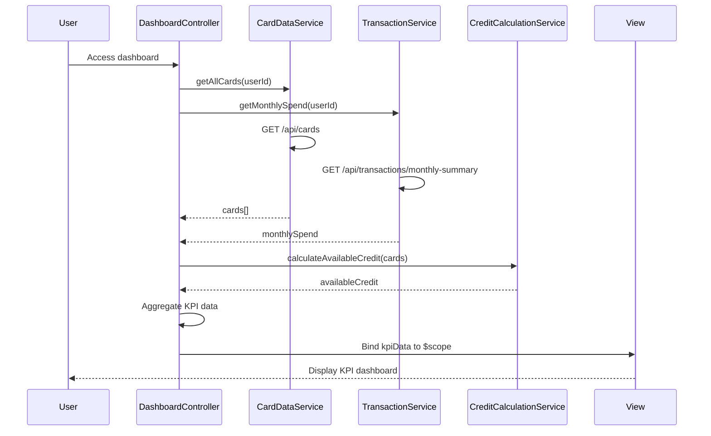

# Low-Level Design: QE-10087 - Dashboard KPIs and Financial Overview

## a. Architecture Mapping

- **Dashboard Module** (`app.dashboard`) → Main AngularJS module for KPI dashboard
- **DashboardController** → Manages KPI data, refresh logic, and view binding
- **CardDataService** → Factory for retrieving card details, balances, and limits via REST API
- **TransactionService** → Factory for fetching monthly spend data
- **CreditCalculationService** → Service for computing available credit
- **KpiCardDirective** → Directive for rendering individual KPI cards with responsive layout

**Folder Structure:**
```
/app
  /dashboard
    dashboard.module.js
    dashboard.controller.js
    dashboard.html
    /services
      card-data.service.js
      transaction.service.js
      credit-calculation.service.js
    /directives
      kpi-card.directive.js
```

## b. Component Specifications

| Component Name | Artifact Type | Responsibility | Key Dependencies |
|----------------|---------------|----------------|------------------|
| DashboardModule | Module | Register dashboard components and configure routing | angular, ui-router |
| DashboardController | Controller | Orchestrate KPI data retrieval, handle refresh, bind to view | CardDataService, TransactionService, CreditCalculationService, $scope, $interval |
| CardDataService | Factory | Fetch card details, balances, limits from REST API | $http, $q |
| TransactionService | Factory | Retrieve monthly spend aggregated data | $http, $q |
| CreditCalculationService | Service | Calculate available credit (limit - outstanding) | None |
| KpiCardDirective | Directive | Render responsive KPI card with icon, label, value | None |

## c. Data Model

**Card Object:**
```javascript
{
  cardId: String,
  cardNumber: String, // Masked
  cardType: String,
  creditLimit: Number,
  outstandingAmount: Number,
  issuer: String
}
```

**KpiData Object:**
```javascript
{
  monthlySpend: Number,
  totalCreditLimit: Number,
  availableCredit: Number,
  totalOutstanding: Number,
  lastUpdated: Date
}
```

## d. Data Flow

User accesses dashboard → DashboardController initializes and calls CardDataService.getAllCards() and TransactionService.getMonthlySpend() in parallel → CardDataService fetches card details via GET /api/cards → TransactionService fetches monthly spend via GET /api/transactions/monthly-summary → CreditCalculationService computes availableCredit = sum(card.creditLimit) - sum(card.outstandingAmount) → Controller aggregates all KPI metrics into KpiData object → Data bound to $scope → KpiCardDirective renders each KPI in responsive grid → Dashboard displays real-time financial overview.

## e. Primary Sequence Diagram



## f. Implementation Notes

- Use $q.all() to fetch card and transaction data in parallel for faster load times (meet 2-second NFR)
- Implement $interval for auto-refresh every 30 seconds; cancel on $scope.$destroy to prevent memory leaks
- Use Bootstrap grid system for responsive layout; apply ng-repeat with KpiCardDirective for dynamic KPI rendering
- Cache card data in CardDataService using $cacheFactory; invalidate on manual refresh
- Apply ES6 promises and arrow functions for cleaner async code

## g. Error Handling

Use $http interceptor for global error handling; display error notifications via toastr; implement fallback to cached data if API fails.

## h. Security Notes

Requires token-based auth via existing SSO; mask sensitive card numbers in UI; ensure HTTPS for all API calls.