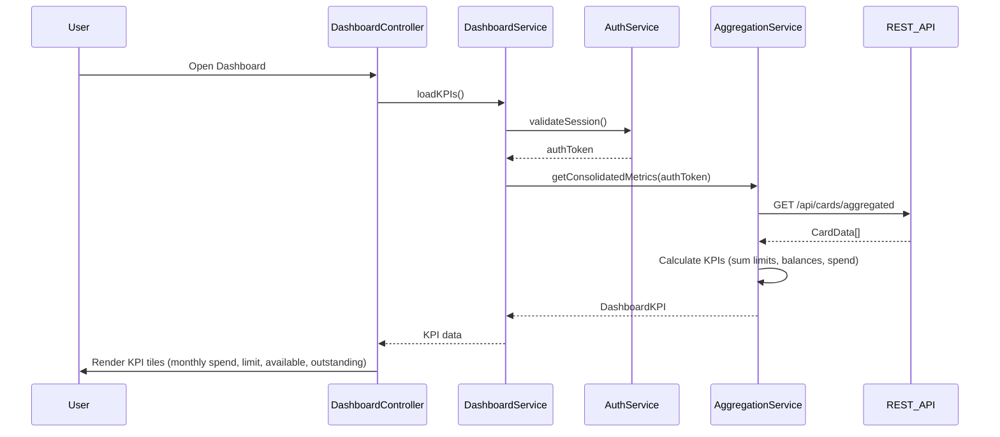

# Low-Level Design: Dashboard KPIs and Financial Overview
**Epic ID:** QE-10088  
**Stack:** AngularJS 1.x, JavaScript ES6, HTML5, CSS3, Bootstrap, REST APIs, MVC

---

## a. Architecture Mapping

- **DashboardModule** (ng-module) - Root module for dashboard feature
- **DashboardController** (ng-controller) - Manages KPI display logic and data binding
- **DashboardService** (ng-service) - Orchestrates authentication and data aggregation calls
- **AuthService** (ng-service) - Handles user authentication and session management
- **AggregationService** (ng-service) - Fetches and calculates consolidated financial metrics
- **kpiCard** (ng-directive) - Reusable component for rendering individual KPI tiles

**Folder Structure:**
```
/app
  /dashboard
    dashboard.module.js
    dashboard.controller.js
    dashboard.service.js
    dashboard.html
    /directives
      kpi-card.directive.js
      kpi-card.html
  /shared
    /services
      auth.service.js
      aggregation.service.js
```

---

## b. Component Specifications

| Component Name | Artifact Type | Responsibility | Key Dependencies |
|----------------|---------------|----------------|------------------|
| DashboardModule | Module | Registers dashboard feature components and routes | ngRoute, DashboardController, DashboardService |
| DashboardController | Controller | Binds KPI data to view, handles refresh logic | DashboardService, $scope, $interval |
| DashboardService | Service | Coordinates auth check and aggregation API calls | AuthService, AggregationService, $http, $q |
| AuthService | Service | Validates user session and retrieves auth token | $http, $window (localStorage) |
| AggregationService | Service | Calls REST API to fetch consolidated card metrics | $http, API_ENDPOINTS constant |
| kpiCard | Directive | Renders individual KPI tile with value, label, icon | None (isolated scope) |

---

## c. Data Model

**DashboardKPI (JS Object):**
```javascript
{
  monthlySpend: Number,        // Total spend for current month
  totalCreditLimit: Number,    // Sum of all card limits
  availableCredit: Number,     // Total limit - outstanding
  outstandingAmount: Number,   // Total balance across cards
  lastUpdated: Date            // Timestamp of last data refresh
}
```

**CardData (from API):**
```javascript
{
  cardId: String,
  creditLimit: Number,
  currentBalance: Number,
  monthlySpend: Number
}
```

---

## d. Data Flow

User opens dashboard → DashboardController initializes and calls DashboardService.loadKPIs() → DashboardService authenticates via AuthService → On success, AggregationService.getConsolidatedMetrics() invokes REST API GET /api/cards/aggregated → API returns array of CardData → AggregationService calculates totals (sum limits, balances, monthly spend) → DashboardKPI object populated and returned → Controller binds to $scope.kpis → View renders four kpiCard directives with responsive Bootstrap grid → $interval triggers periodic refresh every 30 seconds.

---

## e. Primary Sequence Diagram



---

## f. Implementation Notes

- Use AngularJS Dependency Injection for all services; register with `angular.module().service()` pattern
- Implement $http interceptor for attaching auth token to all API requests
- Use ES6 classes for service definitions; transpile with Babel if needed
- Leverage Bootstrap grid (col-xs/sm/md/lg) for responsive KPI card layout
- Cache aggregated data in service for 30s to reduce API calls; use $interval for auto-refresh

---

## g. Error Handling

HTTP interceptor catches API failures (401/403/500); display Bootstrap alert modal with user-friendly message and retry option.

---

## h. Security Notes

Requires token-based auth via existing SSO; token stored in localStorage and passed in Authorization header for all API calls.

---