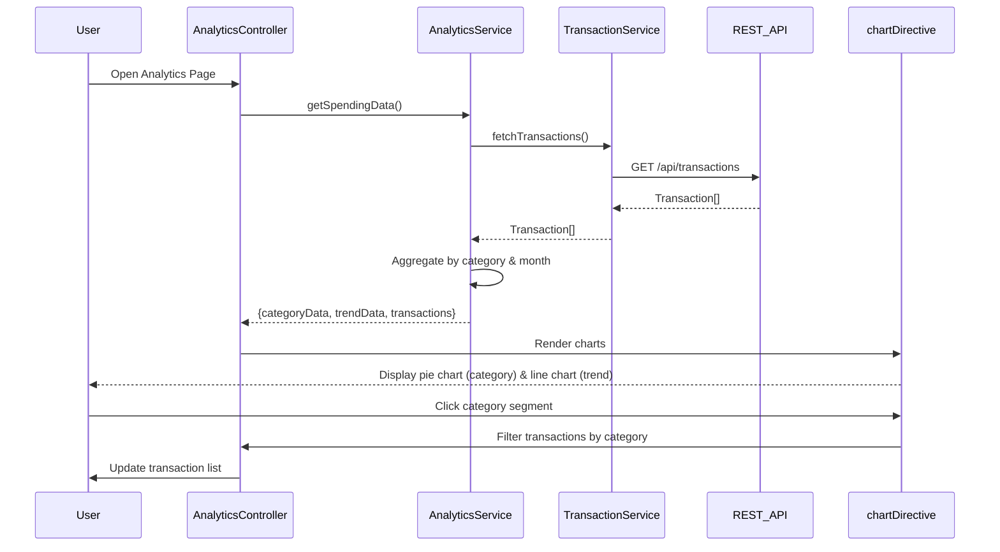

# Low-Level Design: Spending Analytics and Transaction Insights
**Epic ID:** QE-10089  
**Stack:** AngularJS 1.x, JavaScript ES6, HTML5, CSS3, Bootstrap, REST APIs, MVC

---

## a. Architecture Mapping

- **AnalyticsModule** (ng-module) - Root module for analytics feature
- **AnalyticsController** (ng-controller) - Manages chart rendering and transaction list display
- **AnalyticsService** (ng-service) - Fetches transaction data and aggregates by category/time
- **TransactionService** (ng-service) - Retrieves raw transaction data from REST API
- **CategoryService** (ng-service) - Provides category metadata and classification logic
- **chartDirective** (ng-directive) - Wraps Chart.js or D3.js for interactive visualizations
- **transactionList** (ng-directive) - Renders paginated transaction table

**Folder Structure:**
```
/app
  /analytics
    analytics.module.js
    analytics.controller.js
    analytics.service.js
    analytics.html
    /directives
      chart.directive.js
      transaction-list.directive.js
  /shared
    /services
      transaction.service.js
      category.service.js
```

---

## b. Component Specifications

| Component Name | Artifact Type | Responsibility | Key Dependencies |
|----------------|---------------|----------------|------------------|
| AnalyticsModule | Module | Registers analytics components and routes | ngRoute, AnalyticsController, AnalyticsService |
| AnalyticsController | Controller | Binds chart data and transaction list to view | AnalyticsService, $scope |
| AnalyticsService | Service | Aggregates transactions by category and month | TransactionService, CategoryService, $q |
| TransactionService | Service | Calls REST API to fetch user transactions | $http, API_ENDPOINTS |
| CategoryService | Service | Returns list of 9 predefined categories | None (static data) |
| chartDirective | Directive | Renders interactive pie/bar charts using Chart.js | Chart.js library |
| transactionList | Directive | Displays paginated, sortable transaction table | None (isolated scope) |

---

## c. Data Model

**Transaction (JS Object):**
```javascript
{
  transactionId: String,
  cardId: String,
  amount: Number,           // Decimal with 2 precision
  category: String,         // One of 9 predefined categories
  merchantName: String,
  transactionDate: Date,
  description: String
}
```

**CategorySpend (Aggregated):**
```javascript
{
  category: String,
  totalAmount: Number,
  transactionCount: Number,
  percentage: Number        // % of total spend
}
```

**MonthlyTrend (Aggregated):**
```javascript
{
  month: String,            // YYYY-MM format
  totalSpend: Number
}
```

---

## d. Data Flow

User navigates to analytics page → AnalyticsController calls AnalyticsService.getSpendingData() → AnalyticsService invokes TransactionService.fetchTransactions() → REST API GET /api/transactions returns Transaction[] → AnalyticsService aggregates by category (group by category, sum amounts) and by month (group by month, sum amounts) → CategorySpend[] and MonthlyTrend[] objects created → Controller binds to $scope.categoryData and $scope.trendData → chartDirective renders interactive pie chart (category-wise) and line chart (monthly trend) → transactionList directive displays full transaction table with sorting/filtering → User clicks chart segment to filter transaction list by category.

---

## e. Primary Sequence Diagram



---

## f. Implementation Notes

- Use Chart.js library integrated via custom AngularJS directive with two-way data binding
- Implement ES6 Array methods (map, filter, reduce) for client-side aggregation logic
- Cache transaction data in AnalyticsService to avoid redundant API calls on chart interactions
- Use ng-repeat with track by transactionId for efficient transaction list rendering
- Apply Bootstrap table classes for responsive transaction list; implement client-side pagination with limitTo filter

---

## g. Error Handling

$http interceptor catches API errors; display inline error message in analytics view with retry button; log errors to console for debugging.

---

## h. Security Notes

Standard input validation and secure API calls assumed; auth token passed via interceptor for all transaction API requests.

---