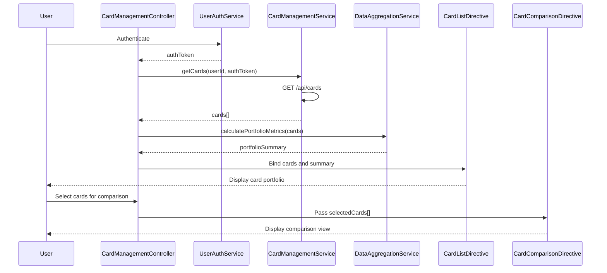

# Low-Level Design: QE-10090 - Multiple Credit Card Management

## a. Architecture Mapping

- **CardManagement Module** (`app.cardManagement`) → Main AngularJS module for card portfolio management
- **CardManagementController** → Manages card list, card selection, comparison logic, and view state
- **CardManagementService** → Factory for retrieving and managing card data via REST API
- **UserAuthService** → Service for user authentication and authorization
- **DataAggregationService** → Service for portfolio-level calculations and card comparisons
- **CardListDirective** → Directive for rendering card list with individual card details
- **CardComparisonDirective** → Directive for side-by-side card comparison view

**Folder Structure:**
```
/app
  /card-management
    card-management.module.js
    card-management.controller.js
    card-management.html
    /services
      card-management.service.js
      user-auth.service.js
      data-aggregation.service.js
    /directives
      card-list.directive.js
      card-comparison.directive.js
```

## b. Component Specifications

| Component Name | Artifact Type | Responsibility | Key Dependencies |
|----------------|---------------|----------------|------------------|
| CardManagementModule | Module | Register card management components and configure routing | angular, ui-router |
| CardManagementController | Controller | Manage card portfolio state, handle card selection/comparison | CardManagementService, DataAggregationService, $scope |
| CardManagementService | Factory | Fetch card data, sync cards, retrieve card-specific details | $http, $q, UserAuthService |
| UserAuthService | Service | Authenticate user, provide auth token for secure API calls | $http, $window |
| DataAggregationService | Service | Calculate portfolio metrics (total limits, utilization, comparisons) | None |
| CardListDirective | Directive | Render scrollable card list with card details and actions | None |
| CardComparisonDirective | Directive | Display side-by-side comparison of selected cards | None |

## c. Data Model

**Card Object:**
```javascript
{
  cardId: String,
  cardNumber: String, // Masked (e.g., **** **** **** 1234)
  cardType: String, // Visa, MasterCard, Amex
  issuer: String,
  creditLimit: Number,
  outstandingBalance: Number,
  availableCredit: Number,
  utilizationRate: Number, // Percentage
  monthlySpend: Number,
  lastSyncDate: Date
}
```

**PortfolioSummary Object:**
```javascript
{
  totalCards: Number,
  totalCreditLimit: Number,
  totalOutstanding: Number,
  totalAvailableCredit: Number,
  averageUtilization: Number
}
```

## d. Data Flow

User authenticates via UserAuthService → CardManagementController calls CardManagementService.getCards() → Service fetches card data via GET /api/cards?userId={id} with auth token → DataAggregationService calculates portfolio-level metrics (total limits, average utilization) and individual card utilization rates → Controller binds card array and portfolio summary to $scope → CardListDirective renders card list → User selects cards for comparison → Controller passes selected cards to CardComparisonDirective → Comparison view displays side-by-side card details → User triggers sync → CardManagementService calls POST /api/cards/sync → Updated card data refreshed in UI.

## e. Primary Sequence Diagram



## f. Implementation Notes

- Use AngularJS DI to inject services; follow modular architecture with separation of concerns
- Implement virtual scrolling in CardListDirective for performance with 50+ cards using ng-virtual-repeat or custom solution
- Cache card data in CardManagementService; implement debouncing for sync operations to avoid API throttling
- Use ES6 classes for services; apply const/let and template literals
- Implement optimistic UI updates for sync operations; revert on API failure

## g. Error Handling

Use $http interceptor for global error handling; display user notifications via toastr; implement retry logic for failed sync operations.

## h. Security Notes

Requires token-based auth via existing SSO; mask card numbers (show last 4 digits only); ensure encryption at rest and in transit for card data.