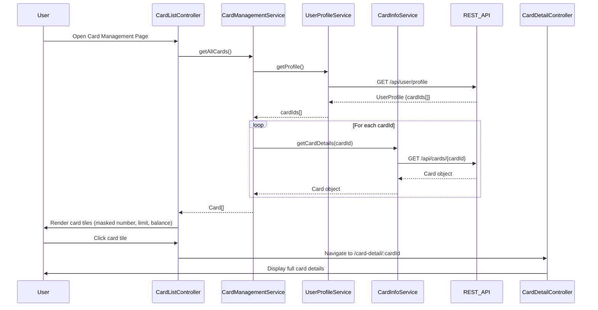

# Low-Level Design: Multiple Credit Card Management
**Epic ID:** QE-10091  
**Stack:** AngularJS 1.x, JavaScript ES6, HTML5, CSS3, Bootstrap, REST APIs, MVC

---

## a. Architecture Mapping

- **CardManagementModule** (ng-module) - Root module for card management feature
- **CardListController** (ng-controller) - Manages card list display and selection
- **CardDetailController** (ng-controller) - Manages individual card detail view
- **CardManagementService** (ng-service) - Orchestrates card data retrieval and user profile check
- **CardInfoService** (ng-service) - Fetches card details from REST API
- **UserProfileService** (ng-service) - Retrieves user profile and associated cards
- **cardTile** (ng-directive) - Reusable component for rendering card summary tile
- **cardDetail** (ng-directive) - Displays detailed card information panel

**Folder Structure:**
```
/app
  /card-management
    card-management.module.js
    card-list.controller.js
    card-detail.controller.js
    card-management.service.js
    card-list.html
    card-detail.html
    /directives
      card-tile.directive.js
      card-tile.html
      card-detail.directive.js
      card-detail.html
  /shared
    /services
      card-info.service.js
      user-profile.service.js
```

---

## b. Component Specifications

| Component Name | Artifact Type | Responsibility | Key Dependencies |
|----------------|---------------|----------------|------------------|
| CardManagementModule | Module | Registers card management components and routes | ngRoute, CardListController, CardDetailController |
| CardListController | Controller | Binds card list to view, handles card selection | CardManagementService, $scope, $location |
| CardDetailController | Controller | Binds selected card details to view | CardManagementService, $routeParams, $scope |
| CardManagementService | Service | Coordinates user profile and card info retrieval | UserProfileService, CardInfoService, $q |
| UserProfileService | Service | Calls REST API to get user profile and card IDs | $http, API_ENDPOINTS |
| CardInfoService | Service | Calls REST API to fetch card details by card ID | $http, API_ENDPOINTS |
| cardTile | Directive | Renders card summary (masked number, limit, balance) | None (isolated scope) |
| cardDetail | Directive | Renders full card details (limit, balance, usage, transactions) | None (isolated scope) |

---

## c. Data Model

**Card (JS Object):**
```javascript
{
  cardId: String,
  cardNumber: String,          // Masked (e.g., "**** **** **** 1234")
  cardType: String,            // Visa, MasterCard, Amex
  creditLimit: Number,
  currentBalance: Number,
  availableCredit: Number,     // creditLimit - currentBalance
  monthlySpend: Number,
  lastTransactionDate: Date,
  cardHolderName: String
}
```

**UserProfile (JS Object):**
```javascript
{
  userId: String,
  cardIds: String[]            // Array of card IDs associated with user
}
```

---

## d. Data Flow

User opens card management page → CardListController calls CardManagementService.getAllCards() → CardManagementService invokes UserProfileService.getProfile() → REST API GET /api/user/profile returns UserProfile with cardIds[] → CardManagementService iterates cardIds and calls CardInfoService.getCardDetails(cardId) for each → REST API GET /api/cards/{cardId} returns Card object → All Card objects aggregated into array → Controller binds to $scope.cards → View renders cardTile directive for each card in Bootstrap grid → User clicks card tile → $location navigates to /card-detail/:cardId → CardDetailController loads selected card via CardManagementService.getCardById(cardId) → cardDetail directive displays full card information.

---

## e. Primary Sequence Diagram



---

## f. Implementation Notes

- Use $q.all() to parallelize multiple CardInfoService.getCardDetails() calls for performance
- Implement AngularJS routing with ngRoute; define routes for /cards (list) and /card-detail/:cardId (detail)
- Cache card data in CardManagementService to avoid redundant API calls when navigating back to list
- Use ES6 template literals for masked card number formatting
- Apply Bootstrap card component for responsive card tile layout; use ng-repeat with track by cardId

---

## g. Error Handling

$http interceptor catches API errors (404 for missing card, 500 for server error); display Bootstrap toast notification with error message and fallback to card list view.

---

## h. Security Notes

Card numbers are masked server-side before transmission; token-based auth via existing SSO ensures only authorized users access their own cards.

---