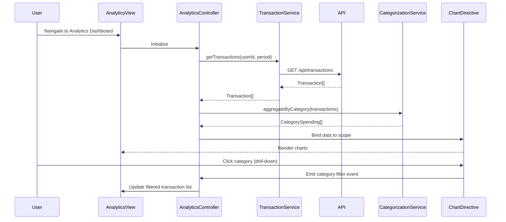

# Low-Level Design: Spending Analytics and Insights
**Epic ID**: QE-10092

## a. Architecture Mapping

- **Analytics Dashboard Module** (`app.analytics`) → Main AngularJS module
- **AnalyticsController** → Manages dashboard state, user interactions, and visualization data binding
- **TransactionService** → Factory for REST API calls to retrieve transaction data
- **CategorizationService** → Service for client-side category filtering and aggregation logic
- **ChartDirective** (`<spending-chart>`) → Custom directive wrapping visualization library (e.g., Chart.js/D3.js)
- **TrendAnalysisService** → Factory for computing monthly trend calculations

**Folder Structure**:
```
/app
  /analytics
    analytics.module.js
    analytics.controller.js
    analytics.html
    /services
      transaction.service.js
      categorization.service.js
      trend-analysis.service.js
    /directives
      spending-chart.directive.js
```

## b. Component Specifications

| Name | Artifact Type | Responsibility | Key Dependencies |
|------|---------------|----------------|------------------|
| AnalyticsController | Controller | Orchestrates dashboard view, handles user interactions (date filters, category drill-down), binds data to chart directive | TransactionService, CategorizationService, TrendAnalysisService |
| TransactionService | Factory | Fetches transaction data from REST API endpoint `/api/transactions`, handles HTTP errors | $http, $q |
| CategorizationService | Service | Aggregates transactions by 9 predefined categories, calculates category totals | None |
| TrendAnalysisService | Factory | Computes monthly spending trends, returns time-series data for visualization | None |
| SpendingChartDirective | Directive | Renders interactive category and trend charts, handles drill-down events | Chart.js or D3.js library |

## c. Data Model

**Transaction Object**:
```javascript
{
  id: String,
  cardId: String,
  amount: Number,
  category: String, // One of: 'Food & Dining', 'Fuel', 'Shopping', 'Travel', 'Entertainment', 'Utilities', 'Healthcare', 'Education', 'Miscellaneous'
  merchant: String,
  date: Date,
  description: String
}
```

**CategorySpending Object**:
```javascript
{
  category: String,
  total: Number,
  transactionCount: Number,
  percentage: Number
}
```

**MonthlyTrend Object**:
```javascript
{
  month: String, // 'YYYY-MM'
  totalSpend: Number,
  categoryBreakdown: Array<CategorySpending>
}
```

## d. Data Flow

User navigates to analytics dashboard → AnalyticsController initializes and calls TransactionService.getTransactions() → Service makes GET request to `/api/transactions?userId={id}&period={months}` → API returns transaction array → CategorizationService.aggregateByCategory() processes transactions into CategorySpending objects → TrendAnalysisService.computeMonthlyTrends() generates MonthlyTrend array → Controller binds aggregated data to scope → SpendingChartDirective renders category pie chart and monthly trend line chart → User clicks category slice → Directive emits drill-down event → Controller filters transactions by selected category and updates view.

## e. Primary Sequence Diagram



## f. Implementation Notes

- Use AngularJS Dependency Injection to inject services into controller via constructor parameters
- Implement TransactionService using $http with promise-based error handling ($q)
- Leverage ES6 classes for services and controllers; use arrow functions for callbacks
- Integrate Chart.js via custom directive with isolated scope for reusability
- Apply Bootstrap grid system for responsive layout; use `ng-if` for conditional chart rendering based on data availability

## g. Error Handling

HTTP interceptor captures API errors; user-friendly notifications displayed via Bootstrap alerts; failed requests trigger retry with exponential backoff in TransactionService.

## h. Security Notes

Standard input validation and secure API calls assumed; API endpoints require token-based authentication via existing SSO.