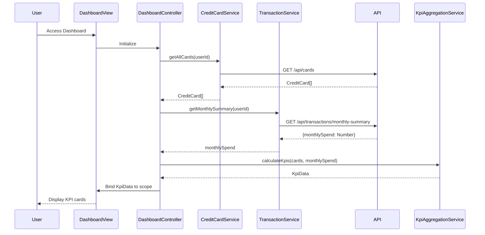

# Low-Level Design: Credit Card Dashboard and KPIs
**Epic ID**: QE-10093

## a. Architecture Mapping

- **Dashboard Module** (`app.dashboard`) → Main AngularJS module
- **DashboardController** → Manages KPI state, real-time refresh logic, and data binding
- **CreditCardService** → Factory for REST API calls to fetch card details, limits, and balances
- **TransactionService** → Factory for retrieving monthly spend totals
- **KpiAggregationService** → Service for client-side KPI calculations (total credit, available credit, outstanding)
- **RefreshDirective** (`<auto-refresh>`) → Directive for periodic data refresh

**Folder Structure**:
```
/app
  /dashboard
    dashboard.module.js
    dashboard.controller.js
    dashboard.html
    /services
      credit-card.service.js
      transaction.service.js
      kpi-aggregation.service.js
    /directives
      auto-refresh.directive.js
```

## b. Component Specifications

| Name | Artifact Type | Responsibility | Key Dependencies |
|------|---------------|----------------|------------------|
| DashboardController | Controller | Orchestrates dashboard view, triggers KPI aggregation, manages real-time refresh interval | CreditCardService, TransactionService, KpiAggregationService, $interval |
| CreditCardService | Factory | Fetches all user credit cards from `/api/cards`, retrieves balances and limits | $http, $q |
| TransactionService | Factory | Retrieves monthly spend totals from `/api/transactions/monthly-summary` | $http, $q |
| KpiAggregationService | Service | Aggregates KPIs: total credit limit, available credit, outstanding amount, monthly spend | None |
| AutoRefreshDirective | Directive | Implements periodic data refresh using $interval, triggers controller refresh method | $interval |

## c. Data Model

**CreditCard Object**:
```javascript
{
  cardId: String,
  cardNumber: String, // Masked
  cardType: String, // 'Visa', 'MasterCard', etc.
  creditLimit: Number,
  currentBalance: Number,
  availableCredit: Number
}
```

**KpiData Object**:
```javascript
{
  totalCreditLimit: Number,
  totalAvailableCredit: Number,
  totalOutstanding: Number,
  monthlySpend: Number,
  cardCount: Number
}
```

## d. Data Flow

User accesses dashboard → DashboardController initializes and calls CreditCardService.getAllCards() → Service makes GET request to `/api/cards?userId={id}` → API returns CreditCard array → Controller calls TransactionService.getMonthlySummary() → Service makes GET request to `/api/transactions/monthly-summary?userId={id}` → API returns monthly spend total → KpiAggregationService.calculateKpis(cards, monthlySpend) computes aggregated KPIs → Controller binds KpiData to scope → View renders KPI cards with Bootstrap responsive grid → AutoRefreshDirective triggers periodic refresh every 30 seconds → Controller re-fetches data and updates KPIs.

## e. Primary Sequence Diagram



## f. Implementation Notes

- Use AngularJS $interval service in AutoRefreshDirective for periodic refresh (configurable interval)
- Implement CreditCardService and TransactionService with $http; cache responses using $cacheFactory for sub-2-second load times
- Apply ES6 arrow functions and template literals for cleaner code
- Use Bootstrap cards and grid system for responsive KPI display (col-md-3 for desktop, col-sm-6 for tablet, col-xs-12 for mobile)
- Leverage AngularJS filters (currency, number) for formatting KPI values in view

## g. Error Handling

HTTP interceptor-based error handling with user notification via Bootstrap toast/alert components; retry logic in services for transient failures.

## h. Security Notes

Requires token-based auth via existing SSO; all API calls include Authorization header with JWT token.