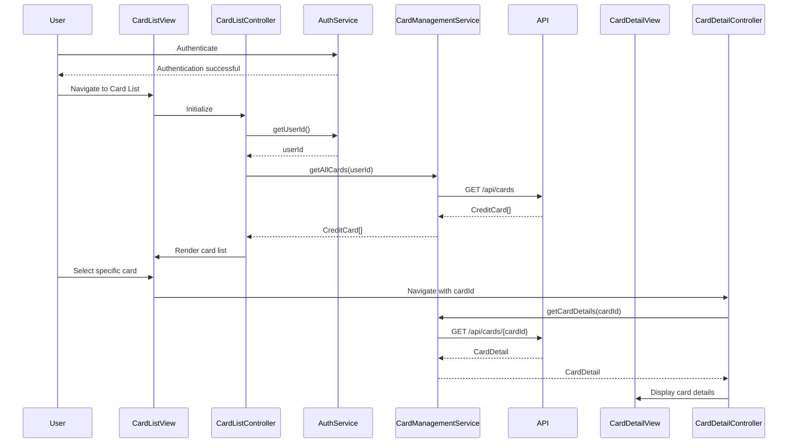

# Low-Level Design: Multiple Credit Card Management
**Epic ID**: QE-10094

## a. Architecture Mapping

- **Card Management Module** (`app.cardManagement`) → Main AngularJS module
- **CardListController** → Manages card list view, handles card selection and navigation
- **CardDetailController** → Manages individual card detail view with card-specific metrics
- **CardManagementService** → Factory for REST API calls to retrieve multiple cards and card-specific data
- **AuthService** → Service for user authentication and session management
- **CardSelectorDirective** (`<card-selector>`) → Directive for card selection UI component

**Folder Structure**:
```
/app
  /card-management
    card-management.module.js
    card-list.controller.js
    card-detail.controller.js
    card-list.html
    card-detail.html
    /services
      card-management.service.js
      auth.service.js
    /directives
      card-selector.directive.js
```

## b. Component Specifications

| Name | Artifact Type | Responsibility | Key Dependencies |
|------|---------------|----------------|------------------|
| CardListController | Controller | Displays list of all user cards, handles card selection, navigates to detail view | CardManagementService, AuthService, $state |
| CardDetailController | Controller | Displays selected card details (balance, limit, spending), handles card-specific actions | CardManagementService, $stateParams |
| CardManagementService | Factory | Fetches all user cards from `/api/cards`, retrieves card-specific details from `/api/cards/{id}` | $http, $q |
| AuthService | Service | Manages user authentication state, provides userId for API calls | $window (localStorage) |
| CardSelectorDirective | Directive | Renders card selection dropdown/list with card icons, emits selection events | None |

## c. Data Model

**CreditCard Object**:
```javascript
{
  cardId: String,
  cardNumber: String, // Masked (e.g., '**** **** **** 1234')
  cardHolderName: String,
  cardType: String, // 'Visa', 'MasterCard', 'Amex'
  creditLimit: Number,
  currentBalance: Number,
  availableCredit: Number,
  lastTransactionDate: Date
}
```

**CardDetail Object** (extends CreditCard):
```javascript
{
  ...CreditCard,
  monthlySpend: Number,
  transactions: Array<Transaction>,
  dueDate: Date,
  minimumPayment: Number
}
```

## d. Data Flow

User authenticates via AuthService → CardListController initializes and calls CardManagementService.getAllCards(userId) → Service makes GET request to `/api/cards?userId={id}` → API returns CreditCard array → Controller binds cards to scope → View renders card list using CardSelectorDirective with Bootstrap cards → User clicks specific card → Controller navigates to card detail state with cardId parameter → CardDetailController initializes and calls CardManagementService.getCardDetails(cardId) → Service makes GET request to `/api/cards/{cardId}` → API returns CardDetail object → Controller binds card details to scope → View displays card-specific metrics and recent transactions.

## e. Primary Sequence Diagram



## f. Implementation Notes

- Use ui-router for state management; define states for card list (`cardManagement.list`) and card detail (`cardManagement.detail`)
- Implement CardManagementService with $http; use $q promises for async operations
- Apply ES6 classes for controllers and services; use const/let for variable declarations
- Leverage Bootstrap list-group for card list rendering; use card component for detail view
- Optimize card switching with client-side caching to achieve sub-500ms response time

## g. Error Handling

Interceptor-based error handling with try/catch blocks in service methods; display user-friendly error messages using Bootstrap alerts.

## h. Security Notes

Requires token-based auth via existing SSO; AuthService stores JWT token in localStorage and includes in all API request headers.