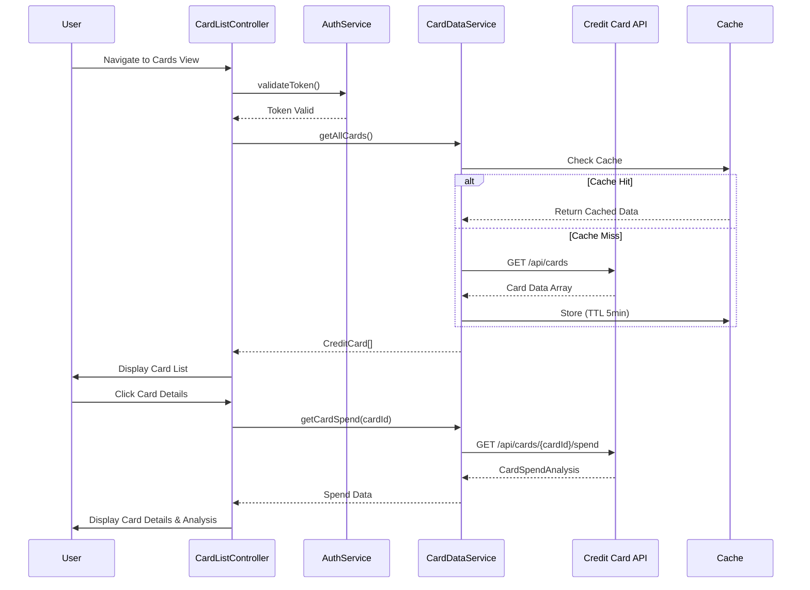

# Low-Level Design: Multiple Credit Cards Management
**Epic ID:** QE-10095  
**Technology Stack:** AngularJS 1.x, JavaScript ES6, HTML5, CSS3, Bootstrap, REST APIs, MVC Architecture

---

## a. Architecture Mapping

- **Card Management Module** → AngularJS Module (`cardManagementModule`)
- **User Interface** → AngularJS Controller (`CardListController`, `CardDetailController`)
- **API Layer** → AngularJS Service/Factory (`CardDataService`)
- **User Authentication Service** → AngularJS Service (`AuthService`)
- **Card Database Integration** → REST API calls via `$http` service

**Recommended Folder Structure:**
```
/app
  /modules
    /card-management
      /controllers
      /services
      /views
      /directives
  /shared
    /services (AuthService)
```

---

## b. Component Specifications

| Name | Artifact Type | Responsibility | Key Dependencies |
|------|--------------|----------------|------------------|
| cardManagementModule | Module | Root module for credit card management features | angular, ngRoute, authModule |
| CardListController | Controller | Manages display of multiple credit cards list view | CardDataService, AuthService, $scope |
| CardDetailController | Controller | Handles individual card detail view and card-wise spend analysis | CardDataService, $routeParams, $scope |
| CardDataService | Factory | Fetches card data from REST API with caching (5-min TTL) | $http, $q, $cacheFactory |
| AuthService | Service | Validates user authentication tokens before API calls | $http, $window |
| cardListDirective | Directive | Renders card list with credit limit, balance, available credit | CardDataService |
| cardComparisonDirective | Directive | Provides side-by-side card comparison UI | None |

---

## c. Data Model

**CreditCard Object:**
```javascript
{
  cardId: String,
  cardNumber: String (masked, last 4 digits),
  cardHolderName: String,
  cardType: String, // Visa, MasterCard, Amex
  creditLimit: Number,
  outstandingBalance: Number,
  availableCredit: Number,
  expiryDate: String, // MM/YY
  isActive: Boolean
}
```

**CardSpendAnalysis Object:**
```javascript
{
  cardId: String,
  monthlySpend: Number,
  categoryBreakdown: Array<{category: String, amount: Number}>,
  lastUpdated: Date
}
```

---

## d. Data Flow

User navigates to card management view → CardListController initializes and calls CardDataService.getAllCards() → AuthService validates session token → CardDataService makes REST API call to Credit Card Data Service with caching → API returns card array → Controller binds data to $scope → cardListDirective renders card tiles with Bootstrap grid → User clicks card for details → CardDetailController fetches card-wise spend via CardDataService.getCardSpend(cardId) → View updates with individual card metrics and comparison options.

---

## e. Primary Sequence Diagram



---

## f. Implementation Notes

- Use AngularJS Dependency Injection for all services and controllers; register via module.controller() and module.factory().
- Implement $cacheFactory with 5-minute TTL for card data to meet 3-second retrieval NFR and reduce API calls.
- Use $http interceptors for adding authentication headers (Bearer token) to all outgoing API requests.
- Apply Bootstrap grid (col-md-4) for responsive card tiles; use ng-repeat for card list rendering.
- Leverage ES6 arrow functions and template literals in service layer for cleaner promise handling.

---

## g. Error Handling

HTTP interceptor captures API errors (401, 403, 500); displays user-friendly notifications via toastr or Bootstrap alerts; redirects to login on auth failure.

---

## h. Security Notes

Requires token-based auth via existing SSO; all API calls include Authorization header validated by AuthService before execution.