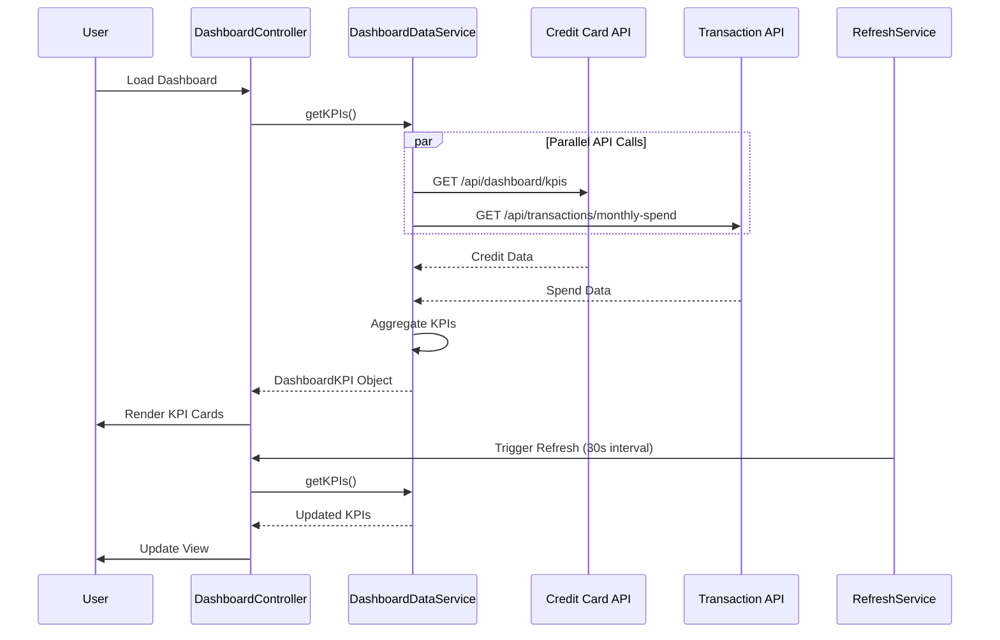

# Low-Level Design: Dashboard KPIs and Credit Card Overview
**Epic ID:** QE-10096  
**Technology Stack:** AngularJS 1.x, JavaScript ES6, HTML5, CSS3, Bootstrap, REST APIs, MVC Architecture

---

## a. Architecture Mapping

- **Dashboard UI Component** → AngularJS Controller (`DashboardController`)
- **API Gateway** → AngularJS Service (`DashboardDataService`)
- **Credit Card Data Service** → REST API endpoint `/api/dashboard/kpis`
- **Transaction Data Service** → REST API endpoint `/api/transactions/monthly-spend`
- **Database** → Backend integration (out of scope for LLD)

**Recommended Folder Structure:**
```
/app
  /modules
    /dashboard
      /controllers
      /services
      /views
      /directives
  /shared
    /filters
```

---

## b. Component Specifications

| Name | Artifact Type | Responsibility | Key Dependencies |
|------|--------------|----------------|------------------|
| dashboardModule | Module | Root module for dashboard features | angular, ngRoute |
| DashboardController | Controller | Orchestrates KPI data fetching and binding to view | DashboardDataService, $scope, $interval |
| DashboardDataService | Factory | Fetches aggregated KPI data from REST APIs | $http, $q |
| kpiCardDirective | Directive | Renders individual KPI card (Monthly Spend, Credit Limit, etc.) | None |
| refreshService | Service | Manages auto-refresh of KPIs every 30-60 seconds | $interval, DashboardDataService |
| currencyFormatFilter | Filter | Formats currency values for display | None |

---

## c. Data Model

**DashboardKPI Object:**
```javascript
{
  monthlySpend: Number,
  totalCreditLimit: Number,
  availableCredit: Number,
  outstandingAmount: Number,
  cardCount: Number,
  lastUpdated: Date
}
```

---

## d. Data Flow

User lands on dashboard → DashboardController initializes and calls DashboardDataService.getKPIs() → Service makes parallel REST API calls to Credit Card Data Service and Transaction Data Service → Backend aggregates data from database → API returns DashboardKPI object → Controller binds to $scope → kpiCardDirective renders four KPI cards using Bootstrap grid → refreshService triggers $interval to re-fetch KPIs every 30 seconds → View updates automatically via two-way data binding.

---

## e. Primary Sequence Diagram



---

## f. Implementation Notes

- Use $q.all() for parallel API calls to Credit Card and Transaction services to optimize load time under 2 seconds.
- Implement $interval in refreshService with 30-second delay for near real-time KPI updates; cancel interval on $scope.$destroy.
- Apply Bootstrap responsive grid (col-xs-12 col-sm-6 col-md-3) for KPI cards to ensure mobile/tablet/desktop compatibility.
- Use AngularJS filters (currency, number) for formatting KPI values in the view layer.
- Leverage ES6 promises and async/await patterns in service layer for cleaner asynchronous code.

---

## g. Error Handling

$http interceptor captures API failures; displays error toast notification; retries failed requests once before showing user-facing error message.

---

## h. Security Notes

Standard input validation and secure API calls assumed; dashboard data is user-scoped and requires authenticated session.