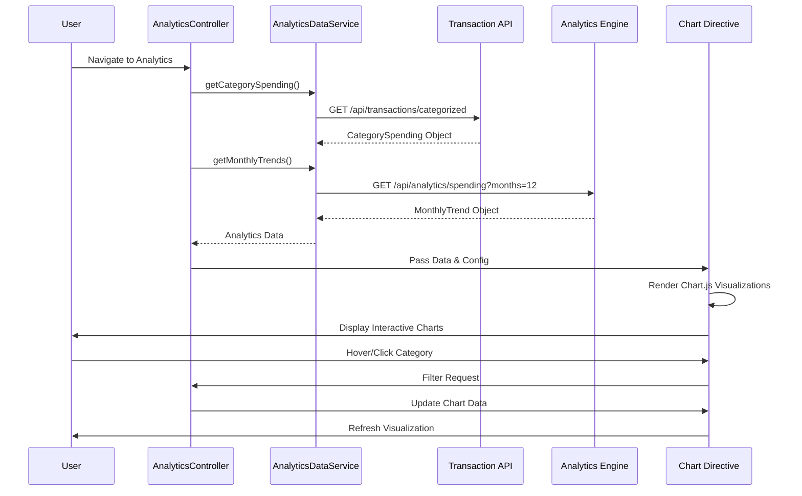

# Low-Level Design: Spending Analytics and Trend Visualization
**Epic ID:** QE-10097  
**Technology Stack:** AngularJS 1.x, JavaScript ES6, HTML5, CSS3, Bootstrap, REST APIs, MVC Architecture, Chart.js

---

## a. Architecture Mapping

- **Analytics UI Module** → AngularJS Controller (`AnalyticsController`)
- **API Gateway** → AngularJS Service (`AnalyticsDataService`)
- **Analytics Engine** → REST API endpoint `/api/analytics/spending`
- **Transaction Data Service** → REST API endpoint `/api/transactions/categorized`
- **Category Classification Service** → Backend service (pre-processed data)
- **Visualization Components** → AngularJS Directive (`spendingChartDirective`) with Chart.js

**Recommended Folder Structure:**
```
/app
  /modules
    /analytics
      /controllers
      /services
      /views
      /directives
  /shared
    /chart-config
```

---

## b. Component Specifications

| Name | Artifact Type | Responsibility | Key Dependencies |
|------|--------------|----------------|------------------|
| analyticsModule | Module | Root module for analytics and visualization features | angular, ngRoute, chart.js |
| AnalyticsController | Controller | Manages analytics data fetching and chart configuration | AnalyticsDataService, $scope, $filter |
| AnalyticsDataService | Factory | Fetches categorized spending and trend data from REST APIs | $http, $q |
| spendingChartDirective | Directive | Renders interactive pie/bar charts for category-wise spending using Chart.js | Chart.js library |
| trendChartDirective | Directive | Renders line chart for monthly spend trends over 12 months | Chart.js library |
| categoryFilterService | Service | Filters spending data by selected categories and date ranges | None |

---

## c. Data Model

**CategorySpending Object:**
```javascript
{
  categories: Array<{
    name: String, // Food & Dining, Fuel, Shopping, Travel, Entertainment, Utilities, Healthcare, Education, Miscellaneous
    amount: Number,
    percentage: Number,
    transactionCount: Number
  }>,
  totalSpend: Number,
  period: String // e.g., "2023-01"
}
```

**MonthlyTrend Object:**
```javascript
{
  months: Array<String>, // ["2023-01", "2023-02", ...]
  spendData: Array<Number>, // [1500, 1800, ...]
  categoryTrends: Object // {Food: [500, 600, ...], Fuel: [200, 250, ...]}
}
```

---

## d. Data Flow

User navigates to analytics view → AnalyticsController calls AnalyticsDataService.getCategorySpending() and getMonthlyTrends() → Service makes REST API calls to Transaction Data Service and Analytics Engine → Backend returns pre-aggregated CategorySpending and MonthlyTrend objects → Controller processes data and configures Chart.js options → spendingChartDirective and trendChartDirective render interactive charts → User interacts with chart (hover, click) → Directive updates tooltip and filters data via categoryFilterService → View refreshes with filtered results.

---

## e. Primary Sequence Diagram



---

## f. Implementation Notes

- Integrate Chart.js library via CDN or npm; wrap in AngularJS directive for reusable chart components.
- Use AngularJS $watch in chart directives to re-render charts when data model changes.
- Implement lazy loading for 12-month historical data; fetch on-demand when user expands trend view.
- Apply Bootstrap responsive classes (col-md-6) for side-by-side chart layout on desktop; stack on mobile.
- Use ES6 array methods (map, reduce, filter) in AnalyticsDataService for data transformation and aggregation.

---

## g. Error Handling

$http interceptor handles API errors; displays user-friendly message ("Unable to load analytics data") via Bootstrap alert; provides retry button.

---

## h. Security Notes

Standard input validation and secure API calls assumed; analytics data is user-scoped and requires authenticated session with read-only access.