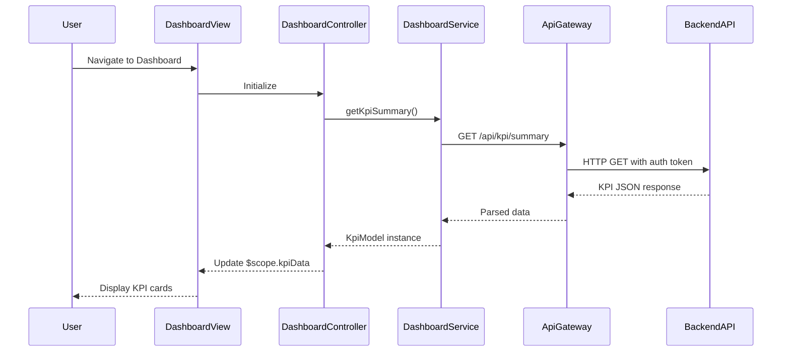

# Low-Level Design: Dashboard and Financial KPI Overview
**Epic ID:** QE-10098

## a. Architecture Mapping

- **Dashboard UI Component** → AngularJS Module (`app.dashboard`) + Controller (`DashboardController`) + View Template (`dashboard.html`)
- **API Gateway** → AngularJS Service (`ApiGatewayService`) using `$http` for REST calls
- **KPI Calculation Engine** → Backend REST API endpoints (`/api/kpi/summary`, `/api/kpi/monthly-spend`)
- **Credit Card Data Repository** → Backend data service accessed via REST API
- **Transaction Data Store** → Backend data service accessed via REST API

**Recommended Folder Structure:**
```
app/
├── modules/
│   └── dashboard/
│       ├── dashboard.module.js
│       ├── dashboard.controller.js
│       ├── dashboard.service.js
│       └── dashboard.html
├── shared/
│   └── services/
│       └── api-gateway.service.js
└── models/
    └── kpi.model.js
```

## b. Component Specifications

| Component Name | Artifact Type | Responsibility | Key Dependencies |
|----------------|---------------|----------------|------------------|
| DashboardModule | AngularJS Module | Defines dashboard feature module and routing | `ngRoute`, `ui.bootstrap` |
| DashboardController | Controller | Manages dashboard state, fetches KPI data, handles user interactions | `DashboardService`, `$scope` |
| DashboardService | Factory | Fetches aggregated KPI data from backend APIs | `ApiGatewayService`, `$q` |
| ApiGatewayService | Service | Centralizes HTTP calls with authentication headers and error handling | `$http`, `AuthService` |
| KpiModel | ES6 Class | Represents KPI data structure (monthly spend, credit limit, available credit, outstanding) | None |
| dashboard.html | View Template | Renders KPI cards in responsive grid layout using Bootstrap | Bootstrap CSS, AngularJS directives |

## c. Data Model

**KpiModel (ES6 Class):**
```javascript
class KpiModel {
  constructor(data) {
    this.monthlySpend = data.monthlySpend || 0;          // Number
    this.totalCreditLimit = data.totalCreditLimit || 0;  // Number
    this.availableCredit = data.availableCredit || 0;    // Number
    this.outstandingAmount = data.outstandingAmount || 0;// Number
    this.lastUpdated = data.lastUpdated || new Date();   // Date
  }
}
```

## d. Data Flow

User navigates to dashboard → `DashboardController` initializes and calls `DashboardService.getKpiSummary()` → Service invokes `ApiGatewayService` to make GET request to `/api/kpi/summary` → Backend aggregates data from Credit Card Data Repository and Transaction Data Store → API returns JSON with KPI metrics → Service transforms response into `KpiModel` instance → Controller updates `$scope.kpiData` → View renders KPI cards (monthly spend, total credit limit, available credit, outstanding amount) in responsive Bootstrap grid.

## e. Primary Sequence Diagram



## f. Implementation Notes

- Use AngularJS 1.x module pattern with dependency injection for all controllers and services
- Implement ES6 classes for data models with constructor-based initialization
- Use `$http` service wrapped in `ApiGatewayService` for centralized REST API calls with token-based authentication
- Apply Bootstrap responsive grid (col-xs-*, col-md-*) for KPI card layout to ensure mobile/tablet/desktop compatibility
- Leverage `$q` promises for asynchronous data fetching with proper `.then()` and `.catch()` chains

## g. Error Handling

HTTP interceptor in `ApiGatewayService` catches API errors, logs them, and displays user-friendly notifications via Bootstrap alerts or toast service.

## h. Security Notes

Requires token-based authentication via existing SSO; all API calls include Authorization header with JWT token.