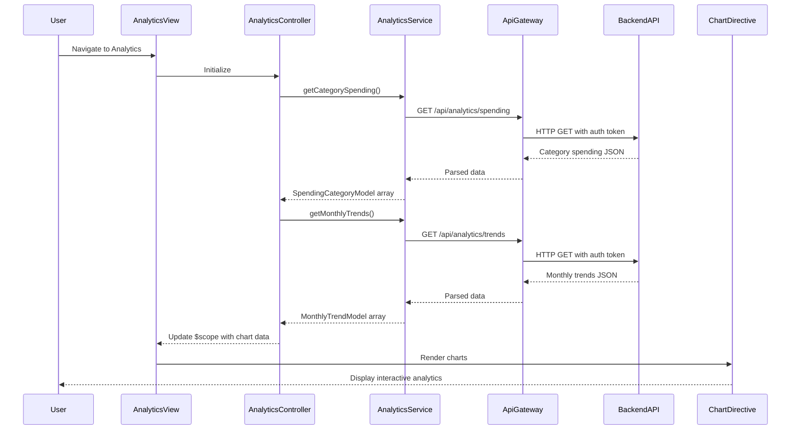

# Low-Level Design: Spending Analytics and Transaction Insights
**Epic ID:** QE-10099

## a. Architecture Mapping

- **Analytics Dashboard UI** → AngularJS Module (`app.analytics`) + Controller (`AnalyticsController`) + View Template (`analytics.html`)
- **API Gateway** → AngularJS Service (`ApiGatewayService`) using `$http` for REST calls
- **Analytics Engine** → Backend REST API endpoints (`/api/analytics/spending`, `/api/analytics/trends`)
- **Transaction Data Repository** → Backend data service accessed via REST API
- **Categorization Service** → Backend service (transparent to frontend)
- **Visualization Library** → AngularJS Directive wrapping Chart.js (`chartDirective`)

**Recommended Folder Structure:**
```
app/
├── modules/
│   └── analytics/
│       ├── analytics.module.js
│       ├── analytics.controller.js
│       ├── analytics.service.js
│       └── analytics.html
├── shared/
│   ├── services/
│   │   └── api-gateway.service.js
│   └── directives/
│       └── chart.directive.js
└── models/
    ├── spending-category.model.js
    └── monthly-trend.model.js
```

## b. Component Specifications

| Component Name | Artifact Type | Responsibility | Key Dependencies |
|----------------|---------------|----------------|------------------|
| AnalyticsModule | AngularJS Module | Defines analytics feature module and routing | `ngRoute`, `chart.js` |
| AnalyticsController | Controller | Manages analytics state, fetches spending data, prepares chart data | `AnalyticsService`, `$scope`, `$filter` |
| AnalyticsService | Factory | Fetches category-wise spending and monthly trends from backend APIs | `ApiGatewayService`, `$q` |
| ChartDirective | Directive | Wraps Chart.js library to render interactive pie/bar/line charts | `Chart.js`, `$timeout` |
| SpendingCategoryModel | ES6 Class | Represents category spending (category name, amount, percentage) | None |
| MonthlyTrendModel | ES6 Class | Represents monthly spend trend (month, total spend) | None |
| analytics.html | View Template | Renders category breakdown and trend charts in responsive layout | Bootstrap CSS, ChartDirective |

## c. Data Model

**SpendingCategoryModel (ES6 Class):**
```javascript
class SpendingCategoryModel {
  constructor(data) {
    this.category = data.category || '';        // String (Food and Dining, Fuel, Shopping, etc.)
    this.amount = data.amount || 0;             // Number
    this.percentage = data.percentage || 0;     // Number (0-100)
    this.transactionCount = data.transactionCount || 0; // Number
  }
}
```

**MonthlyTrendModel (ES6 Class):**
```javascript
class MonthlyTrendModel {
  constructor(data) {
    this.month = data.month || '';              // String (YYYY-MM format)
    this.totalSpend = data.totalSpend || 0;     // Number
  }
}
```

## d. Data Flow

User navigates to analytics dashboard → `AnalyticsController` initializes and calls `AnalyticsService.getCategorySpending()` and `AnalyticsService.getMonthlyTrends()` → Service invokes `ApiGatewayService` to make GET requests to `/api/analytics/spending` and `/api/analytics/trends` → Backend retrieves transactions from Transaction Data Repository, applies Categorization Service to classify into nine categories, and aggregates data → API returns JSON arrays with category breakdowns and monthly trends → Service transforms responses into `SpendingCategoryModel` and `MonthlyTrendModel` instances → Controller updates `$scope.categoryData` and `$scope.trendData` → `ChartDirective` renders interactive pie chart (category breakdown) and line chart (monthly trends) using Chart.js → User interacts with charts to explore spending patterns.

## e. Primary Sequence Diagram



## f. Implementation Notes

- Use AngularJS 1.x module pattern with dependency injection for controllers, services, and directives
- Implement custom directive wrapping Chart.js for reusable chart components with two-way data binding
- Use `$http` service via `ApiGatewayService` for REST API calls with token-based authentication
- Apply AngularJS `$filter` service for date formatting and currency display in charts
- Ensure Chart.js configuration includes responsive: true and maintainAspectRatio: false for mobile compatibility

## g. Error Handling

HTTP interceptor in `ApiGatewayService` catches API errors, logs them, and displays user-friendly notifications; chart rendering failures handled with try/catch and fallback message.

## h. Security Notes

Requires token-based authentication via existing SSO; all API calls include Authorization header with JWT token.