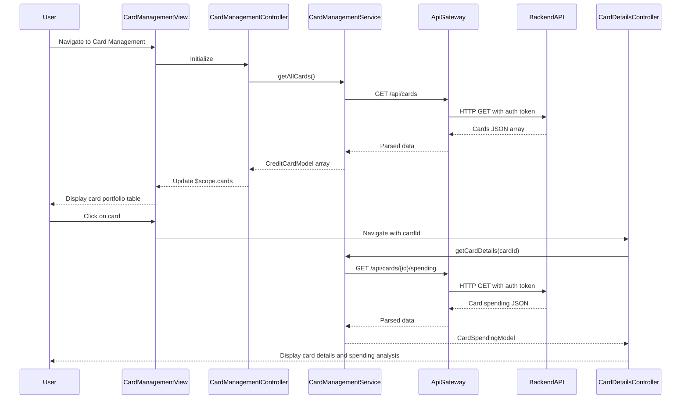

# Low-Level Design: Multi-Card Management and Monitoring
**Epic ID:** QE-10100

## a. Architecture Mapping

- **Card Management UI** → AngularJS Module (`app.cardManagement`) + Controller (`CardManagementController`) + View Template (`card-management.html`)
- **API Gateway** → AngularJS Service (`ApiGatewayService`) using `$http` for REST calls
- **Card Management Service** → Backend REST API endpoints (`/api/cards`, `/api/cards/{id}`, `/api/cards/{id}/spending`)
- **Credit Card Data Service** → Backend data service accessed via REST API
- **Transaction Processing System** → Backend service accessed via REST API
- **Spend Analysis Module** → Backend service (transparent to frontend)

**Recommended Folder Structure:**
```
app/
├── modules/
│   └── card-management/
│       ├── card-management.module.js
│       ├── card-management.controller.js
│       ├── card-details.controller.js
│       ├── card-management.service.js
│       ├── card-management.html
│       └── card-details.html
├── shared/
│   └── services/
│       └── api-gateway.service.js
└── models/
    ├── credit-card.model.js
    └── card-spending.model.js
```

## b. Component Specifications

| Component Name | Artifact Type | Responsibility | Key Dependencies |
|----------------|---------------|----------------|------------------|
| CardManagementModule | AngularJS Module | Defines card management feature module and routing | `ngRoute`, `ui.bootstrap` |
| CardManagementController | Controller | Manages card list view, fetches all cards, handles card selection | `CardManagementService`, `$scope`, `$location` |
| CardDetailsController | Controller | Manages individual card detail view, fetches card-specific spending data | `CardManagementService`, `$scope`, `$routeParams` |
| CardManagementService | Factory | Fetches card list, individual card details, and card-wise spending from backend APIs | `ApiGatewayService`, `$q` |
| CreditCardModel | ES6 Class | Represents credit card data (card number, limit, available credit, outstanding, issuer) | None |
| CardSpendingModel | ES6 Class | Represents card-specific spending data (card ID, monthly spend, transaction count) | None |
| card-management.html | View Template | Renders card portfolio overview with card comparison table using Bootstrap | Bootstrap CSS, AngularJS directives |
| card-details.html | View Template | Renders individual card details and spending analysis | Bootstrap CSS, AngularJS directives |

## c. Data Model

**CreditCardModel (ES6 Class):**
```javascript
class CreditCardModel {
  constructor(data) {
    this.cardId = data.cardId || '';                    // String (unique identifier)
    this.cardNumber = data.cardNumber || '';            // String (masked, e.g., **** 1234)
    this.cardholderName = data.cardholderName || '';    // String
    this.issuer = data.issuer || '';                    // String (Visa, Mastercard, etc.)
    this.creditLimit = data.creditLimit || 0;           // Number
    this.availableCredit = data.availableCredit || 0;   // Number
    this.outstandingAmount = data.outstandingAmount || 0; // Number
    this.status = data.status || 'Active';              // String (Active, Blocked, Expired)
  }
}
```

**CardSpendingModel (ES6 Class):**
```javascript
class CardSpendingModel {
  constructor(data) {
    this.cardId = data.cardId || '';                    // String
    this.monthlySpend = data.monthlySpend || 0;         // Number
    this.transactionCount = data.transactionCount || 0; // Number
    this.lastTransactionDate = data.lastTransactionDate || null; // Date
  }
}
```

## d. Data Flow

User navigates to card management interface → `CardManagementController` initializes and calls `CardManagementService.getAllCards()` → Service invokes `ApiGatewayService` to make GET request to `/api/cards` → Backend retrieves card data from Credit Card Data Service and card-wise spending from Transaction Processing System via Spend Analysis Module → API returns JSON array with all cards and their spending summaries → Service transforms response into `CreditCardModel` and `CardSpendingModel` instances → Controller updates `$scope.cards` → View renders card portfolio table with comparison metrics (credit limit, available credit, monthly spend, outstanding) → User clicks on a card → `CardDetailsController` fetches detailed card info via `CardManagementService.getCardDetails(cardId)` → Detailed view displays individual card performance and spending analysis.

## e. Primary Sequence Diagram



## f. Implementation Notes

- Use AngularJS 1.x module pattern with dependency injection for all controllers and services
- Implement ES6 classes for `CreditCardModel` and `CardSpendingModel` with constructor-based initialization
- Use `$http` service wrapped in `ApiGatewayService` for centralized REST API calls with token-based authentication
- Apply AngularJS `$routeParams` to pass cardId between list and detail views
- Use Bootstrap table component with responsive classes for card comparison view to ensure scalability with multiple cards

## g. Error Handling

HTTP interceptor in `ApiGatewayService` catches API errors, logs them, and displays user-friendly notifications via Bootstrap alerts.

## h. Security Notes

Requires token-based authentication via existing SSO; all API calls include Authorization header with JWT token; card numbers are masked on frontend.