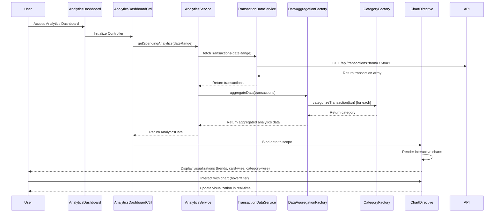

# Low-Level Design: QE-10101 - Spending Analytics and Insights

## a. Architecture Mapping

- **Analytics Dashboard UI** → AngularJS Module (`analytics.module.js`) + Controller (`AnalyticsDashboardController`)
- **Analytics Service** → AngularJS Service (`AnalyticsService`) for business logic and data orchestration
- **Data Aggregation Engine** → AngularJS Factory (`DataAggregationFactory`) for transaction processing and categorization
- **Visualization Renderer** → AngularJS Directive (`chartRenderer`) wrapping Chart.js or D3.js for interactive visualizations
- **Transaction Data Service** → AngularJS Service (`TransactionDataService`) for REST API calls
- **Category Engine** → AngularJS Factory (`CategoryFactory`) for mapping transactions to 9 predefined categories

**Recommended Folder Structure:**
```
app/
├── modules/
│   └── analytics/
│       ├── analytics.module.js
│       ├── controllers/
│       │   └── analytics-dashboard.controller.js
│       ├── services/
│       │   ├── analytics.service.js
│       │   └── transaction-data.service.js
│       ├── factories/
│       │   ├── data-aggregation.factory.js
│       │   └── category.factory.js
│       ├── directives/
│       │   └── chart-renderer.directive.js
│       └── views/
│           └── analytics-dashboard.html
```

## b. Component Specifications

| Component Name | Artifact Type | Responsibility | Key Dependencies |
|----------------|---------------|----------------|------------------|
| analytics.module | AngularJS Module | Module definition and routing configuration for analytics feature | ngRoute, chart library (Chart.js/D3.js) |
| AnalyticsDashboardController | Controller | Manages dashboard state, user interactions, and coordinates data flow between services and view | AnalyticsService, $scope |
| AnalyticsService | Service | Orchestrates data aggregation, processes analytics requests, and manages caching for performance | DataAggregationFactory, TransactionDataService |
| TransactionDataService | Service | Handles REST API calls to retrieve transaction data with date range filtering | $http, $q |
| DataAggregationFactory | Factory | Aggregates transactions by month/card, computes totals, and prepares data for visualization | CategoryFactory |
| CategoryFactory | Factory | Maps transactions to 9 categories (Food & Dining, Fuel, Shopping, Travel, Entertainment, Utilities, Healthcare, Education, Miscellaneous) | None |
| chartRenderer | Directive | Renders interactive, responsive charts; handles chart updates on data changes | Chart.js or D3.js library |

## c. Data Model

```javascript
// Transaction Model
class Transaction {
  id: String
  cardId: String
  amount: Number
  category: String  // One of 9 predefined categories
  description: String
  timestamp: Date
  merchantName: String
}

// Analytics Data Model
class AnalyticsData {
  monthlyTrends: Array<{month: String, totalSpend: Number}>
  cardWiseSpending: Array<{cardId: String, cardName: String, totalSpend: Number}>
  categoryWiseSpending: Array<{category: String, amount: Number, percentage: Number}>
  currentMonthTotal: Number
  previousMonthTotal: Number
}

// Chart Configuration Model
class ChartConfig {
  type: String  // 'line', 'bar', 'pie', 'doughnut'
  data: Object
  options: Object
  responsive: Boolean
}
```

## d. Data Flow

User accesses analytics dashboard → AnalyticsDashboardController initializes and calls AnalyticsService.getSpendingAnalytics() → AnalyticsService invokes TransactionDataService to fetch transaction data via REST API → DataAggregationFactory processes raw transactions, uses CategoryFactory to categorize each transaction into one of 9 categories, then aggregates by month and card → AnalyticsService returns structured AnalyticsData to controller → Controller binds data to $scope → chartRenderer directive watches scope changes and renders/updates interactive visualizations (monthly trends line chart, card-wise bar chart, category-wise pie chart) → User interacts with charts (hover, filter) triggering digest cycle and real-time UI updates.

## e. Primary Sequence Diagram



## f. Implementation Notes

- Use AngularJS dependency injection to inject services and factories into controllers and directives for testability and modularity.
- Implement ES6 classes for models and use arrow functions for callbacks to maintain lexical `this` context.
- Leverage AngularJS `$http` service with promise-based API calls; use `$q.all()` for parallel data fetching if needed.
- Integrate Chart.js via custom directive with two-way data binding; watch scope variables and call chart.update() on data changes.
- Apply Bootstrap grid system (col-md-*, col-sm-*) for responsive layout; use CSS3 media queries for fine-tuned mobile optimization.

## g. Error Handling

HTTP interceptor-based error handling with user-friendly toast notifications for API failures; try/catch blocks in aggregation logic with fallback to empty datasets.

## h. Security Notes

Standard input validation and secure API calls assumed; requires token-based auth via existing SSO for API access.