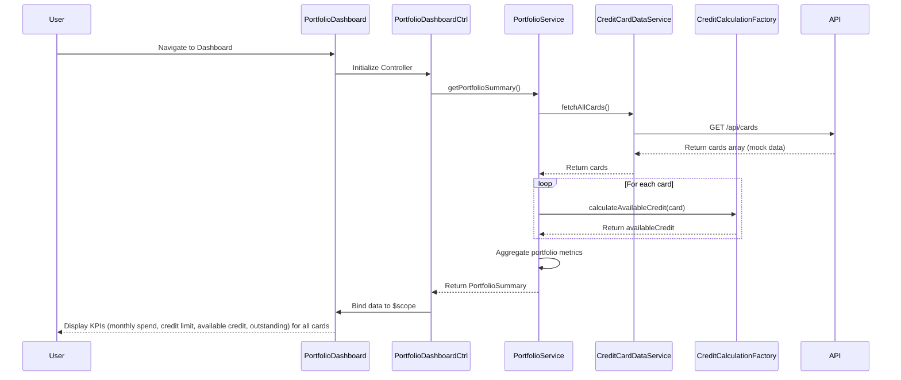

# Low-Level Design: QE-10102 - Credit Card Portfolio Management

## a. Architecture Mapping

- **User Dashboard UI** → AngularJS Module (`portfolio.module.js`) + Controller (`PortfolioDashboardController`)
- **Portfolio Management Service** → AngularJS Service (`PortfolioService`) for orchestrating card data retrieval and KPI computation
- **Credit Calculation Engine** → AngularJS Factory (`CreditCalculationFactory`) for computing available credit and aggregating metrics
- **Credit Card Data Service** → AngularJS Service (`CreditCardDataService`) for REST API calls to retrieve card information
- **Mock Data Service** → Backend REST API endpoint (`/api/cards`) returning mock credit card data

**Recommended Folder Structure:**
```
app/
├── modules/
│   └── portfolio/
│       ├── portfolio.module.js
│       ├── controllers/
│       │   └── portfolio-dashboard.controller.js
│       ├── services/
│       │   ├── portfolio.service.js
│       │   └── credit-card-data.service.js
│       ├── factories/
│       │   └── credit-calculation.factory.js
│       └── views/
│           └── portfolio-dashboard.html
```

## b. Component Specifications

| Component Name | Artifact Type | Responsibility | Key Dependencies |
|----------------|---------------|----------------|------------------|
| portfolio.module | AngularJS Module | Module definition and routing configuration for portfolio management | ngRoute |
| PortfolioDashboardController | Controller | Manages dashboard state, loads card data, and binds KPIs to view | PortfolioService, $scope |
| PortfolioService | Service | Orchestrates card data retrieval, invokes credit calculations, and manages portfolio state | CreditCardDataService, CreditCalculationFactory |
| CreditCardDataService | Service | Handles REST API calls to fetch credit card information from mock data service | $http, $q |
| CreditCalculationFactory | Factory | Computes available credit (Total Credit Limit - Outstanding Amount) and aggregates portfolio-level metrics | None |

## c. Data Model

```javascript
// Credit Card Model
class CreditCard {
  cardId: String
  cardNumber: String  // Masked, e.g., "**** **** **** 1234"
  cardType: String    // "Visa", "MasterCard", "Amex"
  cardHolderName: String
  totalCreditLimit: Number
  outstandingAmount: Number
  availableCredit: Number  // Computed: totalCreditLimit - outstandingAmount
  monthlySpend: Number
  expiryDate: String  // "MM/YY"
  status: String      // "Active", "Blocked", "Expired"
}

// Portfolio Summary Model
class PortfolioSummary {
  totalCards: Number
  totalCreditLimit: Number
  totalOutstanding: Number
  totalAvailableCredit: Number
  totalMonthlySpend: Number
  cards: Array<CreditCard>
}
```

## d. Data Flow

User navigates to portfolio dashboard → PortfolioDashboardController initializes and calls PortfolioService.getPortfolioSummary() → PortfolioService invokes CreditCardDataService.fetchAllCards() to retrieve card data via REST API call to /api/cards → CreditCardDataService returns array of card objects → PortfolioService passes each card to CreditCalculationFactory.calculateAvailableCredit() which computes availableCredit = totalCreditLimit - outstandingAmount → PortfolioService aggregates portfolio-level metrics (total cards, total credit limit, total outstanding, total available credit, total monthly spend) → PortfolioService returns PortfolioSummary to controller → Controller binds data to $scope → View renders responsive dashboard with KPI cards displaying metrics for each credit card and portfolio totals → User views consolidated portfolio across desktop, tablet, or mobile with Bootstrap responsive layout.

## e. Primary Sequence Diagram



## f. Implementation Notes

- Use AngularJS dependency injection to inject PortfolioService and other dependencies into PortfolioDashboardController.
- Implement ES6 classes for CreditCard and PortfolioSummary models; use const/let for variable declarations.
- Leverage AngularJS `$http` service for REST API calls with promise chaining; implement loading spinner during data fetch.
- Apply Bootstrap grid (row/col-*) and card components for responsive KPI display; use CSS3 flexbox for layout optimization.
- Implement one-time binding (::) in view templates for static data to improve performance with multiple cards.

## g. Error Handling

HTTP interceptor captures API errors and displays user-friendly error messages via toast notifications; try/catch in calculation logic with default values on failure.

## h. Security Notes

Requires token-based auth via existing SSO; card numbers must be masked on client-side; secure HTTPS API calls enforced.