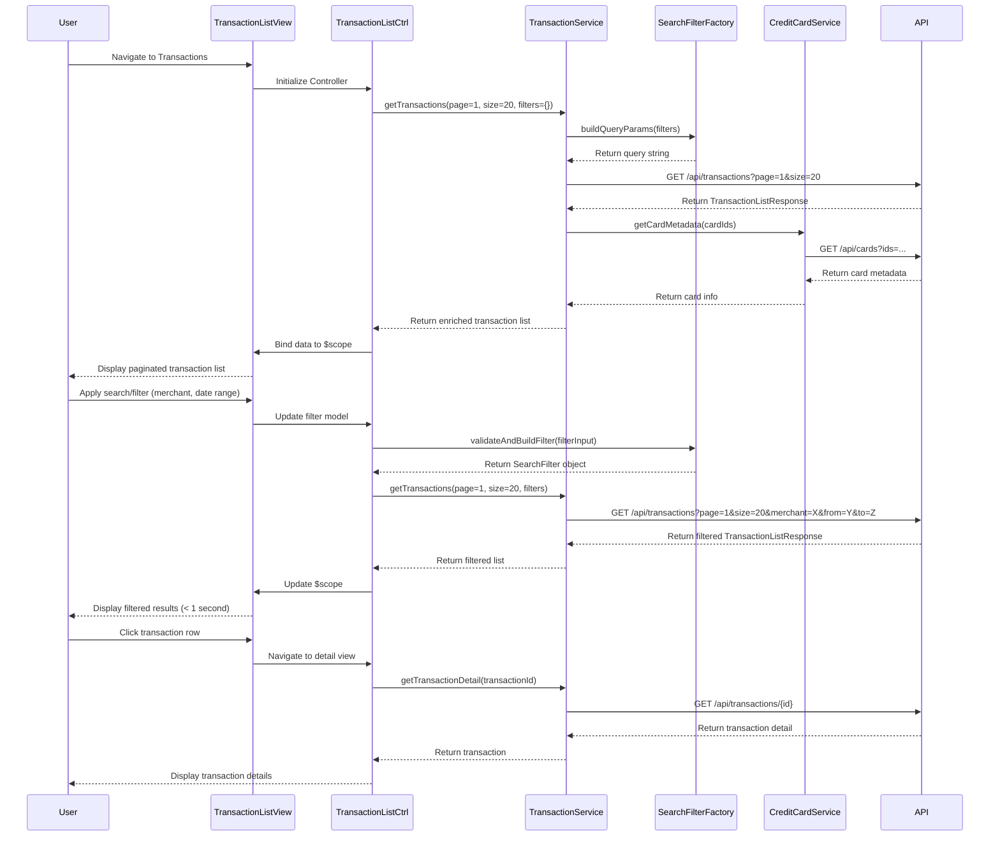

# Low-Level Design: QE-10103 - Transaction Management and Visibility

## a. Architecture Mapping

- **User Interface** → AngularJS Module (`transaction.module.js`) + Controller (`TransactionListController`) + View (`transaction-list.html`)
- **Transaction Service** → AngularJS Service (`TransactionService`) for business logic and data orchestration
- **Search and Filter Engine** → AngularJS Factory (`SearchFilterFactory`) for client-side filtering and server-side query building
- **Transaction Data Repository** → Backend REST API (`/api/transactions`) with pagination and filter support
- **Credit Card Data Source** → AngularJS Service (`CreditCardService`) for card metadata retrieval

**Recommended Folder Structure:**
```
app/
├── modules/
│   └── transaction/
│       ├── transaction.module.js
│       ├── controllers/
│       │   ├── transaction-list.controller.js
│       │   └── transaction-detail.controller.js
│       ├── services/
│       │   ├── transaction.service.js
│       │   └── credit-card.service.js
│       ├── factories/
│       │   └── search-filter.factory.js
│       └── views/
│           ├── transaction-list.html
│           └── transaction-detail.html
```

## b. Component Specifications

| Component Name | Artifact Type | Responsibility | Key Dependencies |
|----------------|---------------|----------------|------------------|
| transaction.module | AngularJS Module | Module definition and routing configuration for transaction management | ngRoute |
| TransactionListController | Controller | Manages transaction list display, pagination, search/filter state, and user interactions | TransactionService, SearchFilterFactory, $scope |
| TransactionDetailController | Controller | Manages single transaction detail view and related actions | TransactionService, $routeParams, $scope |
| TransactionService | Service | Orchestrates transaction data retrieval, caching, and multi-card aggregation | $http, $q, CreditCardService |
| SearchFilterFactory | Factory | Builds filter queries, applies client-side filtering, and manages filter state | None |
| CreditCardService | Service | Retrieves credit card metadata for multi-card transaction aggregation | $http |

## c. Data Model

```javascript
// Transaction Model
class Transaction {
  transactionId: String
  cardId: String
  cardNumber: String  // Masked
  amount: Number
  currency: String    // "USD", "EUR", etc.
  merchantName: String
  category: String
  transactionDate: Date
  transactionType: String  // "Debit", "Credit", "Refund"
  status: String      // "Completed", "Pending", "Failed"
  description: String
  location: String
}

// Transaction List Response Model
class TransactionListResponse {
  transactions: Array<Transaction>
  totalCount: Number
  pageNumber: Number
  pageSize: Number
  hasMore: Boolean
}

// Search Filter Model
class SearchFilter {
  cardId: String
  startDate: Date
  endDate: Date
  minAmount: Number
  maxAmount: Number
  category: String
  merchantName: String
  transactionType: String
  searchText: String
}
```

## d. Data Flow

User navigates to transaction list view → TransactionListController initializes with default pagination (page 1, size 20) and empty filters → Controller calls TransactionService.getTransactions(pageNumber, pageSize, filters) → TransactionService builds query parameters using SearchFilterFactory and makes REST API call to /api/transactions with pagination and filter params → API returns TransactionListResponse with paginated transaction array → TransactionService aggregates card metadata from CreditCardService for multi-card display → Service returns enriched transaction list to controller → Controller binds data to $scope → View renders transaction table with pagination controls → User applies search/filter (date range, amount, merchant, category) → SearchFilterFactory validates and builds filter object → Controller triggers new API call with updated filters (sub-second response per NFR) → View updates with filtered results → User clicks transaction row → Controller navigates to transaction detail view via $routeParams → TransactionDetailController loads single transaction details and displays in modal or separate view.

## e. Primary Sequence Diagram



## f. Implementation Notes

- Use AngularJS dependency injection for all services and factories; implement singleton pattern for TransactionService to enable caching.
- Implement ES6 classes for Transaction and filter models; use arrow functions in promise chains to maintain context.
- Leverage AngularJS `$http` service with interceptors for auth token injection; use `$q` for promise-based error handling.
- Apply server-side pagination via API query params (page, size); implement infinite scroll or "Load More" button for UX.
- Use Bootstrap table component with responsive utilities; apply CSS3 for mobile-optimized transaction card layout on small screens.

## g. Error Handling

HTTP interceptor-based error handling with retry logic for transient failures; user notifications via toast for API errors; try/catch in filter validation with fallback to default filters.

## h. Security Notes

Requires token-based auth via existing SSO; transaction data must be fetched over HTTPS; input validation on all filter parameters to prevent injection attacks.