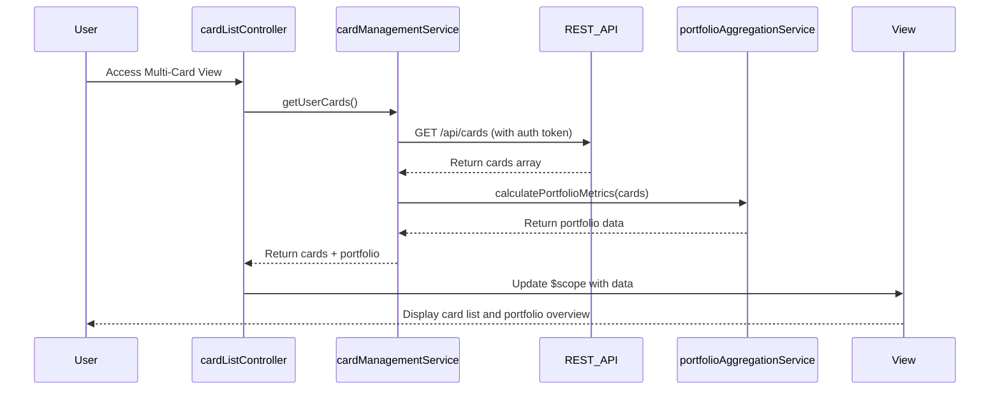

# Low-Level Design: Multi-Card Management and Visualization
**Epic ID:** QE-10116

## a. Architecture Mapping

- **cardManagementModule** (AngularJS Module) → Main module for multi-card features
- **cardListController** (Controller) → Manages card list display and navigation
- **cardDetailsController** (Controller) → Handles individual card detail view
- **cardComparisonController** (Controller) → Manages card comparison interface
- **cardManagementService** (Service) → Orchestrates card data operations and API calls
- **portfolioAggregationService** (Service) → Calculates portfolio-level metrics
- **cardComparisonFactory** (Factory) → Provides card comparison logic
- **cardListDirective** (Directive) → Renders card list with navigation

**Recommended Folder Structure:**
```
/app
  /modules
    /card-management
      /controllers
      /services
      /directives
      /views
  /models
  /shared
```

## b. Component Specifications

| Component Name | Artifact Type | Responsibility | Key Dependencies |
|----------------|---------------|----------------|------------------|
| cardManagementModule | Module | Root module for card management features | ngRoute, ngResource |
| cardListController | Controller | Display all user cards, handle navigation | cardManagementService, $scope |
| cardDetailsController | Controller | Show individual card details and usage | cardManagementService, $routeParams |
| cardComparisonController | Controller | Enable side-by-side card comparison | cardComparisonFactory, $scope |
| cardManagementService | Service | Fetch card data via REST API, manage state | $http, $q, authService |
| portfolioAggregationService | Service | Calculate total limits, balances, usage | cardManagementService |
| cardComparisonFactory | Factory | Compare card attributes, generate comparison data | None |
| cardListDirective | Directive | Render responsive card list with click handlers | cardManagementService |

## c. Data Model

**CreditCard Object:**
```javascript
{
  cardId: String,
  cardNumber: String (masked),
  cardType: String,
  cardName: String,
  totalLimit: Number,
  availableCredit: Number,
  outstandingBalance: Number,
  monthlySpend: Number,
  lastUpdated: Date
}
```

**Portfolio Object:**
```javascript
{
  userId: String,
  cards: Array<CreditCard>,
  totalCreditLimit: Number,
  totalOutstanding: Number,
  totalAvailableCredit: Number,
  cardCount: Number
}
```

## d. Data Flow

User authenticates and navigates to Multi-Card View → cardListController initializes and calls cardManagementService.getUserCards() → Service sends GET /api/cards to REST API with auth token → API returns array of card objects → portfolioAggregationService calculates portfolio metrics → Controller updates $scope with cards and portfolio data → cardListDirective renders card list → User clicks card for details → cardDetailsController loads specific card via $routeParams → View displays card-specific limits, balances, and usage → User selects comparison mode → cardComparisonController uses cardComparisonFactory to generate side-by-side comparison → UI updates with comparison table.

## e. Primary Sequence Diagram



## f. Implementation Notes

- Use AngularJS dependency injection for all services and controllers with explicit annotation for minification safety
- Implement card data caching in cardManagementService using $cacheFactory to reduce API calls
- Use $http interceptor for auth token injection and error handling across all API requests
- Apply ES6 arrow functions and const/let for service and factory implementations
- Bootstrap grid system (col-md-4, col-sm-6) for responsive card layout

## g. Error Handling

HTTP interceptor captures API errors; user-friendly notifications via toast/modal; retry logic for network failures.

## h. Security Notes

Requires token-based auth via existing SSO; card numbers masked client-side; secure API calls over HTTPS.