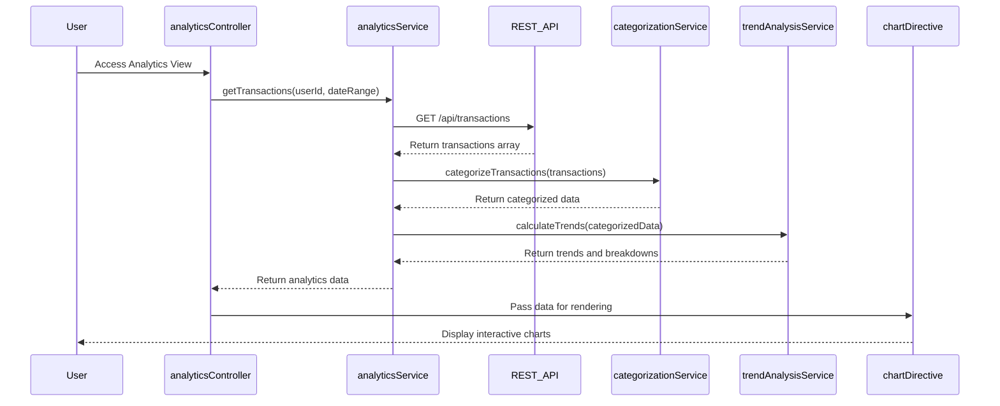

# Low-Level Design: Spending Analytics and Transaction Insights
**Epic ID:** QE-10117

## a. Architecture Mapping

- **analyticsModule** (AngularJS Module) → Main module for analytics features
- **analyticsController** (Controller) → Manages analytics view and user interactions
- **analyticsService** (Service) → Fetches transaction data and analytics via REST API
- **categorizationService** (Service) → Categorizes transactions into spending categories
- **trendAnalysisService** (Service) → Calculates monthly trends and patterns
- **chartDirective** (Directive) → Renders interactive charts using Chart.js/D3
- **categoryFilterFactory** (Factory) → Provides filtering logic for categories

**Recommended Folder Structure:**
```
/app
  /modules
    /analytics
      /controllers
      /services
      /directives
      /views
  /models
  /shared
```

## b. Component Specifications

| Component Name | Artifact Type | Responsibility | Key Dependencies |
|----------------|---------------|----------------|------------------|
| analyticsModule | Module | Root module for spending analytics | ngRoute, ngResource, chart.js |
| analyticsController | Controller | Manage analytics view, handle user filters | analyticsService, trendAnalysisService, $scope |
| analyticsService | Service | Fetch transaction data from REST API | $http, $q, authService |
| categorizationService | Service | Categorize transactions by predefined rules | None |
| trendAnalysisService | Service | Calculate monthly trends, patterns, breakdowns | categorizationService |
| chartDirective | Directive | Render interactive charts (bar, pie, line) | Chart.js or D3.js |
| categoryFilterFactory | Factory | Filter transactions by category and date range | None |

## c. Data Model

**Transaction Object:**
```javascript
{
  transactionId: String,
  cardId: String,
  amount: Number,
  merchantName: String,
  category: String,
  transactionDate: Date,
  description: String
}
```

**CategorySpending Object:**
```javascript
{
  category: String,
  totalAmount: Number,
  transactionCount: Number,
  percentage: Number
}
```

**MonthlyTrend Object:**
```javascript
{
  month: String,
  totalSpend: Number,
  categoryBreakdown: Array<CategorySpending>
}
```

## d. Data Flow

User navigates to Analytics View → analyticsController calls analyticsService.getTransactions() → Service sends GET /api/transactions?userId=X&dateRange=Y to REST API → API returns transaction array → categorizationService categorizes each transaction into Food, Fuel, Shopping, etc. → trendAnalysisService processes categorized data to calculate monthly trends and category breakdowns → Controller updates $scope with analytics data → chartDirective renders interactive bar chart for category spending and line chart for monthly trends → User interacts with chart filters → categoryFilterFactory applies filters → View updates with filtered analytics.

## e. Primary Sequence Diagram



## f. Implementation Notes

- Use Chart.js for lightweight, responsive chart rendering with AngularJS directive wrapper
- Implement lazy loading for transaction data using pagination to handle large volumes
- Apply ES6 Array methods (map, filter, reduce) in categorizationService and trendAnalysisService
- Use $http interceptor for auth token and error handling
- Bootstrap responsive grid for chart layout across devices

## g. Error Handling

HTTP interceptor for API errors; user notification via modal; graceful degradation if chart library fails.

## h. Security Notes

Standard input validation and secure API calls assumed; token-based authentication for transaction access.