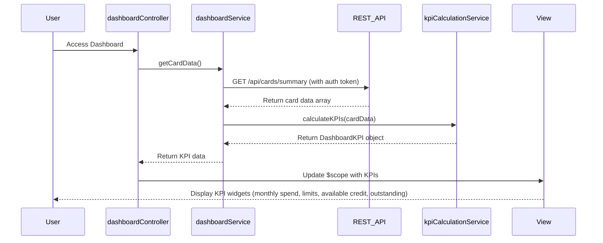

# Low-Level Design: Credit Card Dashboard and KPI Management
**Epic ID:** QE-10118

## a. Architecture Mapping

- **dashboardModule** (AngularJS Module) → Main module for dashboard features
- **dashboardController** (Controller) → Manages dashboard view and KPI display
- **dashboardService** (Service) → Fetches card data and orchestrates KPI calculation
- **kpiCalculationService** (Service) → Calculates KPIs (monthly spend, limits, available credit)
- **kpiWidgetDirective** (Directive) → Renders individual KPI widgets responsively
- **refreshFactory** (Factory) → Handles periodic data refresh logic

**Recommended Folder Structure:**
```
/app
  /modules
    /dashboard
      /controllers
      /services
      /directives
      /views
  /models
  /shared
```

## b. Component Specifications

| Component Name | Artifact Type | Responsibility | Key Dependencies |
|----------------|---------------|----------------|------------------|
| dashboardModule | Module | Root module for dashboard functionality | ngRoute, ngResource |
| dashboardController | Controller | Manage dashboard state, handle user actions | dashboardService, kpiCalculationService, $scope |
| dashboardService | Service | Fetch credit card data via REST API | $http, $q, authService |
| kpiCalculationService | Service | Calculate monthly spend, total limit, available credit, outstanding | dashboardService |
| kpiWidgetDirective | Directive | Render responsive KPI widgets with icons and values | None |
| refreshFactory | Factory | Provide auto-refresh logic for real-time updates | $interval |

## c. Data Model

**CreditCard Object:**
```javascript
{
  cardId: String,
  cardNumber: String,
  totalLimit: Number,
  outstandingAmount: Number,
  availableCredit: Number,
  monthlySpend: Number
}
```

**DashboardKPI Object:**
```javascript
{
  totalCreditLimit: Number,
  totalOutstanding: Number,
  totalAvailableCredit: Number,
  totalMonthlySpend: Number,
  cardCount: Number
}
```

## d. Data Flow

User authenticates and accesses Dashboard → dashboardController initializes and calls dashboardService.getCardData() → Service sends GET /api/cards/summary to REST API with auth token → API returns card data array → kpiCalculationService aggregates data to calculate total credit limit, total outstanding, total available credit, and monthly spend → Service returns DashboardKPI object to controller → Controller updates $scope with KPI data → kpiWidgetDirective renders each KPI in responsive Bootstrap grid → refreshFactory triggers periodic refresh every 5 minutes → Dashboard updates with latest KPI values.

## e. Primary Sequence Diagram



## f. Implementation Notes

- Use AngularJS $http service with promise chaining for API calls and error handling
- Implement KPI calculation using ES6 reduce method for aggregating card data
- Apply Bootstrap grid (col-lg-3, col-md-6) for responsive KPI widget layout
- Use $interval service in refreshFactory for periodic data refresh with cleanup on scope destroy
- Dependency injection with explicit array notation for minification compatibility

## g. Error Handling

HTTP interceptor captures API errors; user notification via toast; fallback to cached data if refresh fails.

## h. Security Notes

Requires token-based auth via existing SSO; secure HTTPS API calls; input validation on client side.