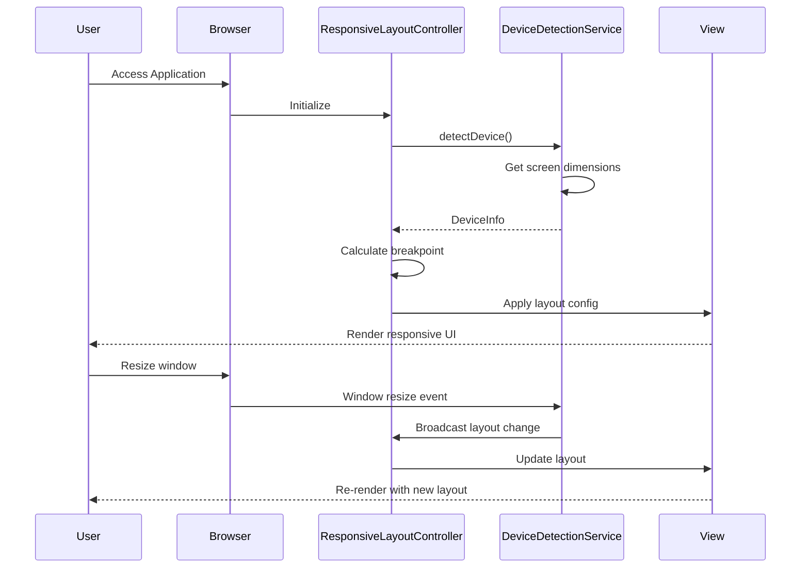

# Low-Level Design: QE-10137 - Responsive User Interface and Experience

## a. Architecture Mapping

- **AngularJS Module**: `creditCardApp.responsive` - Main module for responsive UI components
- **Controller**: `ResponsiveLayoutController` - Manages device detection and layout switching
- **Service**: `DeviceDetectionService` - Detects device type, screen size, and orientation
- **Service**: `ResponsiveUtilsService` - Provides utility functions for responsive breakpoints
- **Directive**: `responsiveContainer` - Adaptive container directive for responsive layouts
- **Directive**: `touchFriendly` - Ensures touch-friendly interactions (min 44x44px targets)

**Folder Structure:**
```
/app
  /modules
    /responsive
      responsive.module.js
      responsive.controller.js
      responsive-layout.controller.js
  /services
    device-detection.service.js
    responsive-utils.service.js
  /directives
    responsive-container.directive.js
    touch-friendly.directive.js
  /styles
    responsive.css
    breakpoints.css
```

## b. Component Specifications

| Name | Artifact Type | Responsibility | Key Dependencies |
|------|---------------|----------------|------------------|
| creditCardApp.responsive | Module | Root module for responsive UI functionality | angular, ngRoute |
| ResponsiveLayoutController | Controller | Manages layout state and device-specific rendering | DeviceDetectionService, $scope, $window |
| DeviceDetectionService | Service | Detects device type, screen size, orientation changes | $window, $rootScope |
| ResponsiveUtilsService | Service | Provides breakpoint calculations and responsive helpers | DeviceDetectionService |
| responsiveContainer | Directive | Wraps content with adaptive sizing based on device | ResponsiveUtilsService, $window |
| touchFriendly | Directive | Ensures minimum touch target sizes and gesture support | DeviceDetectionService |

## c. Data Model

```javascript
// DeviceInfo Model
DeviceInfo = {
  type: String,           // 'mobile', 'tablet', 'desktop'
  screenWidth: Number,    // Current screen width in pixels
  screenHeight: Number,   // Current screen height in pixels
  orientation: String,    // 'portrait', 'landscape'
  breakpoint: String,     // 'xs', 'sm', 'md', 'lg', 'xl'
  isTouchDevice: Boolean  // true if touch-enabled
}

// LayoutConfig Model
LayoutConfig = {
  containerWidth: String,  // CSS width value
  columnCount: Number,     // Number of grid columns
  fontSize: String,        // Base font size
  spacing: String          // Padding/margin values
}
```

## d. Data Flow

User accesses application → DeviceDetectionService detects device characteristics (screen size, touch capability) on app initialization → ResponsiveLayoutController receives device info and determines appropriate breakpoint → responsiveContainer directive applies layout configuration → View renders with device-optimized layout → On window resize or orientation change, DeviceDetectionService broadcasts update → ResponsiveLayoutController recalculates layout → UI updates dynamically without page reload.

## e. Primary Sequence Diagram



## f. Implementation Notes

- Use AngularJS $window service for device detection to enable testability via dependency injection
- Implement CSS Grid and Flexbox via Bootstrap 4+ grid system with custom breakpoints (320px, 768px, 1024px, 1440px, 2560px)
- Use $rootScope.$broadcast for orientation/resize events with debouncing (250ms) to optimize performance
- Lazy-load non-critical CSS and images using ng-if with device-type conditions
- Implement touch gestures using ng-swipe directives for mobile interactions

## g. Error Handling

HTTP interceptor catches API errors; client-side validation errors shown via Bootstrap alerts; graceful degradation for unsupported browsers.

## h. Security Notes

Standard input validation and secure API calls assumed.