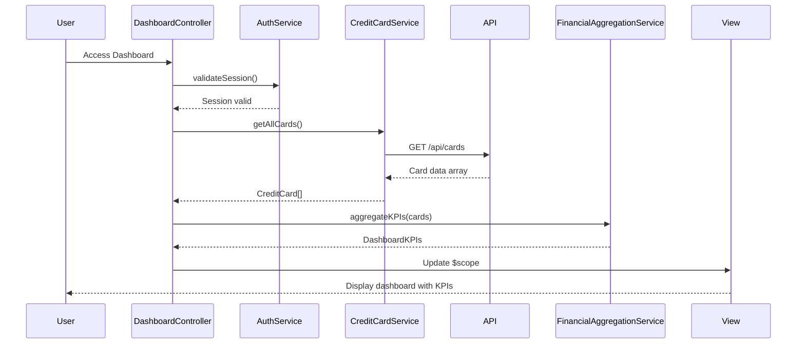

# Low-Level Design: QE-10138 - Dashboard and Credit Card Management

## a. Architecture Mapping

- **AngularJS Module**: `creditCardApp.dashboard` - Main dashboard module
- **Controller**: `DashboardController` - Manages dashboard state and KPI display
- **Service**: `CreditCardService` - Fetches credit card data via REST API
- **Service**: `FinancialAggregationService` - Aggregates multi-card financial metrics
- **Service**: `AuthService` - Handles user authentication and session management
- **Factory**: `CreditCardFactory` - Creates CreditCard model instances
- **Directive**: `kpiCard` - Displays individual KPI metrics

**Folder Structure:**
```
/app
  /modules
    /dashboard
      dashboard.module.js
      dashboard.controller.js
  /services
    credit-card.service.js
    financial-aggregation.service.js
    auth.service.js
  /factories
    credit-card.factory.js
  /directives
    kpi-card.directive.js
  /views
    dashboard.html
```

## b. Component Specifications

| Name | Artifact Type | Responsibility | Key Dependencies |
|------|---------------|----------------|------------------|
| creditCardApp.dashboard | Module | Root module for dashboard functionality | angular, ngRoute, creditCardApp.core |
| DashboardController | Controller | Orchestrates dashboard data loading and KPI calculations | CreditCardService, FinancialAggregationService, AuthService, $scope |
| CreditCardService | Service | Fetches credit card data from REST API (/api/cards) | $http, $q, AuthService |
| FinancialAggregationService | Service | Aggregates monthly spend, credit limits, available credit, outstanding amounts | CreditCardFactory |
| AuthService | Service | Validates user authentication and manages session tokens | $http, $window.localStorage |
| CreditCardFactory | Factory | Creates and validates CreditCard model objects | None |
| kpiCard | Directive | Renders individual KPI with icon, label, and value | None |

## c. Data Model

```javascript
// CreditCard Model
CreditCard = {
  cardId: String,              // Unique card identifier
  cardNumber: String,          // Masked card number (e.g., "**** 1234")
  cardType: String,            // 'Visa', 'MasterCard', 'Amex'
  cardHolderName: String,      // Cardholder name
  creditLimit: Number,         // Total credit limit
  outstandingAmount: Number,   // Current outstanding balance
  availableCredit: Number,     // Calculated: creditLimit - outstandingAmount
  monthlySpend: Number,        // Current month's spend
  expiryDate: String           // MM/YY format
}

// DashboardKPIs Model
DashboardKPIs = {
  totalMonthlySpend: Number,   // Sum of all cards' monthly spend
  totalCreditLimit: Number,    // Sum of all cards' credit limits
  totalAvailableCredit: Number,// Sum of all cards' available credit
  totalOutstanding: Number,    // Sum of all cards' outstanding amounts
  creditUtilization: Number    // Percentage: (totalOutstanding / totalCreditLimit) * 100
}
```

## d. Data Flow

User logs in → AuthService validates credentials and stores session token → DashboardController initializes and calls CreditCardService.getAllCards() → CreditCardService makes GET request to /api/cards with auth token → API returns array of card data → CreditCardFactory creates CreditCard model instances → FinancialAggregationService calculates DashboardKPIs by summing metrics across all cards → DashboardController updates $scope with cards and KPIs → View renders dashboard with kpiCard directives displaying metrics within 2-second load time.

## e. Primary Sequence Diagram



## f. Implementation Notes

- Use $http interceptor to attach auth token to all API requests automatically
- Implement promise-based data loading with $q.all() to parallelize card data and user profile fetches
- Use ng-repeat with track by cardId for efficient card list rendering
- Cache card data in FinancialAggregationService for 30 seconds to reduce API calls on navigation
- Implement auto-refresh using $interval (every 10 seconds) for near real-time data updates

## g. Error Handling

HTTP interceptor with try/catch blocks; API errors displayed via Bootstrap toast notifications; session expiry redirects to login.

## h. Security Notes

Requires token-based auth via existing SSO; all API calls include Authorization header with JWT token.