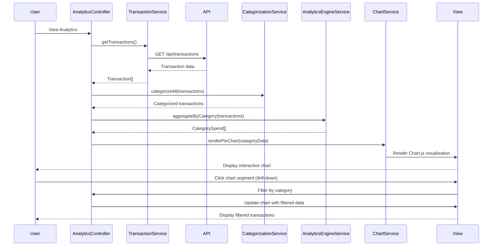

# Low-Level Design: QE-10139 - Transaction and Spending Analytics

## a. Architecture Mapping

- **AngularJS Module**: `creditCardApp.analytics` - Main analytics module
- **Controller**: `AnalyticsController` - Manages analytics view and chart interactions
- **Service**: `TransactionService` - Fetches transaction data via REST API
- **Service**: `CategorizationService` - Categorizes transactions into spending categories
- **Service**: `AnalyticsEngineService` - Processes and aggregates transaction data
- **Service**: `ChartService` - Configures and renders Chart.js visualizations
- **Factory**: `TransactionFactory` - Creates Transaction model instances
- **Directive**: `spendingChart` - Renders interactive spending charts

**Folder Structure:**
```
/app
  /modules
    /analytics
      analytics.module.js
      analytics.controller.js
  /services
    transaction.service.js
    categorization.service.js
    analytics-engine.service.js
    chart.service.js
  /factories
    transaction.factory.js
  /directives
    spending-chart.directive.js
  /views
    analytics.html
```

## b. Component Specifications

| Name | Artifact Type | Responsibility | Key Dependencies |
|------|---------------|----------------|------------------|
| creditCardApp.analytics | Module | Root module for analytics functionality | angular, ngRoute, chart.js |
| AnalyticsController | Controller | Manages analytics state, filters, and chart data | TransactionService, AnalyticsEngineService, ChartService, $scope |
| TransactionService | Service | Fetches transaction data from REST API (/api/transactions) | $http, $q, AuthService |
| CategorizationService | Service | Maps transactions to 9 predefined categories using merchant codes | None |
| AnalyticsEngineService | Service | Aggregates transactions for category-wise, monthly, and card-wise analysis | CategorizationService, TransactionFactory |
| ChartService | Service | Configures Chart.js options and renders pie/bar/line charts | chart.js library |
| TransactionFactory | Factory | Creates and validates Transaction model objects | None |
| spendingChart | Directive | Renders interactive Chart.js visualizations with drill-down | ChartService |

## c. Data Model

```javascript
// Transaction Model
Transaction = {
  transactionId: String,       // Unique transaction ID
  cardId: String,              // Associated card ID
  merchantName: String,        // Merchant name
  merchantCategory: String,    // MCC code or category identifier
  amount: Number,              // Transaction amount
  currency: String,            // Currency code (e.g., 'USD')
  transactionDate: Date,       // Transaction date
  category: String,            // Mapped category: 'Food & Dining', 'Fuel', 'Shopping', etc.
  description: String          // Transaction description
}

// CategorySpend Model
CategorySpend = {
  category: String,            // Category name
  totalSpend: Number,          // Total spend in category
  transactionCount: Number,    // Number of transactions
  percentage: Number           // Percentage of total spend
}

// MonthlyTrend Model
MonthlyTrend = {
  month: String,               // 'YYYY-MM' format
  totalSpend: Number,          // Total spend for the month
  categoryBreakdown: Object    // Key-value pairs: category -> spend
}
```

## d. Data Flow

User navigates to analytics view → AnalyticsController calls TransactionService.getTransactions() → TransactionService fetches data from /api/transactions → CategorizationService maps each transaction to one of 9 categories using merchant codes → AnalyticsEngineService aggregates data for category-wise spend, monthly trends, and card-wise analysis → ChartService configures Chart.js with aggregated data → spendingChart directive renders interactive visualizations (pie chart for categories, line chart for trends) → User clicks chart segment to drill down → AnalyticsController filters data and updates chart within 1.5-second rendering time.

## e. Primary Sequence Diagram



## f. Implementation Notes

- Use Chart.js 2.x with AngularJS wrapper (angular-chart.js) for declarative chart rendering
- Implement category mapping via lookup table in CategorizationService (MCC code → category name)
- Cache transaction data in TransactionService for current session to avoid repeated API calls
- Use $filter for date range filtering and sorting without re-fetching from API
- Implement chart drill-down using Chart.js onClick event handlers bound to AngularJS scope updates

## g. Error Handling

HTTP interceptor handles API failures; empty state UI shown for no transactions; Chart.js errors caught and logged with fallback message.

## h. Security Notes

Standard input validation and secure API calls assumed; transaction data filtered by authenticated user ID on backend.